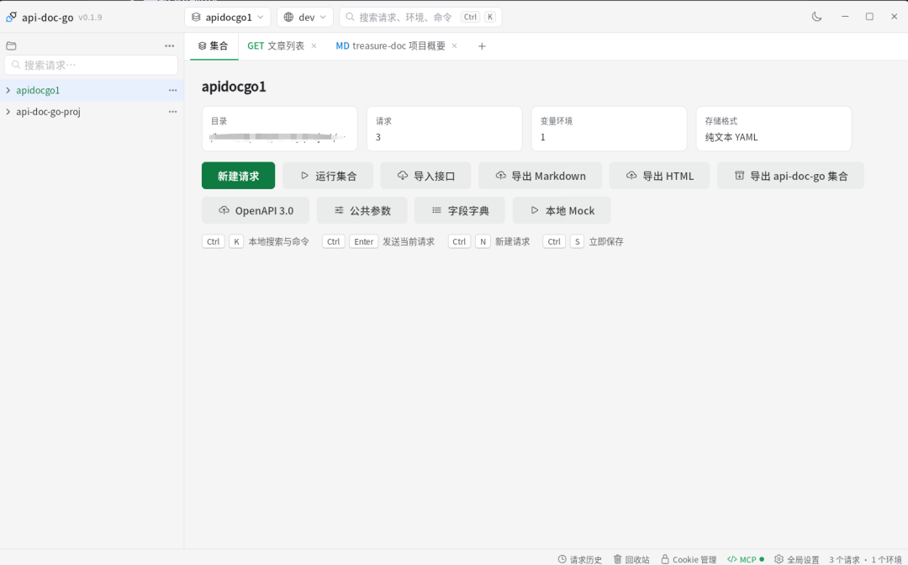
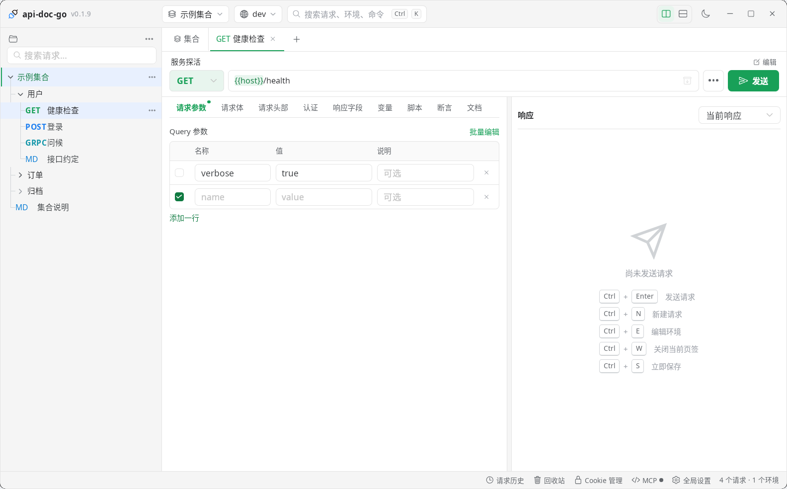
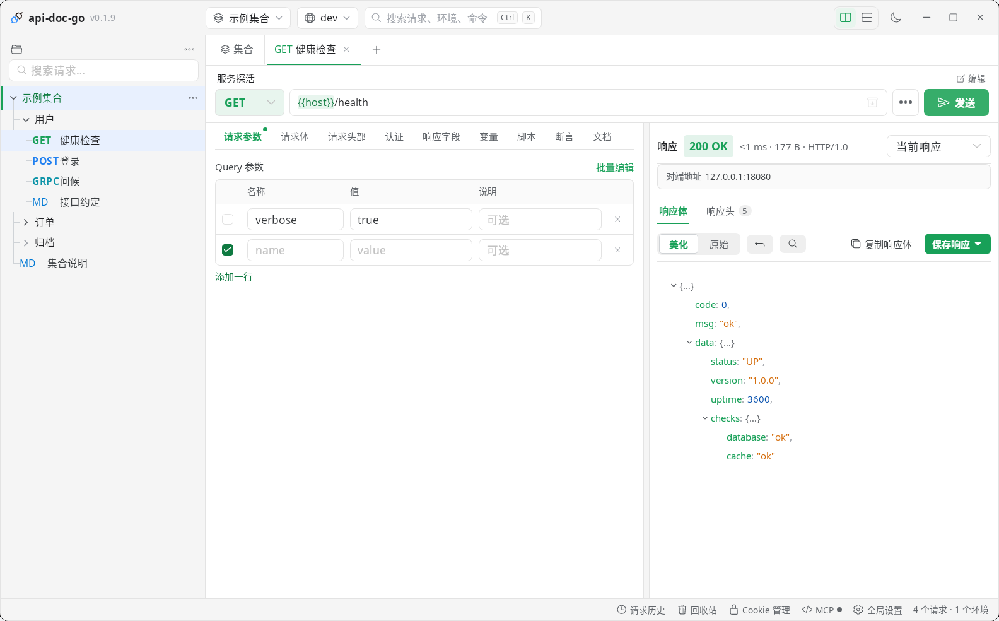
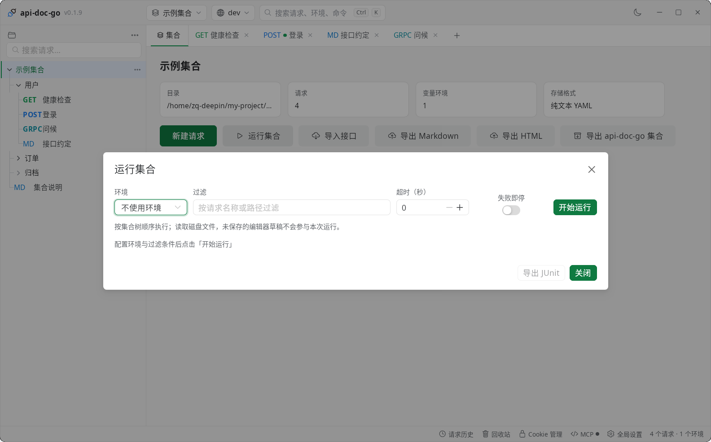
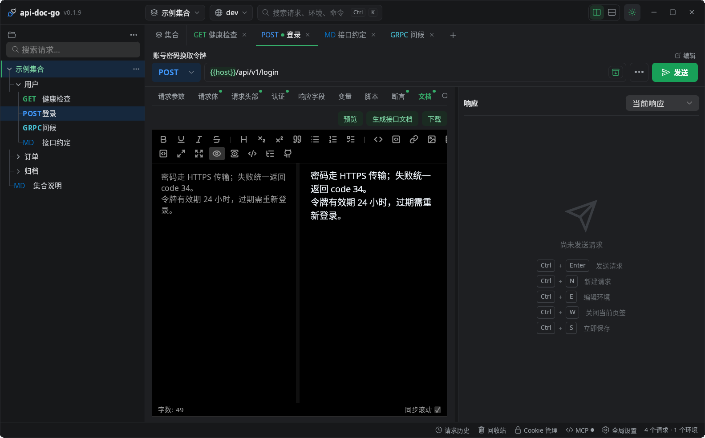

[中文](README.md) | **English**

# API-DOC-GO Client

**API-DOC-GO** is a lightweight API documentation and collaboration tool. This repository is its **desktop client**: Wails v2 (Go core + Vue 3 / TypeScript frontend). A collection is a plain-text YAML directory — **files are the source of truth** — so every feature works fully offline; bind a server project and it syncs bidirectionally with the web app.

| Repository | Purpose |
|---|---|
| **api-doc-go-client** (this repo) | Desktop client: request debugging, docs authoring, environments, mock, code generation, collection runner |
| [api-doc-go](https://github.com/leihenshang/api-doc-go) | Server + web collaboration: projects / members / permissions, PAT, incremental sync, read-only sharing |
| [api-doc-go-share](https://github.com/leihenshang/api-doc-go-share) | Rules shared by both sides: collection format, variable resolution, code generation, OpenAPI / Postman conversion, sync protocol |

See [CHANGELOG.md](CHANGELOG.md) for versions and changes.

## Features

| Area | Capabilities |
|---|---|
| Collections | A directory is a collection; requests / groups / docs are all YAML. Multiple collection roots in parallel, drag-to-reorder, cross-root moves, trash, duplication |
| Request debugging | HTTP (GET/POST/PUT/DELETE…), gRPC; params / headers / five body types / auth / request settings / pre-request scripts / assertions |
| Responses | JSON tree, response headers and cookies, response field table, multiple response examples rendered by content type (including binary preview) |
| Variables | Multiple environments (`environments/*.yml`), global variables, collection defaults, secret values encrypted with your passphrase (AES-256-GCM) |
| Docs | Markdown editing with live preview, image paste (content-addressed under `assets/`), outline, one-click API doc generation |
| Import / export | Import OpenAPI 3.0 / Postman / Bruno / cURL; export Markdown / HTML (single file with embedded images) / PDF / OpenAPI / Postman |
| Productivity | Command palette (`Ctrl+K`), batch editing, field dictionary, code generation (cURL / fetch / axios / Go / Python), local mock server |
| Automation | Collection runner: "Run collection" in the UI or `clientctl run` on the CLI, JUnit reports, fits straight into CI |
| Collaboration | Bidirectional incremental sync with a server project (PAT auth, conflict copies, cursor tracking) |
| AI | Built-in MCP server that exposes collections to AI coding assistants (auditable, permission-gated) |

## Screenshots

Overview page: collection info, request and environment counts, and the common actions (run collection, import / export, mock, field dictionary).



Request editor: collection tree on the left, parameters / body / auth / scripts / assertions / docs in the middle, response on the right.





Collection runner and dark theme:





More screens (environment manager, mock, code generation, cookies, history, trash, gRPC, command palette) live in
[`doc/screenshots/`](doc/screenshots/).

## Getting started

### Prerequisites

| Dependency | Version / notes |
|---|---|
| Go | 1.26+ |
| Node.js | 20.19+ (CI uses Node 20) |
| Wails CLI | `go install github.com/wailsapp/wails/v2/cmd/wails@latest` (installs into `$GOPATH/bin`) |
| Linux | `libgtk-3-dev libwebkit2gtk-4.0-dev`; if only 4.1 headers are available, build with `-tags webkit2_41` |
| Windows | WebView2 Runtime (bundled with Win10/11); no CGO needed |
| macOS | Xcode Command Line Tools |

Run `wails doctor` once after installing the CLI.

### Development (desktop window + frontend hot reload)

```bash
./scripts/dev.sh          # macOS / Linux
./scripts/dev.ps1         # Windows (recommended: three-layer cleanup on exit)
wails dev                 # or use wails dev directly
```

> **Why the scripts**: `wails dev` does not reliably clean up its process tree on Windows — after Ctrl+C the app
> and vite may still hold their ports. `dev.ps1` sweeps in three passes (**CLI → process name → port**) and prints
> the resulting port state. The app itself also guards against this: on Ctrl+C / SIGTERM it waits 1.5s and then
> closes its own window if nobody else did (`watchSignals` in `internal/app`).

> The `Wails is now using the new Go WebView2Loader…` line in the startup log is informational, not an error. Only
> fall back to the old loader when you hit "crashes on start / blank window / WebView2 creation failed":
> `-tags native_webview2loader` (or put it in `wails.json` under `build:tags`).

### Frontend only (browser debugging)

```bash
cd frontend && npm install && npm run dev
```

### Building the desktop app

Wails runs `npm run build` for the frontend automatically, so no separate frontend build is needed:

```bash
wails build               # output: build/bin/api-doc-client
wails build -tags devbuild -o api-doc-client-dev   # dev build (its own icon / name, installs side by side)
```

**Linux (deb package)** — one command does build → deb tree → multi-size icons → `dpkg-deb`:

```bash
bash scripts/build-deb.sh          # amd64, one package for prod and one for dev
bash scripts/build-deb.sh arm64    # cross-build for arm64
VERSION=0.2.0 bash scripts/build-deb.sh
SKIP_BUILD=1 bash scripts/build-deb.sh   # repackage existing binaries in build/bin
```

Artifacts land in `build/bin/`: `api-doc-client_<version>_amd64.deb` and `api-doc-client-dev_<version>_amd64.deb`.
Launch from the desktop entry after installing (do not run `/usr/bin` directly, or the dock will not match the icon):

```bash
sudo apt install ./build/bin/api-doc-client_<version>_amd64.deb
gtk-launch api-doc-client
```

The packaging machine also needs `dpkg-deb`, ImageMagick (`magick`/`convert`) and binutils (`readelf`, used to derive
an exact `Depends` line from the WebKit soname the binary actually links). Details in
[`build/linux/x86/deepin25/README.md`](build/linux/x86/deepin25/README.md).

**Windows**:

```bash
# On Windows (full artifact: exe icon / version info / installer)
powershell -ExecutionPolicy Bypass -File .\scripts\build-win.ps1

# Cross-compile a double-clickable exe on Linux (no installer, no exe resources)
bash scripts/build-win.sh          # output: build/bin/api-doc-client.exe
bash scripts/build-win.sh --dev    # output: build/bin/api-doc-client-dev.exe
```

**macOS**:

```bash
wails build -platform darwin/universal
```

### Headless (debugging / CI)

```bash
# Serve the same App methods to a browser at http://127.0.0.1:8175 (reflection bridge: /api/App/<Method>)
go run ./cmd/devserver -dir /tmp/my-collection -web frontend/dist

# Run a collection from the CLI (same execution layer as "Run collection" in the UI)
go run ./cmd/clientctl run <collection-dir> --env dev --reporter junit --output report.xml
```

`clientctl` also provides `init` / `list` / `send` subcommands; see `go run ./cmd/clientctl -h`.

## Usage notes

- **A collection is a directory**: opening an empty directory prompts for initialization (writes `opencollection.yml`);
  after confirming, existing `.yml` files in that directory are recognized as requests. Cancelling means nothing is
  loaded and nothing is written. With no collection open, the client starts with a fallback `default-collection`
  under the config directory.
- **Renaming only changes `info.name`**, never the file name; move / duplicate keep the original file name and refuse
  a target that already exists.
- **The request body field table** has exactly one source of truth: `body.fields` (`body.descs` is only a seed for the
  first generated table).
- **Shortcuts**: `Ctrl+K` command palette, `Ctrl+Enter` send, `Ctrl+N` new request, `Ctrl+S` save now, `Ctrl+E` edit environment.
- **Secret variables**: once a sync passphrase is set they leave the machine encrypted with AES-256-GCM (`enc:v1:`);
  without a passphrase, secrets never leave the machine at all.

## Sync with the server (bidirectional)

Sync is **per collection**: one collection directory binds to one server project. Bind information lives in
`.sync.json` inside the collection (already covered by the collection's auto-maintained `.gitignore`, so it is never
shared with the collection).

### 1. Prepare the server

```bash
# In the api-doc-go repository root
cp .env.example .env        # fill in ADMIN_PASSWORD and JWT_SECRET
docker compose up -d --build
# Open http://localhost:9090 and log in with the admin account from .env
```

(Binary / from-source deployment is documented in the
[server README](https://github.com/leihenshang/api-doc-go/blob/master/README.en.md#deployment).)

### 2. Create a project and issue a PAT in the web app

1. Log in and **create a project** (a project is the sync boundary; one collection maps to one project).
2. Avatar (top right) → **Personal center** → **Access tokens** → create: give it a name, choose the **sync**
   scope, and set an expiry in days (`0` = never expires).
3. Click the eye icon to reveal the plaintext and copy the `pat_…` token (the server stores only ciphertext; you can
   reveal it again at any time).

### 3. Bind the collection in the client

1. Open (or create) a collection and accept initialization; make sure it is the **active collection root** in the sidebar.
2. Click `···` on the collection root row → **Sync settings**.
3. Fill in:
   - **Server**: `http://127.0.0.1:9090` (plain `http` is allowed for loopback; **non-loopback addresses must use
     `https`**, otherwise the plaintext token is rejected)
   - **Access token**: paste `pat_…`
   - Click **Fetch projects** and pick the target project from the dropdown (no need to type a numeric ID)
   - **Mode**:
     | Mode | Behavior |
     |---|---|
     | Auto (bidirectional, `auto`, default) | Pull then push for the **active collection** every 120s; can also be triggered manually |
     | Manual (`manual`) | Runs only when you click "Sync now" |
     | Read-only mirror (`mirror`) | Pull only, never push; good for read-only members or backups |
4. Click **Link**. The status bar then shows sync state (`linked · last run`); click it to reopen this dialog.

> The token is stored encrypted (`tokenEnc`) in `.sync.json`, with the key in the local config directory
> (`pat_vault.key`, mode 0600). Moving to another machine / user means re-entering the token. **Never** commit
> `.sync.json`, `.conflicts/` or `*.secrets.yml`.

### 4. Syncing and conflicts

- **Sync now**: the refresh button on the collection root row, or the sync state text in the status bar.
- **Each round pulls first, then pushes**: `state` to read the cursor → `changes` for the delta (paged) → apply remote
  changes → push locally dirty items. The first bind, or a cursor gap, falls back to a full `snapshot` alignment.
- **Conflicts**: if the same request changed on both sides, the push brings the server version back; the server
  version is written to the original file while the local version is saved to
  `.conflicts/<name>.conflict-<timestamp>.yml`, and a dialog lets you choose "keep local / keep remote / keep copy".
- **Scope** (seven entity types): groups, requests (including the 21 request/response fields), docs, response
  examples, environments, variables, field dictionary. Images inside the collection are converted between
  `/doc-assets/<hash>` and the server upload URL automatically; external image links are left untouched.
- **Permissions**: pushes from read-only members are rejected (`rejected.forbidden`) — that is the normal path, not
  an error to shout about.

### 5. Optional: secret variables and the sync passphrase

The **sync passphrase** in the sync settings encrypts variable values marked as secret. With one set, ciphertext is
synced and the server **stores but never parses it**; without one, secret variables never leave the machine. **A new
device needs the same passphrase** to decrypt, and existing `enc:v1:` ciphertext cannot be recovered if the passphrase
is lost.

## Where data lives

| Content | Location |
|---|---|
| Collections (requests / docs / environments / images) | Any directory you choose (plain text, git-friendly) |
| App config, window state, PAT key | `~/.config/api-doc-client` (dev build: `api-doc-client-dev`); `%AppData%` on Windows |
| Bind info (encrypted PAT, cursor, hashes) | `.sync.json` in the collection directory |
| Conflict copies | `.conflicts/` in the collection directory |
| Fallback collection when none is open | `default-collection` in the config directory |

## Quality gates

```bash
bash scripts/check.sh            # gofmt + build + vet + go test(-race) + vue-tsc + ESLint + i18n
bash scripts/check.sh --no-race  # faster local run
bash scripts/check.sh --smoke    # adds Playwright smoke tests (needs npx playwright install chromium first)
bash scripts/check.sh --full     # adds the full e2e suite
```

After changing the shared library (`api-doc-go-share`), run `bash ../api-doc-go-share/scripts/gowork.sh` in the parent
directory to generate `go.work` so all three repositories use local code. To release, run `scripts/release.sh <version>`
to align version numbers, tag and push.

## Repository layout

```
cmd/           CLI entry points (clientctl collection runner / devserver headless bridge / mcpserver / test fixtures)
internal/      Go core (app facade, collection, syncengine, runner, varx, mocksrv, mcp, secrets…)
frontend/      Vue 3 frontend (src/{api,components,views,stores,i18n,styles})
build/         Packaging assets and per-platform build notes (linux/windows)
scripts/       Dev / build / package / quality-gate scripts
doc/           Planning notes, design docs and UI screenshots
wails.json     Wails build config (output name: api-doc-client)
```

## License

MIT (same as api-doc-go / api-doc-go-share).
