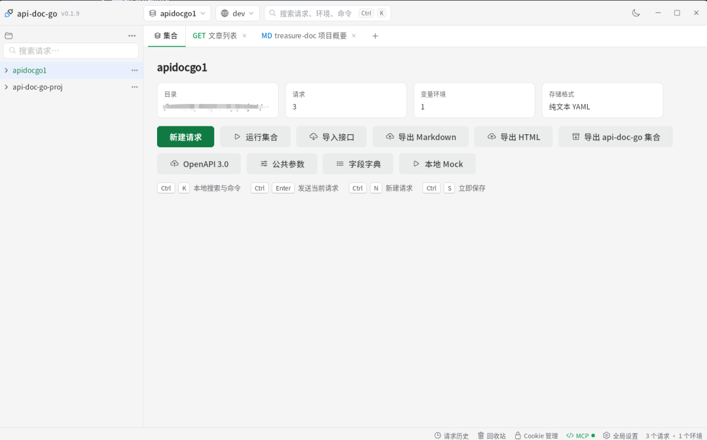
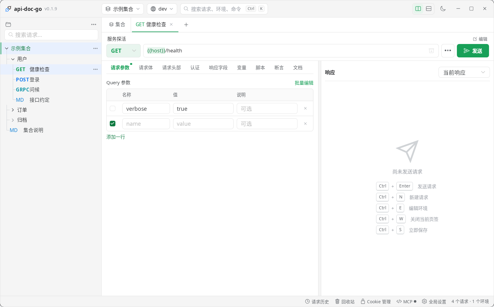
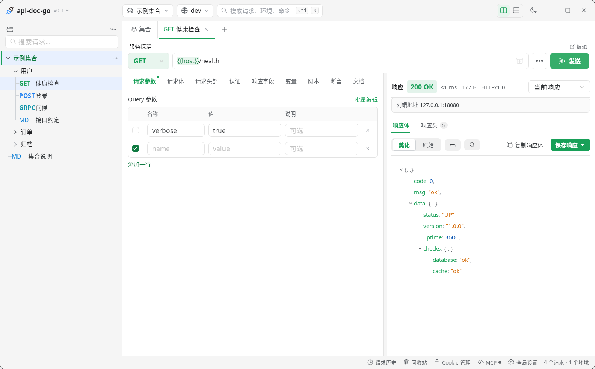
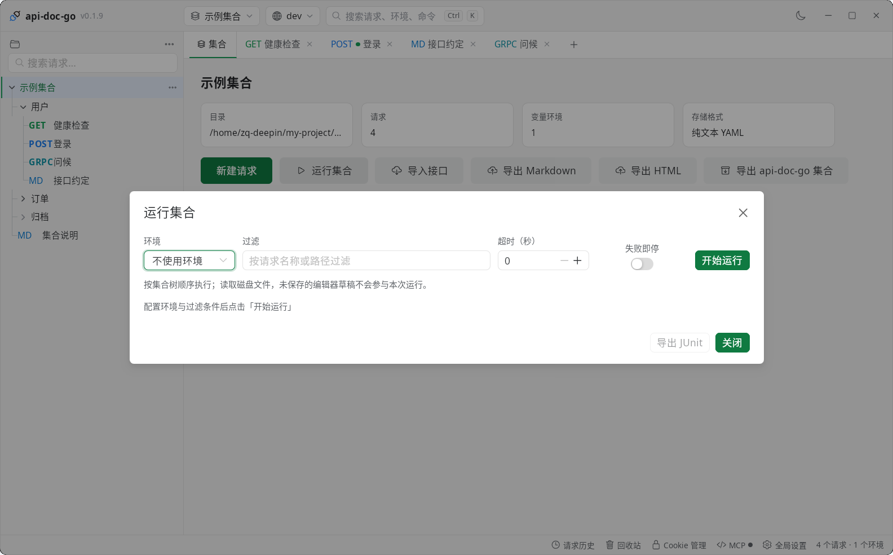
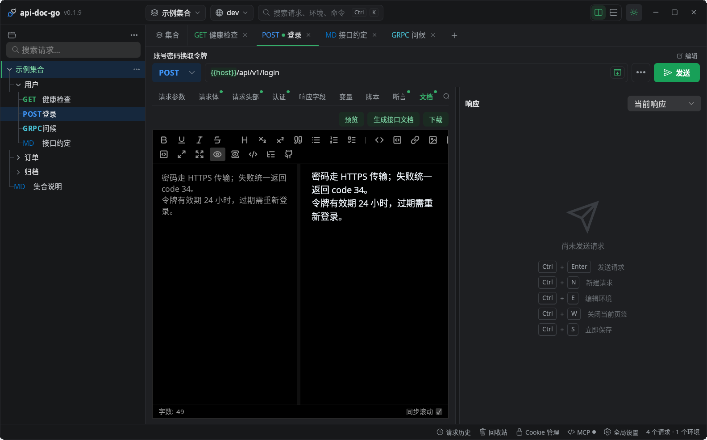

# API-DOC 客户端

**API-DOC** 是一套轻量的接口文档协作工具。本仓库是它的**桌面客户端**：Wails v2（Go 内核 + Vue 3 / TypeScript 前端），
集合以纯文本 YAML 目录存储 —— **文件即真相源**，不联服务端也能全功能使用；关联服务端后可与 Web 端双向同步。

| 仓库 | 作用 |
|---|---|
| **api-doc-go-client**（本仓库） | 桌面客户端：接口调试、文档编写、环境变量、Mock、代码生成、集合运行器 |
| [api-doc-go](https://github.com/leihenshang/api-doc-go) | 服务端 + Web 协作端：项目 / 成员 / 权限、PAT、增量同步、在线分享 |
| [api-doc-go-share](https://github.com/leihenshang/api-doc-go-share) | 两端共用的规则：集合格式、变量解析、代码生成、OpenAPI / Postman 转换、同步协议 |

版本与变更记录见 [CHANGELOG.md](CHANGELOG.md)。

## 功能特性

| 模块 | 能力 |
|---|---|
| 集合 | 目录即集合，请求 / 分组 / 文档都是 YAML；支持多集合根并行打开、拖拽排序与跨根移动、回收站、复制 |
| 请求调试 | HTTP（GET/POST/PUT/DELETE…）、gRPC；参数 / 请求头 / 五种请求体 / 认证 / 请求设置 / 前置脚本 / 断言 |
| 响应 | JSON 树、响应头 / Cookie、响应字段表、多响应示例（按内容类型渲染，含二进制预览） |
| 变量 | 多环境（`environments/*.yml`）、全局变量、集合默认值、secret 变量（口令 AES-256-GCM 加密） |
| 文档 | Markdown 编辑 + 实时预览、图片粘贴（内容寻址存 `assets/`）、大纲、接口文档一键生成 |
| 导入导出 | OpenAPI 3.0 / Postman / Bruno / cURL 导入；Markdown / HTML（单文件内嵌图片）/ PDF / OpenAPI / Postman 导出 |
| 效率 | 命令面板（`Ctrl+K`）、批量编辑、字段字典、代码生成（cURL / fetch / axios / Go / Python）、本地 Mock |
| 自动化 | 集合运行器：GUI「运行集合」或 CLI `clientctl run`，报告可导出 JUnit，可直接进 CI |
| 协作 | 关联服务端项目后双向增量同步（PAT 鉴权、冲突留底、游标对齐） |
| AI | 内置 MCP 服务，把集合暴露给 AI 编码助手（可审计、需授权） |

## 界面预览

概览页：集合信息、请求数、环境数与常用动作（运行集合、导入 / 导出、Mock、字段字典）。



请求编辑：左侧集合树，中间参数 / 请求体 / 认证 / 脚本 / 断言 / 文档分段，右侧响应。





集合运行器与暗色主题：





更多界面（环境管理、Mock、代码生成、cookies、历史、回收站、gRPC、命令面板等）见
[`doc/screenshots/`](doc/screenshots/)。

## 快速开始

### 环境依赖

| 依赖 | 版本 / 说明 |
|---|---|
| Go | 1.26+ |
| Node.js | 20.19+（CI 用 Node 20） |
| Wails CLI | `go install github.com/wailsapp/wails/v2/cmd/wails@latest`（装到 `$GOPATH/bin`） |
| Linux | `libgtk-3-dev libwebkit2gtk-4.0-dev`；只有 4.1 头文件时构建加 `-tags webkit2_41` |
| Windows | WebView2 Runtime（Win10/11 一般自带）；无需 CGO |
| macOS | Xcode Command Line Tools |

装完 CLI 先自检一次：`wails doctor`。

### 开发（桌面窗口 + 前端热更新）

```bash
./scripts/dev.sh          # macOS / Linux
./scripts/dev.ps1         # Windows（推荐，退出时三层兜底清理进程）
wails dev                 # 或直接用 wails dev
```

> **为什么推荐脚本**：`wails dev` 在 Windows 上的进程树清理不可靠，Ctrl+C 后应用与 vite 可能仍占着端口。
> `dev.ps1` 按 **CLI → 进程名 → 端口** 三层兜底清扫，并复查端口后打印结果。
> 应用侧也做了兜底：收到 Ctrl+C / SIGTERM 后等 1.5s 无人收尾就自行关窗（`internal/app` 的 `watchSignals`）。

> 启动日志里的 `Wails is now using the new Go WebView2Loader…` 是信息提示，不是错误。只有遇到
> 「启动即崩 / 白屏 / WebView2 创建失败」才需要回退旧 loader：`-tags native_webview2loader`
> （或写进 `wails.json` 的 `build:tags`）。

### 仅前端（浏览器调试）

```bash
cd frontend && npm install && npm run dev
```

### 构建桌面应用

Wails 会自动先跑 `npm run build` 构建前端，无需手动构建：

```bash
wails build               # 产物：build/bin/api-doc-client
wails build -tags devbuild -o api-doc-client-dev   # 开发版（独立图标 / 程序名，可与正式版并存）
```

**Linux（deb 安装包）**——一条命令完成 构建 → deb 目录树 → 多尺寸图标 → `dpkg-deb`：

```bash
bash scripts/build-deb.sh          # amd64，正式版 + 开发版各一个包
bash scripts/build-deb.sh arm64    # 交叉打 arm64
VERSION=0.2.0 bash scripts/build-deb.sh
SKIP_BUILD=1 bash scripts/build-deb.sh   # 复用 build/bin 已有二进制，只重打包
```

产物在 `build/bin/`：`api-doc-client_<版本>_amd64.deb`、`api-doc-client-dev_<版本>_amd64.deb`。
安装后从应用入口启动（不要 `/usr/bin` 裸跑，否则任务栏匹配不到图标）：

```bash
sudo apt install ./build/bin/api-doc-client_<版本>_amd64.deb
gtk-launch api-doc-client
```

打包机额外需要：`dpkg-deb`、ImageMagick（`magick`/`convert`）、binutils（`readelf`，用于按二进制实际链接的
WebKit soname 生成精确 `Depends`）。细节见 [`build/linux/x86/deepin25/README.md`](build/linux/x86/deepin25/README.md)。

**Windows**：

```bash
# Windows 本机（正式产物，含 exe 图标 / 版本信息 / 安装包）
powershell -ExecutionPolicy Bypass -File .\scripts\build-win.ps1

# Linux 上交叉编译一个可直接双击试用的 exe（无安装包、无 exe 资源）
bash scripts/build-win.sh          # 产物 build/bin/api-doc-client.exe
bash scripts/build-win.sh --dev    # 产物 build/bin/api-doc-client-dev.exe
```

**macOS**：

```bash
wails build -platform darwin/universal
```

### 无图形界面运行（调试 / CI）

```bash
# 用浏览器打开 http://127.0.0.1:8175 驱动同一套 App 方法（反射桥 /api/App/<Method>）
go run ./cmd/devserver -dir /tmp/my-collection -web frontend/dist

# 命令行跑集合（与 GUI「运行集合」同一执行层）
go run ./cmd/clientctl run <集合目录> --env dev --reporter junit --output report.xml
```

`clientctl` 还支持 `init` / `list` / `send` 子命令，参数见 `go run ./cmd/clientctl -h`。

## 使用要点

- **集合是目录**：首次打开空目录会提示初始化（生成 `opencollection.yml`），确认后目录里既有的 `.yml`
  会被识别为接口；取消则不载入、不写盘。没有打开的集合时，客户端在配置目录下用 `default-collection` 兜底启动。
- **重命名只改 `info.name`**，不动文件名；移动 / 复制保留原文件名，目标同名会被拒绝。
- **请求体字段表格**以 `body.fields` 为唯一真源（`body.descs` 只作首次生成表格的描述种子）。
- **快捷键**：`Ctrl+K` 命令面板、`Ctrl+Enter` 发送、`Ctrl+N` 新建请求、`Ctrl+S` 立即保存、`Ctrl+E` 编辑环境。
- **secret 变量**：设置「同步口令」后以 AES-256-GCM 加密（`enc:v1:`）出网；未设置口令时 secret 不出本机。

## 与服务端联动（双向同步）

同步是**集合级**的：一个集合目录绑定一个服务端项目，绑定信息写在集合内的 `.sync.json`（已进集合自动维护的
`.gitignore`，不随集合共享）。

### 1. 准备服务端

```bash
# 在 api-doc-go 仓库根目录
cp .env.example .env        # 填 ADMIN_PASSWORD 与 JWT_SECRET
docker compose up -d --build
# 打开 http://localhost:9090 ，用 .env 里的管理员账号登录
```

（二进制 / 源码部署方式见 [服务端 README](https://github.com/leihenshang/api-doc-go#部署)。）

### 2. 在 Web 端建项目、签发 PAT

1. 登录后**新建项目**（项目是同步的边界，客户端一个集合对应一个项目）。
2. 右上角头像 → **个人中心** → **访问令牌** → 创建：填名称、作用域选 **同步（sync）**，
   有效期按需填天数（0 = 长期）。
3. 点眼睛图标查看明文，复制 `pat_…` 开头的令牌（服务端只存密文，明文可随时再查看）。

### 3. 客户端绑定集合

1. 打开（或新建）一个集合同意初始化，确保它在侧栏是**当前集合根**。
2. 点集合根行右侧 `···` → **同步设置**。
3. 依次填写：
   - **服务端**：`http://127.0.0.1:9090`（本机回环可用 http；**非回环地址必须 https**，否则明文令牌会被拒）
   - **访问令牌**：粘贴 `pat_…`
   - 点 **获取项目**，在下拉里选目标项目（不用手填数字 ID）
   - **方式**：
     | 方式 | 行为 |
     |---|---|
     | 自动双向（`auto`，默认） | 每 120s 对**活动集合**自动先拉后推；也可随时手动触发 |
     | 手动拉取（`manual`） | 只在你点「立即同步」时跑 |
     | 只读镜像（`mirror`） | 只拉不推，适合只读成员或只做备份 |
4. 点 **关联**。成功后状态栏出现同步状态（`已关联 · 上次时间`），点它能再次打开本弹窗。

> 令牌以密文（`tokenEnc`）存在 `.sync.json`，密钥在本机配置目录（`pat_vault.key`，0600）；
> 换机器 / 换用户需要重新填令牌。**不要**把 `.sync.json`、`.conflicts/`、`*.secrets.yml` 提交进仓库。

### 4. 同步与冲突

- **立即同步**：集合根行右侧的刷新按钮，或状态栏的同步状态文字。
- **一轮的顺序**是**先拉后推**：`state` 探游标 → `changes` 增量（分页）→ 应用远端变更 → 推送本地脏项。
  首次绑定或游标断层（`gap`）会自动走 `snapshot` 全量对齐。
- **冲突**：同一接口两边都改，推送时会带服务端版本回来；服务端版本落回原文件、本地版本另存
  `.conflicts/<名称>.conflict-<时间戳>.yml`，弹窗让你选「以本地 / 以远端 / 保留副本」。
- **同步范围**（七类实体）：分组、接口（含 21 个请求/响应字段）、文档、响应示例、环境、变量、字段字典。
  集合内的图片经 `/doc-assets/<hash>` ↔ 服务端上传地址自动转换；外链图片不动。
- **权限**：只读成员推送会被拒绝（`rejected.forbidden`），这是正常路径，不报错刷屏。

### 5. 可选：secret 变量与同步口令

同步设置里的 **同步口令** 用于加密标记为 secret 的变量值。设置后密文参与同步，服务端**只存不解析**；
不设置则 secret 变量不出本机。**换设备要输入相同口令**才能解密，忘口令后既有 `enc:v1:` 密文不可恢复。

## 数据与配置位置

| 内容 | 位置 |
|---|---|
| 集合（请求 / 文档 / 环境 / 图片） | 你选择的任意目录（纯文本，可 git 管理） |
| 应用配置、窗口状态、PAT 密钥 | `~/.config/api-doc-client`（开发版 `api-doc-client-dev`）；Windows 为 `%AppData%` |
| 绑定信息（PAT 密文、游标、摘要） | 集合目录下 `.sync.json` |
| 冲突副本 | 集合目录下 `.conflicts/` |
| 无集合时的兜底集合 | 配置目录下 `default-collection` |

## 工程门禁

```bash
bash scripts/check.sh            # gofmt + build + vet + go test(-race) + vue-tsc + ESLint + i18n
bash scripts/check.sh --no-race  # 本地快速跑法
bash scripts/check.sh --smoke    # 再加 Playwright 冒烟（需先 npx playwright install chromium）
bash scripts/check.sh --full     # 再加全量 e2e
```

改共享库（api-doc-go-share）后，先在父目录运行 `bash ../api-doc-go-share/scripts/gowork.sh` 生成 `go.work`，
三个仓库即走本地代码；发布时用 `scripts/release.sh <版本>` 对齐版本号、打 tag 并推送。

## 目录结构

```
cmd/           命令行入口（clientctl 运行集合 / devserver 无 GUI 调试 / mcpserver / 测试夹具）
internal/      Go 内核（app 门面、collection、syncengine、runner、varx、mocksrv、mcp、secrets…）
frontend/      Vue 3 前端（src/{api,components,views,stores,i18n,styles}）
build/         打包素材与平台构建说明（linux/windows）
scripts/       开发 / 构建 / 打包 / 门禁脚本
doc/           功能规划、设计文档与界面截图
wails.json     Wails 构建配置（输出名 api-doc-client）
```

## 许可证

MIT（与 api-doc-go / api-doc-go-share 一致）。
