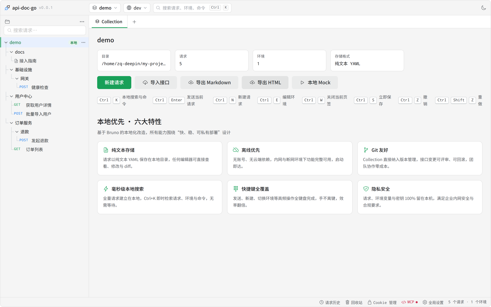
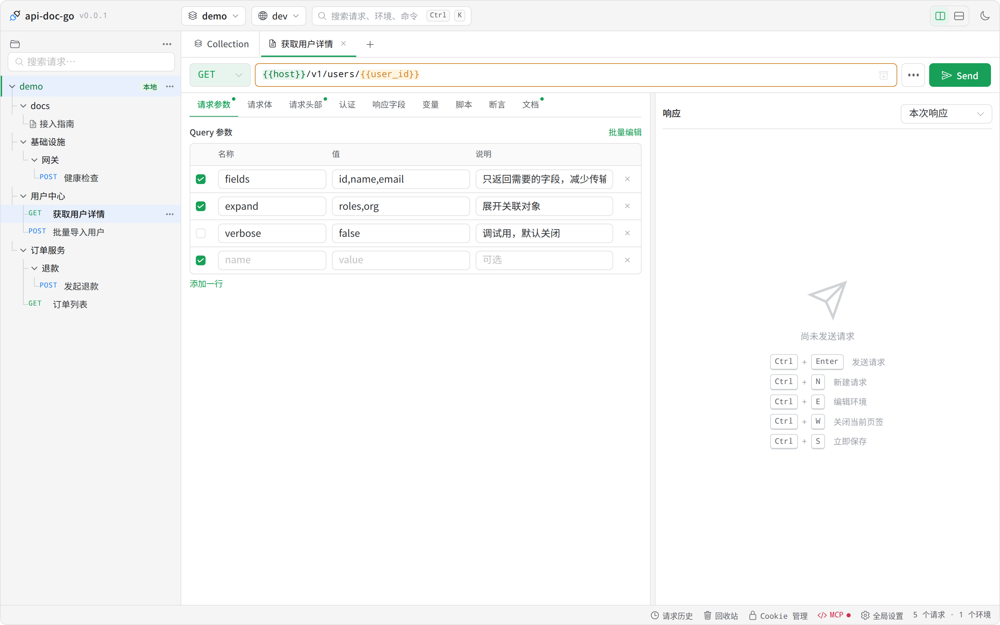
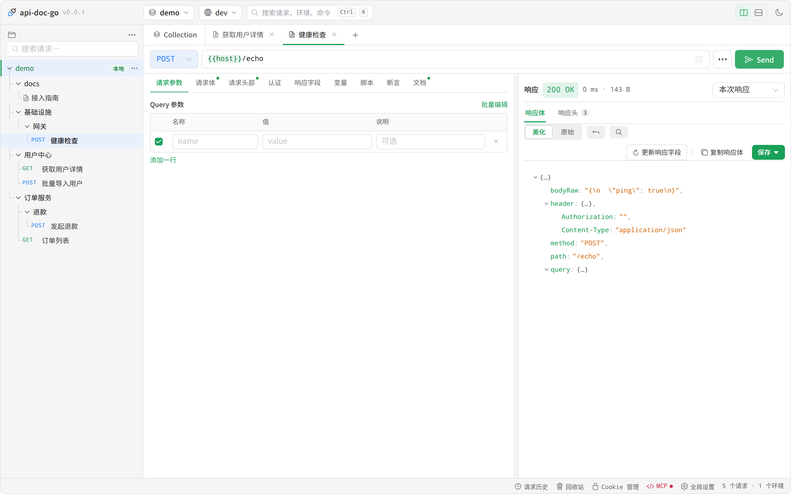
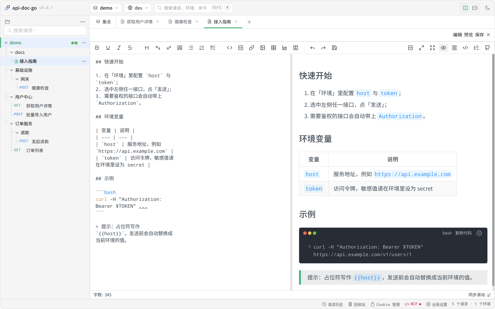
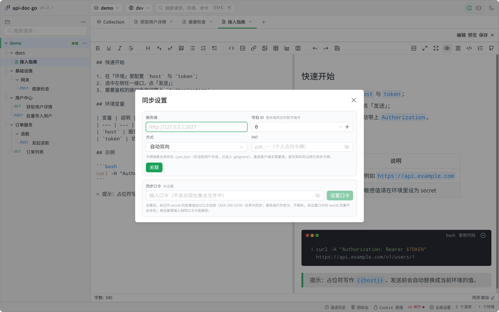
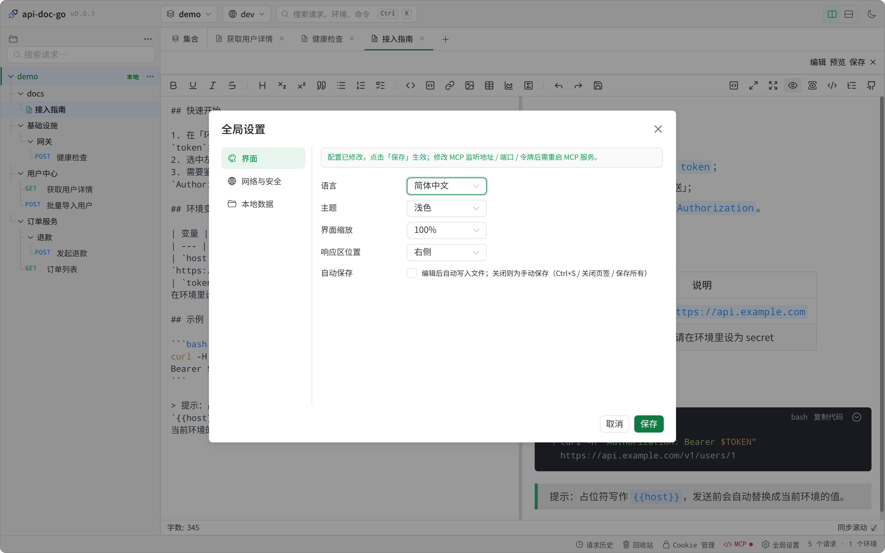
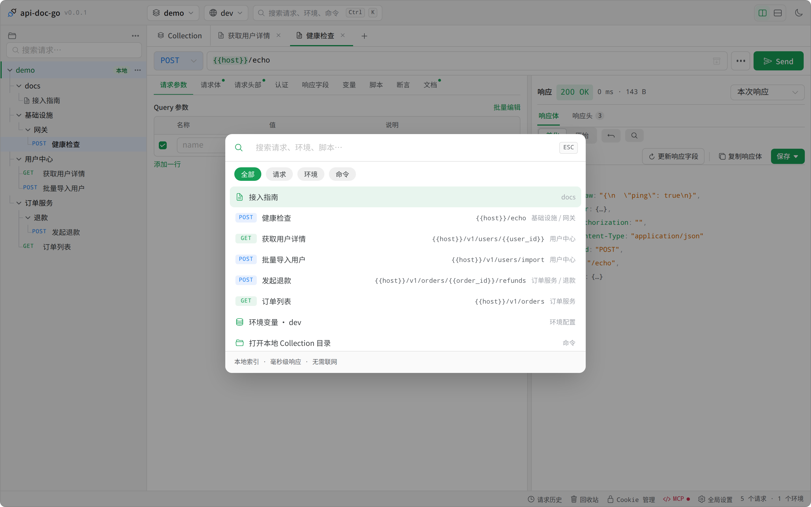

# api-doc-go 客户端 UI 评审

> 评审日期：2026-10-18 · 评审人：UI Designer（像素君）
> 评审对象：`api-doc-go-client` 桌面客户端（Wails v2 + Vue3 + Naive UI），浏览器态渲染
> 结论口径：**页面简洁明了 / 重要信息容易读 / 开箱即用** 三个维度
> 附件：`screenshots/`（8 张实机截图）、`capture.mjs`（截图脚本，可复现）

---

## 0. 一句话结论

底子很扎实——文件化集合、方法色徽标、变量高亮、命令面板、暗色主题都在，**结构化程度明显高于同类自研工具**；
但界面把「**产品介绍**」和「**使用说明书**」当成常驻内容，加上中英文混排、主色对比度不足、关键信息（路径、耗时、条目类型）被截断或误标，
让一个专业工具在首屏显得"像官网、不像工作台"。**问题集中在信息密度分配与文案一致性，不在功能缺失。**

| 维度 | 评分 | 主要扣分项 |
| --- | --- | --- |
| 简洁明了 | **6.0 / 10** | 首屏被营销卡 + 快捷键图例占满；9 个平铺 tab；底栏功能权重不分 |
| 重要信息容易读 | **6.5 / 10** | 主色白字对比度 3.38:1（不达 AA）；路径截断无补偿；`0 ms` 耗时 |
| 开箱即用 | **7.0 / 10** | 无示例集合；术语（项目 ID / PAT / 环境）无就地解释；设置页三按钮语义重叠 |
| 视觉一致性 | **6.0 / 10** | 中文界面混入 `Collection` / `Send` / `Bash`；按钮主色与 logo 蓝两套品牌色无分工说明 |
| 可访问性（WCAG AA） | **5.5 / 10** | 关键按钮文字对比度不足；10px 快捷键图例；仅 hover 才出现的行内操作 |

---

## 1. 评审方式与样本

### 1.1 样本集合（刻意贴近真实使用）

一个"内部开放平台"形态的集合：3 个业务分组 + 1 个二级分组、5 个请求（GET/POST、查询参数、JSON 体、自定义头、`{{变量}}` 占位符）、1 篇含表格/代码块/引用的文档、1 个环境（`host`）。

### 1.2 复现方式

```bash
# 1) 起后端（devserver 反射桥，等价于桌面端 IPC）
go build -o .tmp/ui-review/devserver ./cmd/devserver
.tmp/ui-review/devserver -addr 127.0.0.1:8175 -dir .tmp/ui-review/demo -web frontend/dist

# 2) 起前端（当前源码；本机 dist 因安全策略无法重建，改用 vite dev，/api 已代理到 8175）
cd frontend && npm run dev     # http://localhost:5275

# 3) 截图（Playwright + 完整 chromium）
SHOT_BASE=http://localhost:5275/ SHOT_OUT=./screenshots node doc/ui-review-2026-10-18/capture.mjs
```

> 环境备注：本机 `/dev/shm` 仅 10MB，Chromium 渲染进程在合成阶段会 SIGTRAP；必须 `TMPDIR=<大盘目录>` 并显式 `channel: 'chromium'`（headless shell 必崩）。已写在 `capture.mjs` 头部。

---

## 2. 页面巡览

### 2.1 集合树 + 工作台（首屏）



**做得好**
- 侧栏结构清晰：根 → 分组 → 请求/文档，方法色徽标（GET 绿 / POST 橙）一眼分辨；
- 变量占位符 `{{host}}` 在 URL 里高亮成橙色，与普通文本区分明确；
- 顶部"集合切换 / 环境切换 / 搜索"三件套位置固定，符合 Postman/Bruno 用户肌肉记忆。

**问题**
1. **首屏约一半是"官网内容"**（实测特性卡占内容区 ~43%、快捷键图例 ~7%）：`本地优先 · 六大特性` 六张营销卡 + 7 组快捷键图例常驻。第一次打开可接受，第二周开始纯噪声——它们占据的正是"最近打开的请求 / 最近文档 / 待办"该在的位置。
2. **快捷键图例是 10px 字号**，两行挤压换行（"撤销"被拆成两行）。它既是噪声又不可读。
3. **统计卡里的目录被截断**：`/home/zq-deepin/my-proje…`，路径恰恰是最需要完整可读 + 可复制的信息，无 tooltip、无复制按钮。
4. **"环境 1" 语义模糊**：这里指"变量环境"，与"部署环境"无关，新手会误读。
5. 页签 `Collection` 是英文，与整页中文不一致。

### 2.2 请求编辑器



**做得好**
- URL 行"方法 + 地址 + 发送"一条主线，注意力成本低；
- 参数表三列（名称/值/说明）+ 启用勾选，与 Bruno 心智一致；
- 变量未定义时 URL 里保留原样高亮，不静默吞掉。

**问题**
6. **9 个平铺 tab**（请求参数/请求体/请求头部/认证/响应字段/变量/脚本/断言/文档），无分组、无计数；每项后面的小圆点在 13px 下像标点。
7. **`Send` 是英文**，而同一功能的空态提示写"发送请求"、快捷键 `Ctrl+Enter 发送请求`——同一个动作三种叫法。
8. **右侧空态过重**：插画 + 5 行快捷键占满 400×300 区域，信息价值低；作为对比，Postman 只放一行 "Send a request to see the response"。
9. 表格列宽固定，长说明会把"说明"列挤成多行；不能拖拽列宽。

### 2.3 响应区



**做得好**
- 状态行信息完整（`200 OK · 143 B`）、响应体/响应头分栏、JSON 树着色克制；
- 顶部有"美化 / 原始 / 展开 / 搜索"与"更新响应字段 / 复制响应体"两组动作，分组清楚。

**问题**
10. **`0 ms`**：小于 1ms 的请求显示 0，会让人怀疑"是不是没发出去"。建议 `<1 ms`。
11. **两个"保存"**：页签栏有请求的 `保存`，响应区右上还有 `保存★`（存为响应示例）。两者视觉几乎一样，语义完全不同，误点代价不小（把响应存成示例 vs 保存请求）。
12. 状态行与工具栏同一行上下叠，13px + 12px 混排，视觉上"顶"在一起。

### 2.4 文档编辑器



**做得好**
- 源码 / 预览并排，同步滚动 + 字数统计，Markdown 表格、代码块（带语言与复制）、引用块渲染质量高；
- 工具栏图标（B/I/S/H1/H2/列表/引用/代码/链接/图片/表格）密度合理。

**问题**
13. **左右各占 50%，预览里表格被压到断行**（"变量"列竖排成两行）。文档阅读是"读"的场景，预览应优先（例如 40/60 或可拖拽分隔）。
14. **文档出现在侧栏的 `docs` 目录下**：`docs/` 是磁盘实现细节，直接暴露成一级分组，与业务分组混排，破坏"集合=业务结构"的直觉。
15.（已修，见 §5）页签曾显示 `GET 接入指南`，把文档当成接口。

### 2.5 同步设置



**做得好**
- 单弹窗完成"服务器地址 / 项目 ID / 方式 / PAT / 同步口令"全部配置，字段旁有灰色说明；
- "口令不落盘、AES-256-GCM 加密"这类安全承诺写在了正确位置。

**问题**
16. **术语无就地出口**：`项目 ID`、`PAT`（个人访问令牌）都要去服务端后台找，弹窗里没有"如何获取"链接或一键跳转。
17. **口令区块说明过长**（5 行灰字），把"设置口令"这个可选项说成了必读章节；建议折叠成"为什么需要口令？"。
18. `关联` 按钮是主色实心，但整个弹窗的主要动作其实是"关联"——视觉上它却排在左下方，弱于输入框的存在感。

### 2.6 全局设置



**做得好**
- 左导航（界面 / 网络与安全 / 本地数据）+ 右表单的两栏结构，是设置页的正确做法；
- 顶部变更提示条直接说明"保存后生效 / MCP 需重启"，减少猜测。

**问题**
19. **三个按钮语义重叠**：`取消` / `保存并应用` / `保存`——用户无法从文案判断"应用"到底多做了什么。建议合并为 `保存`，把"需要重启 MCP"这类副作用做成项级提示。
20. **表单控件左对齐但宽度只有 140px**，右侧大片空白；`自动保存` 的勾选框与其它行的控件不在同一列，节奏断了。

### 2.7 命令面板（Ctrl+K）



**做得好**
- 一屏内可搜请求/文档/环境/命令，结果行带方法徽标 + URL + 所属分组，跨根搜索还有集合名标注；
- 底部有范围筛选 chips，键盘上下选择 + 回车执行。

**问题**
21.（已修，见 §5）文档曾被标成 `GET`。
22. 结果行右侧同时出现"所属分组"和"URL"，长 URL 会挤掉分组名；建议 URL 单行截断 + 悬停完整显示。
23. 底部没有 `↑↓ 选择 / Enter 打开 / Esc 关闭` 的键盘提示（Postman/VSCode 都有）。

---

## 3. 问题清单（按维度，含建议）

优先级：**P0**=影响"能不能用对"或直接误导；**P1**=明显影响效率/可读性；**P2**=打磨项。

### 3.1 简洁明了

| # | 问题 | 优先级 | 建议 |
| --- | --- | --- | --- |
| UI-01 | 首屏约一半高度被「六大特性」营销卡 + 快捷键图例占据 | **P0** | 换成"最近请求 / 最近文档 / 待办"三块；营销内容挪到欢迎页（首次启动一次性展示，可关闭）或"帮助" |
| UI-02 | 常驻 7 组快捷键图例（10px，两行挤压） | **P1** | 整块移除；快捷键信息收进 `Ctrl+K` 面板底部 + 各按钮 `title` |
| UI-03 | 请求页 9 个平铺 tab，无分组无计数 | **P1** | 首屏 4 个常用（参数/头部/请求体/认证）+「更多」折叠其余；tab 上显示数量（头部 2） |
| UI-04 | 底栏 5 个入口同权重（历史/回收站/Cookie/MCP/设置） | **P2** | 保留历史/回收站/设置；Cookie、MCP 收进「更多」或设置内页 |
| UI-05 | 根菜单 10 项平铺，无分组 | **P2** | 分三组：新建（分组/请求/gRPC/cURL）· 同步与重载 · 危险区（关闭） |
| UI-06 | 响应区空态插画 + 5 行快捷键 | **P1** | 缩成一行提示（`Ctrl+Enter 发送`），把空间还给"最近响应" |

### 3.2 重要信息容易读

| # | 问题 | 优先级 | 建议 |
| --- | --- | --- | --- |
| UI-07 | 主色 `#18a058` 上白字对比度 **3.38:1**（hover `#36ad6a` 仅 2.86:1），13px 正文不达 WCAG AA 4.5:1 | **P0** | 主色压深至 ≥ 4.5:1（如 `#0f7a41`），或按钮改用 600 字重 + 更深底色；暗色主题同步校准 |
| UI-08 | 目录路径截断无补偿（无 tooltip / 无复制） | **P1** | 路径单行 `text-overflow` + `title` 全量 + 行尾复制图标；或改为"最近使用"一级目录名 |
| UI-09 | 响应耗时显示 `0 ms` | **P1** | `<1 ms` / 保留一位小数（`0.4 ms`） |
| UI-10 | 两个"保存"（请求保存 / 响应存为示例）视觉同权 | **P0** | 响应区按钮改文案为「存为示例」+ 图标区分；危险度低但语义必须正交 |
| UI-11 | 侧栏行高 26px、名称 12.5px，长名易截断 | **P2** | 行高 28px、名称 13px；截断处 `title` + 行尾省略号对齐 |
| UI-12 | 状态栏左右同字号同权重（功能入口 vs 计数） | **P2** | 计数用 `--app-text-2` + 12px，功能入口保持 13px |
| UI-13 | 文档预览在 50/50 分栏下表格断行 | **P1** | 默认 40/60（源码/预览），分隔条可拖拽并记忆 |
| UI-14 | `docs/` 磁盘目录被暴露成一级分组 | **P1** | 侧栏把 `docs/` 收敛成「文档」虚拟节点（置顶或置底），不参与业务分组排序 |
| UI-15 |（已修）文档在页签/命令面板被标成 `GET` | — | 见 §5 |

### 3.3 开箱即用

| # | 问题 | 优先级 | 建议 |
| --- | --- | --- | --- |
| UI-16 | 首次启动只能"打开集合目录"，没有示例集合 | **P0** | 欢迎页加「创建示例集合」：3 个请求 + 1 篇文档 + 1 个 `dev` 环境（含 `host`/`token`），30 秒内能发出第一个请求 |
| UI-17 | 术语（项目 ID / PAT / 环境）无就地解释 | **P1** | 字段旁加 `?` 气泡，内含"在服务端 设置 → 令牌 里创建"与一键跳转；PAT 输入框支持粘贴即校验 |
| UI-18 | 设置页三按钮语义重叠（取消 / 保存并应用 / 保存） | **P1** | 只留「保存」，需要重启的项在项内标注「保存后需重启 MCP」并给「立即重启」 |
| UI-19 | 中文界面混英文：`Collection`（页签）、`Send`、`Bash`（代码块） | **P1** | 术语表化：`Collection`→「集合」、`Send`→「发送」；技术名词（PAT/MCP/Bash）在 i18n 里显式标记「不译」 |
| UI-20 | 空集合工作台的统计 `0 / 0 / 1 / 纯文本 YAML` 含义不明 | **P2** | 加后缀单位与解释（`请求 0 个`），或点击分别跳到对应列表 |

---

## 4. 设计系统层面的三条根因

问题看似零散，根因只有三个，建议一次改到位：

### 4.1 缺少"信息层级令牌"

现在只有 `--app-text` / `--app-text-2` / `--app-accent`，没有字号/间距/圆角/层级的成套令牌，导致：
- 字号出现 10 / 12 / 12.5 / 13px 四种（快捷键图例 10px、侧栏 12.5px、正文 13px）；
- 圆角出现 4 / 6 / 8px 混用；
- "次要信息"和"噪声信息"都靠 `--app-text-2` 表达，权重拉不开。

建议建立 4 档字阶（12 / 13 / 15 / 18）+ 4 档间距（4 / 8 / 12 / 16）+ 3 档圆角（4 / 6 / 10），并规定：
`正文 13/1.6`、`次要 12/`、`分组标题 15/600`、`空态标题 18/600`。

### 4.2 主色只做了"品牌色"，没做"可读色"

`#18a058` 作为品牌色没问题，但它同时被用作**按钮底色（白字）**与**文字色（浅底）**，两种场景对对比度要求不同：
- 白字在主色上 3.38:1 → 不达 AA；
- 主色当文字用在浅底上同样 3.38:1 → 不达标。

建议拆成两个令牌：`--color-accent`（品牌展示：#18a058）与 `--color-action`（可交互：#0f7a41，白字 5.4:1 ✓ / hover #0c6b39 6.6:1 ✓）。暗色主题 `#36ad6a` 白字只有 2.86:1，需同步重算。

### 4.3 "常驻说明书"应改为"上下文提示"

快捷键图例、六特性卡、同步口令长说明，本质都是**一次性/低频知识**，却被常驻化。
建议统一策略：**一次性 → 首次引导（可关闭）；低频 → 折叠/气泡；高频 → 常驻但极简**（一行）。

---

## 5. 走查过程中顺手修掉的 3 个缺陷

这三个是"UI 层面看得见、根因在后端/状态模型"的问题，已在本次评审中修复并补测试：

| 现象 | 根因 | 修复 |
| --- | --- | --- |
| 含 Markdown 表格的文档**从集合里消失**（保存成功但树里没有、搜索搜不到） | `scan` 先对整文件 `yaml.Unmarshal` 取 head，frontmatter 后的 Markdown 正文让整文件解析失败，被当作"非法 YAML"跳过 | `.md` 先走 `parseDocFile` 再谈其它类型；补 `TestScanKeepsDocWithMarkdownTable`（表格/列表/代码块/纯文本四种） — `d437b52` |
| 命令面板里文档显示为 `GET 接入指南`，点开走请求页签 | 面板把所有非 folder 节点都当请求，method 缺省 GET | 新增 `doc` kind + 文档图标 + `open-doc` 事件（跨根先切根） — `9c12ab3` |
| 文档页签标题是 `GET 接入指南` | TabBar 无条件渲染方法徽标，文档页签带 `blankRequest()`（GET） | 按 `tab.kind` 渲染方法徽标或文档图标 — `9c12ab3` |

> 说明：截图均为修复后状态。修复前状态可参考 `capture.mjs` 注释里描述的构建方式（旧 dist 产物）。

---

## 6. 改进路线图（建议按此顺序）

**第 1 批（1–2 天，P0，收益最大）**
1. UI-01 首屏换成"最近使用"，六特性卡移到欢迎页；
2. UI-16 欢迎页「创建示例集合」；
3. UI-07 主色拆成 `--color-action`（对比度达标）；
4. UI-10 响应区「存为示例」改名 + 图标区分。

**第 2 批（3–5 天，P1）**
5. UI-03 tab 分组 + 计数；UI-02 删快捷键图例；
6. UI-08 路径完整可复制；UI-09 耗时 `<1 ms`；
7. UI-13 文档 40/60 分栏 + 可拖拽；UI-14 `docs/` 收敛成虚拟节点；
8. UI-17/18 术语气泡 + 设置页按钮合并；UI-19 术语表化（`Collection`/`Send`）。

**第 3 批（打磨）**
9. UI-04/05/06/11/12/20 的密度与权重微调；
10. 建立 §4.1 的字阶/间距令牌，逐步替换硬编码。

---

## 附录 A：实测尺寸与对比度

| 项目 | 实测值 | 参考 |
| --- | --- | --- |
| 正文基准字号 | 13px | 桌面工具常见 13–14px |
| 侧栏行高 / 名称字号 | 26px / 12.5px | Postman 约 28–30px / 13px |
| 快捷键图例字号 | 10px | 低于可读下限（12px） |
| 侧栏宽度 | 260px | 合理（200–320） |
| 输入框高度 | 28px | 可（28–32） |
| 白字 / 主色 `#18a058` | **3.38 : 1** | AA 需 4.5 : 1 |
| 白字 / 主色 hover `#36ad6a` | **2.86 : 1** | 同上 |
| 主色文字 / 白底 | 3.38 : 1 | 同上 |
| `--app-text` `#202124` / 白底 | 16.1 : 1 | 优秀 |
| `--app-text-2` `#3c4043` / 白底 | 10.5 : 1 | 优秀 |

> 结论：**正文与次要文字对比度没问题，问题集中在"主色当按钮底/当链接文字"这两处**，改一个令牌即可覆盖大部分场景。

---

## 7. 本轮已落地（2026-10-18 下午）

按 §6 第 1、2 批先做了 9 项，均已提交并重拍截图（`screenshots/` 已更新）：

| 条目 | 改动 | 位置 |
| --- | --- | --- |
| UI-01 | 概览页：有请求时把六张特性卡换成 **接口清单**（方法徽标 + 名称 + 分组路径，点击直接打开）；空集合才展示特性卡 | `Overview.vue` |
| UI-02 | 快捷键图例 8 组 → 4 组一行（其余在 Ctrl+K 面板/按钮 tooltip） | `Overview.vue` |
| UI-07 | 主色拆两个角色：品牌绿 `#18a058` 只留给 logo/装饰，**可交互主色** `#0f7a41`（白字 5.41:1 / hover 4.92:1 / pressed 6.61:1）；暗色保留亮绿，但主按钮文字改墨绿（5.96:1） | `lib/naiveTheme.ts` |
| UI-08 | 目录卡片 hover 出现复制按钮（路径被截断时可完整取用） | `Overview.vue` |
| UI-09 | 响应耗时 `0 ms` → `<1 ms` | `ResponsePanel.vue` |
| UI-10 | 响应区主按钮「保存」→ **「保存响应」**，与页签「保存」（保存请求）区分 | `SaveDropdown.vue` + i18n |
| UI-13 | 文档编辑器源码/预览 50/50 → **44/56**，表格不再断行（此条做法有误，已由 §9 修正回 50/50） | `DocEditor.vue` |
| UI-18 | 设置页三按钮 → **「取消 / 保存」**（勾选项本就即时生效） | `SettingsDialog.vue` |
| UI-19 | 中文界面去掉 `Collection` / `Send`：页签「集合」、按钮「发送」、`Sending`→「发送中」 | i18n |

**验证**：`vue-tsc --noEmit`、ESLint、`i18n:check`（KEYS_MATCH 702）通过；改动前后截图对比见
`01-overview-and-tree.png`（首屏从"官网"变"接口清单"）、`04-doc-editor.png`（表格不再断行）、`06-settings.png`（两按钮）。

**仍未做**（按计划留到后续）：UI-03 tab 分组与计数、UI-04/05 菜单与底栏分组、UI-06 响应空态精简、
UI-11/12 行高与状态栏权重、UI-14 `docs/` 收敛为虚拟节点、UI-16 示例集合、UI-17 术语气泡、UI-20 统计口径。

---

## 8. 窗口外框阴影（2026-10-18 追加，已对齐参考图）

**诉求**：无边框窗口在深色或杂色壁纸上"糊"进背景，看不出是一个独立窗口。
参考图（音乐播放器）的特征是**扩散大、无硬边、四边均匀略偏下**。

**最终参数**（`604d546`）：
- `--app-frame-gap: 20px` —— blur 30 的柔光必须有这个留白，否则被窗口矩形裁成一圈脏边；
- 浅色 `0 2px 4px rgba(0,0,0,.05)`（贴边勾轮廓）+ `0 6px 28px -4px rgba(0,0,0,.18)`（柔光）；
- 暗色 `0 2px 4px rgba(0,0,0,.4)` + `0 12px 32px -6px rgba(0,0,0,.62)`；
- 仅 Wails 桌面壳启用（App.vue 按 `hasWailsRuntime()` 写 `data-shell`）；
  浏览器态 `gap=0 / shadow=none`，最大化两者都归零。

**为什么必须留白**：`.app` 铺满窗口，`box-shadow` 画在 border-box **外侧**，
窗口矩形会把它裁掉——没有留白，阴影等于没加。

**窗口尺寸同步补偿**：留白 8→20 会让内容缩 40px，因此 `preferredWindow*` 1600×1000 →
**1640×1040**、`MinWidth/MinHeight` 1120×720 → 1160×760，内容区尺寸保持不变。
（`app.go` 与 `main.go` 的注释里已写明「改 gap 要同步这几个常量」。）

**三态实测**（模拟桌面壳 + 浅灰壁纸）：

| 状态 | body padding | shadow | 内容宽（1640 窗口） |
| --- | --- | --- | --- |
| 浏览器态 | 0 | none | 1640（无留白） |
| 桌面态 | 20px | 两层生效 | 1600 |
| 最大化 | 0 | none | 全屏 |

效果对比：`screenshots/20-window-shadow-web.png`（前）、`21-window-shadow-desktop.png`（第一版）、
`22-window-shadow-final.png`（对齐参考图的最终版）。

> 调参经验：先定 blur，再定留白（留白 ≥ blur/2 才不会裁出硬边），最后定透明度
> （0.18~0.20 之间最接近系统窗口；超过 0.25 会显得"贴纸感"）。

---

## 9. 文档编辑器布局修正（2026-10-18 追加，`2e7dd87`）

**现象**（用户截图红框 1、2）：左侧 Markdown 源码区只占半栏多一点的一条窄带，
正文十几字就折行；右侧预览的标题「快速开始」上方空出约 20px，与左侧首行不在一条水平线上。

### 9.1 红框 1：源码区宽度只有 259px（预览 588px）

上一轮 UI-13 写的规则是：

```css
.body.edit :deep(.md-editor-input-wrapper) { flex: 0 0 44%; width: 44%; }
```

按字面 44% 应该接近半栏，实测却只有 259px（约整幅 1176 的 22%）。**根因是百分比的解析基准
不是我以为的那一层，而且这两个 wrapper 根本不是 flex 项**：

```
.md-editor-content-wrapper      flex, w=1176      ← 真正的分栏容器
├── .md-editor-custom-scrollbar block, w=588     ← 左"列"（已经是整幅的一半）
│   └── .md-editor-input-wrapper block, w=?      ← 列内的普通块，不是 flex 项
└── .md-editor-custom-scrollbar block, w=588     ← 右"列"
    └── .md-editor-preview-wrapper block, w=588
```

实测数据（`getComputedStyle` + `getBoundingClientRect`）：

| 元素 | display | 宽度 | 说明 |
| --- | --- | --- | --- |
| `.md-editor-content-wrapper` | flex | 1176 | 分栏发生在这里 |
| `.md-editor-custom-scrollbar`（左） | block | 588 | 每列固定 50% |
| `.md-editor-input-wrapper` | block | **258.7** | 父级是上面那个 588 的列 |

两点结论：
1. 两个 wrapper 是 `display: block`、父级也是 `block`，**不是 flex 项**，所以写在上面的
   `flex: 0 0 44%` 里只有 `flex-basis` 完全无效（`display:block` 不参与 flex 布局）；
2. 真正决定宽度的是 `width: 44%`，它的百分比按**列宽 588** 解析 —— 44% × 588 = **258.7px**，
   相当于整幅的 22%。于是源码区只剩一条窄栏，正文提前折行。

修复：既然 md-editor-v3 本身已经是 50/50，把列内块恢复成"填满所在列"即可：

```css
.body.edit :deep(.md-editor-input-wrapper),
.body.edit :deep(.md-editor-preview-wrapper) {
  width: auto;      /* 块级元素填满父列（588），不再按百分比缩 */
  min-width: 0;     /* 窄窗口下允许收缩，长行不顶开列宽 */
}
```

实测：`input-wrapper` 258.7 → **588**，`preview-wrapper` **588**，两侧严格相等（1176 / 2）。

> 顺带推翻了 UI-13 的判断：当初改成 44/56 是为了让预览里的表格不断行，但表格断行
> 其实是**源码区被压窄**导致的整体观感问题，不是比例不够。50/50 下表格在 588px 里
> 排版正常（见 `23-doc-split-fixed.png` 的「变量 / 说明」表），所以回退到等分。
>
> 另外，上一版修复里我先写成 `flex: 1 1 0`（等分），复核时发现它对 `display:block` 的
> wrapper 毫无作用 —— 数值没变，只是"看起来修对了"。这类"无效但无害"的声明容易掩盖真实
> 机制，所以最终版本删掉了 flex 行，只留 `width/min-width`。

> 顺带推翻了 UI-13 的判断：当初改成 44/56 是为了让预览里的表格不断行，但表格断行
> 其实是**源码区被压窄**导致的整体观感问题，不是比例不够。50/50 下表格在 588px 里
> 排版正常（见 `23-doc-split-fixed.png` 的「变量 / 说明」表），所以回退到等分。

### 9.2 红框 2：预览标题顶部 20px 空白

预览首元素是 `<h2>`（font-size 24px），UA 默认 `margin: 0.83em 0` ≈ **19.92px** 上外边距。
普通块级容器的首子元素外边距会**穿透**（margin collapsing）到容器外，视觉上等于容器上边距，
标题仍贴着容器顶边；但实测 `.md-editor-preview` 的计算样式是
`display: flow-root`（独立 BFC）**且** `padding-top: 10px` —— 这两个条件任一成立都会挡住
外边距穿透，于是 19.92px 原封不动留在容器内部，标题落在 `容器顶 157 + padding 10 + margin 19.92 ≈ 187`，
而左侧源码首行在 **167**，两边差 20px，看起来就是"预览顶部多了一块空白"。

修复：把预览首元素的上外边距归零（只针对首元素，第二段起仍保留正常段间距）：

```css
.body.edit :deep(.md-editor-preview > :first-child) { margin-top: 0; }
```

实测：首元素 `margin-top` 19.92px → **0px**，预览首元素 top **187 → 167**，
与源码首行 top **167** 完全对齐。

### 9.3 验证

| 指标 | 修复前 | 修复后 |
| --- | --- | --- |
| 源码区宽度 | 259px | **588px** |
| 预览区宽度 | 588px | **588px** |
| 预览首元素 `margin-top` | 19.92px | **0px** |
| 预览首元素 top / 源码首行 top | 187 / 167（错位 20px） | **167 / 167** |

`vue-tsc --noEmit`、`i18n:check`（KEYS_MATCH 702）通过；截图
`screenshots/23-doc-split-fixed.png`（修复后）对比 `04-doc-editor.png`（修复前）。

> 经验一：给第三方组件写覆盖样式前，先用 `querySelector` + `getComputedStyle` 打出它的
> **真实 DOM 层级、`display` 和盒宽**。md-editor-v3 这类组件在"你以为的容器"和"实际子元素"
> 之间多套了一层（`.md-editor-custom-scrollbar`），百分比与 `:first-child` 都会在这层失效；
> 而 `display:block` 的元素根本不参与 flex 布局，往上写 `flex` 只是自我安慰。
>
> 经验二：`margin collapsing` 的直觉要按容器实际样式验证。这里挡住穿透的是
> `display: flow-root`（BFC）+ `padding-top`，不是 `overflow`（实测 `.md-editor-preview`
> 的 `overflow` 仍是 `visible`）。
