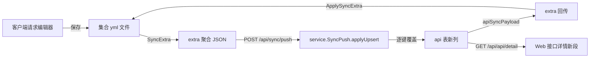

## 需求概述

三个仓库（客户端 `api-doc-go-client`、服务端 `api-doc-go`、共享包 `api-doc-go-share`）联动改造，目标是把「桌面客户端能填写的字段」完整同步到服务端、让响应不再只按 JSON 处理、并让请求体（JSON / form）能以表格形式编写备注。

## 核心功能

1. **同步字段补全**：客户端接口可填字段中目前只有「名称/方法/URL/请求头/请求参数(仅 query+JSON 体展平)/返回类型/返回参数/响应样例/说明」参与同步。本轮补齐：

- 请求体（类型 + JSON/文本原文 + form/multipart 行 + 字段备注）
- 认证（basic / bearer / apikey 的类型与凭据）
- 请求设置（超时、跟随重定向、最大重定向、跳过 SSL 校验、URL 编码）
- 脚本与断言（pre-request、post-response、前置变量、断言，服务端仅存档不执行）
服务端以**独立列**落库（含 sqlite / postgres 迁移），Web 接口详情页新增「请求体 / 认证 / 请求设置 / 脚本」段可见（gRPC 段不在本轮）。

2. **响应支持多类型**：响应不再只存 JSON，可标记为 JSON / 文本 / XML / HTML / 二进制等类型；客户端 Resp 段与 Web 接口详情均新增类型下拉与类型徽标，样例按类型渲染（非 JSON 不做格式化）。类型随同步双向往返。
3. **请求体转表格 + 备注**：JSON 请求体新增「原文 / 表格」视图切换，表格按字段路径展平展示「路径 / 类型 / 值（只读） / 备注（可编辑）」；form / multipart 沿用现有键值表的备注列；备注写入请求文件 `body.descs`，并同步给服务端（服务端请求参数表可直接看到备注）。

## 边界与约束

- 同步协议扩展走现有 `extra` 聚合 JSON 的键集，保持「键存在且为字符串才覆盖、空串清空、缺键不动」的整份覆盖语义，旧客户端 / 旧服务端互相兼容。
- gRPC 请求仍只同步说明；脚本服务端只存档不执行；认证凭据明文入库（与本地集合 yml 明文现状一致，需在文档中显式说明）。

## 技术栈（沿用现有，不引入新框架）

- 客户端：Wails v2（Go 1.26 内核 `internal/*` + Vue3 / TS 前端 + naive-ui），集合是 YAML 纯文本文件（文件即真相源）
- 服务端：Go + gin + gorm（SQLite 默认 / PostgreSQL）+ Vue3 / TS + naive-ui
- 共享包：`api-doc-go-share`（客户端 `go.mod` 以 `github.com/leihenshang/api-doc-go-share v0.7.0` 版本依赖，**当前无 replace**，改共享包需本地 replace 联调 + 发版升版本）

## 实现方案

### 1. 同步键契约（两端必须逐字一致，写在 `syncrows.go` 与 `service/sync.go` 头部注释）

在现有 `desc / headers / params / retType / retParams / retSample / protocol` 之外新增：

| extra 键 | 内容 | 服务端落列 |
| --- | --- | --- |
| `bodyType` | none/json/text/form/multipart | `http_request_body_type` |
| `body` | json/text 原文 | `http_request_body` |
| `bodyForm` | form/multipart 行 JSON `[{name,value,enabled,description,type}]` | `http_request_body_form` |
| `bodyDescs` | `{"a.b":"备注"}` 备注真值 | `http_request_body_descs` |
| `auth` | `{type,username,password,token,key,value,in}` | `http_auth_type` + `http_auth_username/password/token/key/value/in` |
| `settings` | `{timeout,followRedirects,maxRedirects,insecureSsl,encodeUrl}` | `request_timeout/follow_redirects/max_redirects/insecure_ssl/encode_url` |
| `script` | `{preRequest,postResponse}` | `script_pre/script_post` |
| `vars` | `[{name,value,enabled}]` | `script_vars` |
| `asserts` | `[{name,expr}]` | `script_asserts` |
| `retContentType` | json/text/xml/html/binary | `http_return_content_type` |


- `params` 行行为补充：JSON 体展平行带上 `description`（取自 `body.descs[path]`），反向还原时写回 `body.descs` —— 这样**备注零新增列**即可在 Web「请求参数」表显示，同时 `bodyDescs` 作为真值源防 Web 端重排丢失。
- 三态布尔（`FollowRedirects`/`InsecureSSL` 是 `*bool`）用 `smallint`，`-1` = 未设置，避免退化成 bool 丢「未设置」语义。
- 不复用 `http_return_type`（服务端语义是 "JSON" 字符串，客户端 `retType` 是 object/array 根类型，已分叉），新增 `http_return_content_type`。

### 2. 数据流



### 3. 关键实现点

- **客户端 Go**：`internal/collection/syncrows.go` 的 `SyncExtra` / `ApplySyncExtra` 扩展；新增 `internal/collection/sync_extra_fields.go` 承载 `marshalBody/parseBody`、`marshalAuth/parseAuth`、`marshalSettings/parseSettings`、`marshalScript/parseScript` 等（保持函数 ≤50 行、单一职责，避免 syncrows.go 膨胀）；`marshalParamRows` / `applyParamRows` 合并与回写 `body.descs`。
- **落盘**：`ResponseDoc` 加 `ContentType`（`respDocExtra` 用 `json.Marshal(doc)` 落盘，加字段即自动生效）；`Body.Descs` 随共享包 `http.body` 自动落盘，无需改 toFile/fromFile。
- **客户端前端**：`RequestEditor.vue` body 段加「原文/表格」子页签（沿用 `resp.sub-tab` 样式），新增 `components/BodyFieldsTable.vue` 与 `lib/bodyFields.ts`（展平逻辑复用 `responseFields.ts` 的 `extractFields` 口径，MAX_FIELDS/MAX_DEPTH 一致）；Resp 段加类型下拉 + 徽标，样例视图按类型渲染。
- **服务端后端**：`model/api.go` 新增约 17 列（`gorm:"column:xxx"` 命名与现有风格一致）；迁移 `sqlite/0013_api_client_fields.{up,down}.sql` 与 `postgres/0012_api_client_fields.{up,down}.sql`（沿用 `ALTER TABLE ... ADD COLUMN` + 索引风格，注意 postgres 链缺 0010 sync_foundation 的既有缺口）；`service/sync.go` 的 `apiSyncPayload`(360-382) 与 `applyUpsert` api 分支(531-557) 同步扩键；`dto/dto.go` 的 `ApiCreateReq`/`ApiUpdateReq` 增加请求体/认证/设置/响应内容类型字段（脚本类仅展示、不进编辑 DTO）；`service/content.go:247-252` 补字段映射；`repository.UpdateApi` 是 `gmSave` 整条保存，新增列自动落库无需改。
- **Web 前端**：`types/entities.ts` 扩字段；`ApiDetailView.vue` 新增 `data-sec="body" / "auth" / "settings" / "script"` 四段（请求体/认证/设置编辑态可改，脚本只读），「返回参数」段 `title-extra` 增加类型徽标 + 编辑态类型下拉，样例区按类型切换 `JsonBlock` 与纯文本块；大纲 `sections` 自动纳入新段。

## 实施进度（2026-10-14 晚完成，2026-10-15 早收尾核验）

按「先契约、后界面；可独立推送的先做，跨仓的最后做」推进。当前状态：

| 范围 | 内容 | 状态 |
|---|---|---|
| 客户端 Go · 契约层 | `sync_extra_fields.go` 新增 10 个 extra 键常量与编解码（含三态布尔 smallint、form 行转换、`bodyTextOf`/`applyBodyText`/`applyExtendedFields`）；`syncrows.go` 的 `SyncExtra` / `ApplySyncExtra` / `applyResponseDoc` 接入 | ✅ 已完成 |
| 客户端 Go · 响应类型 | `ResponseDoc.ContentType`（`internal/collection/types.go`），落盘走 `respDocExtra` 的 `json.Marshal`，加字段自动生效 | ✅ 已完成 |
| 客户端 Go · 单测 | `sync_extra_fields_test.go`：扩展键双向往返、HTTP 整份下发、gRPC 不下发、**旧键集不清空新字段**、空串清空、三态布尔往返、`bodyTextOf` 分支 | ✅ 已完成（7 个用例） |
| 客户端 · MCP 契约 | `create_request` / `update_request` 的 inputSchema 因 `contentType` 漂移，快照已 `-update` 同步（各 +3 行） | ✅ 已完成 |
| 客户端前端 · 类型 | `types.ts` 的 `ResponseDoc.contentType` | ✅ 已完成 |
| 客户端前端 · UI | `lib/bodyFields.ts`、`components/BodyFieldsTable.vue`、请求体「原文/表格」切换、Resp 段类型下拉与徽标、按类型渲染样例、i18n 文案 | ⬜ 待做 |
| 共享包 | `Body.Descs`（`map[string]string`，yaml/json: `descs,omitempty`） | ⬜ 待做（跨仓，需发版或用临时 replace） |
| 服务端后端 | `model/api.go` 约 17 列、sqlite/postgres 迁移、`service/sync.go` 扩键、`dto` 扩字段、`content.go` 映射、`sync_test.go` | ⬜ 待做 |
| Web 前端 | `types/entities.ts` 扩字段、`ApiDetailView.vue` 新增四段 + 类型徽标、i18n | ⬜ 待做 |

**未接 `bodyDescs` 的原因**：它依赖共享包 `Body` 增字段，而客户端 `go.mod` 目前直接依赖 `api-doc-go-share v0.7.0`（无 replace）。
按方案「共享包跨仓」一节，需先加临时 `replace` 联调、稳定后发版升版本；直接把带本地 `replace` 的 `go.mod` 推上去会破坏 CI。
故本轮客户端不推该键（服务端该列保持不动），`extraKeyBodyDescs` 常量先占位并注明启用条件。

### 收尾核验（2026-10-15 早）

上一轮改动后**未再新增代码**，仅复跑门禁并核对落地情况，结果如下：

| 门禁 | 命令 | 结果 |
|---|---|---|
| 格式 | `gofmt -l internal cmd` | 无输出（clean） |
| 构建 | `go build ./...` | 通过 |
| 静态检查 | `go vet ./...` | 通过 |
| 单测 | `go test ./...` | 19 个包全 `ok`，0 失败 |
| 前端类型 | `vue-tsc --noEmit` | exit 0 |
| i18n | `npm run i18n:check` | `MESSAGES_OK` / `KEYS_MATCH (649)` |

落地核对：10 个 extra 键常量齐备（`bodyType/body/bodyForm/bodyDescs/auth/settings/script/vars/asserts/retContentType`）；
`ResponseDoc.ContentType`（Go `types.go:91`）与前端 `types.ts:174` 的 `contentType` 均已在位；前端 `data-testid` 共 340 处。

**本轮到此收尾**。剩余 4 项仍为 ⬜ 待做，均为跨仓或界面类工作，建议下次按
「共享包 → 服务端后端 → 客户端前端 UI → Web 前端」的顺序推进：先让 `Body.Descs` 落共享包并发版，
再补服务端列与迁移，客户端 UI 与 Web 前端可以并行收口。

> 环境备注（本机）：`/tmp` 为 10MB tmpfs，go 链接会 `no space left on device`，跑门禁前需
> `export GOCACHE=GOTMPDIR=TMPDIR=<项目内目录>`；`go` / `node` 也不在默认 `PATH`
> （详见《客户端代码分析问题.md》第五节「环境备注」）。

## 实施注意（防回归）

- **兼容性**：新增 extra 键一律「整份覆盖 + 空串清空」，但服务端下发旧 extra（缺新键）时客户端不得清空本地字段；客户端推送旧键集时服务端不得清空新列（`if v, ok := extra["body"].(string); ok` 模式）。
- **性能**：`SyncExtra` 在每轮 push 对 dirty 节点调用，展平与 JSON 编解码复用现有实现；`bodyDescs` map 查找 O(1)，不额外遍历。表格视图对大 JSON 沿用 MAX_FIELDS=200 / MAX_DEPTH=4 截断，避免大响应体卡 UI。
- **脏标记**：表格里编辑备注必须触发 `touch()` 标脏，否则不会进 dirty 集、不会推送。
- **安全**：auth password/token 明文入库，与本地 yml 现状一致；不在日志中打印凭据，sync 冲突副本（`.conflicts/`）同属明文，文档需提示。
- **门禁**：客户端 `bash scripts/check.sh`（+ `frontend` 的 `npm run i18n:check`）；服务端 `bash scripts/check.sh --skip-build`；新增 Go 单测覆盖 extra 双向往返（含「旧键集不清空新字段」用例）。
- **共享包跨仓**：先在 `api-doc-go-client/go.mod` 加临时 `replace ... => ../api-doc-go-share` 联调，稳定后在 share 仓库打 tag（CHANGELOG 记一笔）并把 require 升到新版本；若不便发版，退化为客户端 `Request` 顶层 `bodydescs` Extra 段（不碰共享包）。

## 目录结构（增量）

```
api-doc-go-share/
└── collection/types.go                     # [MODIFY] Body 增加 Descs map[string]string（yaml/json: descs,omitempty）

api-doc-go-client/
├── go.mod                                  # [MODIFY] 临时 replace 指向本地 share（联调用）
├── internal/collection/
│   ├── types.go                            # [MODIFY] ResponseDoc 增加 ContentType
│   ├── syncrows.go                         # [MODIFY] SyncExtra/ApplySyncExtra 扩键；params 行合并/回写 body.descs
│   ├── sync_extra_fields.go                # [NEW] body/auth/settings/script/vars/asserts/响应类型的编解码与还原
│   └── sync_extra_fields_test.go           # [NEW] 双向往返 + 旧键集兼容用例
└── frontend/src/
    ├── types.ts                            # [MODIFY] ReqBody 加 descs；ResponseDoc 加 contentType
    ├── lib/bodyFields.ts                   # [NEW] JSON 体展平为表格行、备注读写
    ├── components/BodyFieldsTable.vue      # [NEW] 请求体表格（路径/类型/值只读 + 备注可编辑）
    ├── components/RequestEditor.vue        # [MODIFY] body 段「原文/表格」切换；resp 段类型下拉与徽标、按类型渲染样例
    └── i18n/locales/{zh-CN,en-US}.ts       # [MODIFY] 新增文案 key（两包一一对应）

api-doc-go/
├── server/internal/model/api.go            # [MODIFY] 新增请求体/认证/设置/脚本/响应内容类型列
├── server/migrations/sqlite/0013_api_client_fields.{up,down}.sql    # [NEW]
├── server/migrations/postgres/0012_api_client_fields.{up,down}.sql  # [NEW]
├── server/internal/service/sync.go         # [MODIFY] apiSyncPayload 与 applyUpsert api 分支扩键
├── server/internal/dto/dto.go              # [MODIFY] ApiCreateReq/ApiUpdateReq 扩字段
├── server/internal/service/content.go      # [MODIFY] 创建/更新字段映射（:247-252）
├── server/internal/service/sync_test.go    # [MODIFY] 新增字段往返用例
└── web/src/
    ├── types/entities.ts                   # [MODIFY] Api 类型扩字段
    ├── views/project/ApiDetailView.vue     # [MODIFY] 新增请求体/认证/设置/脚本段 + 响应类型下拉与徽标
    └── i18n/locales/{zh-CN,en-US}.ts       # [MODIFY] 新增文案 key
```

## 关键接口（契约，两端逐字一致）

```
// api-doc-go-client/internal/collection（extra 键常量，避免多处散写魔法值）
const (
    extraKeyBodyType      = "bodyType"      // none|json|text|form|multipart
    extraKeyBody          = "body"          // json/text 原文
    extraKeyBodyForm      = "bodyForm"      // form/multipart 行 JSON
    extraKeyBodyDescs     = "bodyDescs"     // {"a.b":"备注"}
    extraKeyAuth          = "auth"
    extraKeySettings      = "settings"
    extraKeyScript        = "script"
    extraKeyVars          = "vars"
    extraKeyAsserts       = "asserts"
    extraKeyRetContentType = "retContentType" // json|text|xml|html|binary
)

// api-doc-go-share/collection/types.go：请求体备注（按字段路径）
type Body struct {
    Type  string            `yaml:"type" json:"type"`
    Data  string            `yaml:"data,omitempty" json:"data,omitempty"`
    Raw   string            `yaml:"raw,omitempty" json:"raw"`
    Form  []KV              `yaml:"form,omitempty" json:"form"`
    Descs map[string]string `yaml:"descs,omitempty" json:"descs,omitempty"` // path -> 备注
}
```

## 设计取向

两个前端都已有成熟设计体系（naive-ui + 各自 `--app-*` 主题令牌、主色 #18a058），本轮**不引入新组件库**，只在既有页面里追加同构区块，保证视觉与交互一致。

## 客户端（桌面端，浅/深色双主题）

- **请求体分段**：在类型下拉右侧新增「原文 / 表格」小页签（复用 Resp 段的 `.sub-tab` 样式：细边框、选中态主色下划线）。表格沿用「响应字段表」的四列栅格（路径 / 类型 / 值 / 备注），路径与类型用等宽字体并弱化配色，值列只读（灰色不可编辑态），备注列为小尺寸输入框，placeholder 用「可选」。空态显示「暂无字段（JSON 非法或为空）」。
- **响应分段**：在字段/响应数据/响应头三个子页签左侧新增类型下拉（JSON / 文本 / XML / HTML / 二进制），选中后在其后渲染同色系胶囊徽标；「响应数据」页签在类型为非 JSON 时直接原文展示，不做缩进格式化。
- 交互：切换视图不标脏；只有备注输入与类型变更触脏；列宽拖拽等既有能力保持不变；所有可交互元素补 `data-testid`（`body.viewTab`、`body.fieldsRow`、`body.fieldDesc`、`resp.contentType`）。

## 服务端 Web（接口详情）

- 在「请求头部 / 请求参数 / 返回参数 / 响应样例」之间按 Postman 式垂直分段新增「请求体」「认证」「请求设置」「脚本」，沿用现有 `.req-sec` + 悬浮大纲自动纳段（无值时整段隐藏，与「基本信息(有值时)」一致）。
- 请求体段：查看态用等宽文本块，编辑态为「类型下拉 + 原文输入框 / 表单键值表」；认证段为类型下拉 + 对应凭据输入；设置段为紧凑表单；脚本段只读展示（前置/后置两块代码）。
- 「返回参数」段标题右侧增加响应类型徽标，编辑态为下拉；响应样例区按类型切换高亮 JSON 块与纯文本块。
- 全部文案走 i18n（`zh-CN` / `en-US` 同步新增 key），不硬编码中文。

## Agent Extensions

### SubAgent

- **code-explorer**
- 用途：在落地服务端 `service/content.go` 字段映射、`collection.go` 的 respdoc 落盘细节、Web `ApiDetailView.vue` 段落结构时做定点检索与确认，避免凭记忆改错行
- 预期结果：给出准确的文件路径 + 行号 + 上下文片段，保证改动落在既有模式上

### MCP

- **apidoc**
- 用途：改造完成后用 `list_projects` / `get_request_detail` / `update_request` 在真实集合上验证请求体 `descs`、响应类型、认证与设置的读写与落盘（配合一次客户端同步验证端到端）
- 预期结果：确认新建/修改后的接口字段正确落盘并能被读回，备注与响应类型无丢失