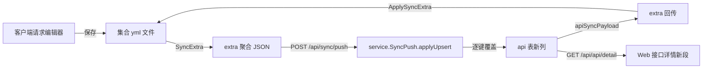

## 需求概述

三个仓库（客户端 `api-doc-go-client`、服务端 `api-doc-go`、共享包 `api-doc-go-share`）联动改造，目标是把「桌面客户端能填写的字段」完整同步到服务端、让响应不再只按 JSON 处理、并让请求体（JSON / form）能以表格形式编写备注。

## 核心功能

1. **同步字段补全**：客户端接口可填字段中目前只有「名称/方法/URL/请求头/请求参数(仅 query+JSON 体展平)/返回类型/返回参数/响应样例/说明」参与同步。本轮补齐：

- 请求体（类型 + JSON/文本原文 + form/multipart 行 + 字段备注）
- 认证（basic / bearer / apikey 的类型与凭据）
- 请求设置（超时、跟随重定向、最大重定向、跳过 SSL 校验、URL 编码）
- 脚本与断言（pre-request、post-response、前置变量、断言，服务端仅存档不执行）
服务端以**独立列**落库（含 sqlite / postgres 迁移），Web 接口详情页新增「请求体 / 认证 / 请求设置 / 脚本」段可见（gRPC 段不在本轮）。

2. **响应支持多类型**：响应不再只存 JSON，可标记为 JSON / 文本 / XML / HTML / 二进制等类型；客户端 Resp 段与 Web 接口详情均新增类型下拉与类型徽标，样例按类型渲染（非 JSON 不做格式化）。类型随同步双向往返。
3. **请求体转表格 + 备注**：JSON 请求体新增「原文 / 表格」视图切换，表格按字段路径展平展示「路径 / 类型 / 值（只读） / 备注（可编辑）」；form / multipart 沿用现有键值表的备注列；备注写入请求文件 `body.descs`，并同步给服务端（服务端请求参数表可直接看到备注）。

## 边界与约束

- 同步协议扩展走现有 `extra` 聚合 JSON 的键集，保持「键存在且为字符串才覆盖、空串清空、缺键不动」的整份覆盖语义，旧客户端 / 旧服务端互相兼容。
- gRPC 请求仍只同步说明；脚本服务端只存档不执行；认证凭据明文入库（与本地集合 yml 明文现状一致，需在文档中显式说明）。

## 技术栈（沿用现有，不引入新框架）

- 客户端：Wails v2（Go 1.26 内核 `internal/*` + Vue3 / TS 前端 + naive-ui），集合是 YAML 纯文本文件（文件即真相源）
- 服务端：Go + gin + gorm（SQLite 默认 / PostgreSQL）+ Vue3 / TS + naive-ui
- 共享包：`api-doc-go-share`（客户端 `go.mod` 以 `github.com/leihenshang/api-doc-go-share v0.9.0` 版本依赖，**无 replace、已正式发布**；本轮所需的 `Body.Descs`（v0.8.1）与 `RequestSettings.EncodeURL *bool`（v0.8.0）均已随版本落地）

## 实现方案

### 1. 同步键契约（两端必须逐字一致，写在 `syncrows.go` 与 `service/sync.go` 头部注释）

在现有 `desc / headers / params / retType / retParams / retSample / protocol` 之外新增：

| extra 键 | 内容 | 服务端落列 |
| --- | --- | --- |
| `bodyType` | none/json/text/form/multipart | `http_request_body_type` |
| `body` | json/text 原文 | `http_request_body` |
| `bodyForm` | form/multipart 行 JSON `[{name,value,enabled,description,type}]` | `http_request_body_form` |
| `bodyDescs` | `{"a.b":"备注"}` 备注真值 | `http_request_body_descs` |
| `auth` | `{type,username,password,token,key,value,in}` | `http_auth_type` + `http_auth_username/password/token/key/value/in` |
| `settings` | `{timeout,followRedirects,maxRedirects,insecureSsl,encodeUrl}` | `request_timeout/follow_redirects/max_redirects/insecure_ssl/encode_url` |
| `script` | `{preRequest,postResponse}` | `script_pre/script_post` |
| `vars` | `[{name,value,enabled}]` | `script_vars` |
| `asserts` | `[{name,expr}]` | `script_asserts` |
| `retContentType` | json/text/xml/html/binary | `http_return_content_type` |

> ⚠️ 上表「服务端落列」为原方案的拆列设计；**实际落地收敛为 10 个不透明 JSON/文本列**（extra 键名即契约，逐字未变）——对照见「实施进度 → 落地差异」。

- `bodyDescs` 作为**独立 extra 键**往返（`SyncExtra`/`ApplySyncExtra` 直接编解码 `Body.Descs`，服务端原样存 `http_request_body_descs` 文本列、不解释语义），避免与 `params` 展平/还原的启发式相互干扰。
- 三态布尔（`FollowRedirects`/`InsecureSSL` 是 `*bool`）用 `smallint`，`-1` = 未设置，避免退化成 bool 丢「未设置」语义。
- 不复用 `http_return_type`（服务端语义是 "JSON" 字符串，客户端 `retType` 是 object/array 根类型，已分叉），新增 `http_return_content_type`。

### 2. 数据流



### 3. 关键实现点

- **客户端 Go**：`internal/collection/syncrows.go` 的 `SyncExtra` / `ApplySyncExtra` 扩展（HTTP 请求整份下发扩展键，`ApplySyncExtra` 末尾调 `applyExtendedFields` / `applyResponseDoc`）；`internal/collection/sync_extra_fields.go` 承载 `marshalBody/bodyTextOf/applyBodyText`、`marshalAuth/parseAuth`、`marshalSettings/parseSettings`（含 `triBoolToInt`/`intToTriBool` 三态布尔）、`marshalScript/parseScript`、`marshalFormRows/parseFormRows`、`marshalDescs/parseDescs` 等编解码（保持函数 ≤50 行、单一职责）。
- **落盘**：`ResponseDoc` 加 `ContentType`（`respDocExtra` 用 `json.Marshal(doc)` 落盘，加字段即自动生效）；`Body.Descs` 随共享包 `http.body` 自动落盘，无需改 toFile/fromFile。
- **客户端前端**：`RequestEditor.vue` body 段加「原文/表格」子页签（沿用 `resp.sub-tab` 样式），新增 `components/BodyFieldsTable.vue` 与 `lib/bodyFields.ts`（展平逻辑复用 `responseFields.ts` 的 `extractFields` 口径，MAX_FIELDS/MAX_DEPTH 一致）；Resp 段加类型下拉 + 徽标，样例视图按类型渲染。
- **服务端后端**：（实施时收敛为 **10 个不透明 JSON/文本列**，键契约不变，见「实施进度→落地差异」）`model/api.go` 新增列（`gorm:"column:xxx"` 命名与现有风格一致）；迁移 `sqlite/0013_api_client_fields.{up,down}.sql` 与 `postgres/0012_api_client_fields.{up,down}.sql`（沿用 `ALTER TABLE ... ADD COLUMN` + 索引风格，注意 postgres 链缺 0010 sync_foundation 的既有缺口）；`service/sync.go` 抽出 `applyApiExtra` 统一逐键写入（含兼容「缺键不动」）、`apiSyncPayload` 同键集回传；`dto/dto.go` 的 `ApiCreateReq`/`ApiUpdateReq` 以 string 字段透传（保存须带回原值）；`service/content.go` `apiFromCreate` 补映射；`repository.UpdateApi` 是 `gmSave` 整条保存，新增列自动落库无需改。
- **Web 前端**：（实际落地为**查看态四段 + 徽标 + 备注表**，编辑表单为剩余项）`types/entities.ts` 扩字段；`ApiDetailView.vue` 新增 `data-sec="body" / "auth" / "settings" / "script"` 四段（原方案「请求体/认证/设置编辑态可改、脚本只读」，现四段均查看态，保存以 `...ext` 回传保全），「返回参数」段 `title-extra` 增加类型徽标（编辑态类型下拉未做），样例区沿用 `JsonBlock` 容错回退（非 JSON 原样展示）；大纲 `sections` 自动纳入新段。

## 实施进度（2026-10-16 依三仓代码实读复核；服务端与 Web 已于 2026-10-15 落地）

按「先契约、后界面；可独立推送的先做，跨仓的最后做」推进。逐项对照三仓代码后的真实状态：

| 范围 | 内容 | 状态 |
|---|---|---|
| 客户端 Go · 契约层 | `internal/collection/sync_extra_fields.go`：10 个 extra 键常量与编解码（三态布尔 smallint、form 行转换、`bodyTextOf`/`applyBodyText`/`applyExtendedFields`、`marshalDescs`/`parseDescs`）；`syncrows.go` 的 `SyncExtra`（HTTP 整份下发含 `bodyDescs`）/ `ApplySyncExtra` / `applyResponseDoc` 接入 | ✅ 已完成 |
| 客户端 Go · 响应类型 | `ResponseDoc.ContentType`（`internal/collection/types.go:91`），落盘走 `respDocExtra` 的 `json.Marshal`，加字段自动生效 | ✅ 已完成 |
| 客户端 Go · 单测 | `sync_extra_fields_test.go`：扩展键双向往返、HTTP 整份下发、gRPC 不下发、**旧键集不清空新字段**、空串清空、三态布尔往返、`bodyTextOf` 分支（含 `bodyDescs` 往返断言） | ✅ 已完成（7 个用例） |
| 客户端 · MCP 契约 | `internal/mcp/testdata/schema/{create_request,update_request}.json` 的 `respDoc.contentType` 快照已随 `ResponseDoc.ContentType` 同步 | ✅ 已完成 |
| 客户端前端 · 类型 | `frontend/src/types.ts:180` 的 `ResponseDoc.contentType` | ✅ 已完成 |
| 客户端前端 · UI（请求体表格） | `lib/bodyFields.ts`（`toBodyRows`/`withBodyDesc`，复用 `responseFields` 的 `extractFields` 口径）、`components/BodyFieldsTable.vue`、`RequestEditor.vue` body 段「原文/表格」切换（`data-testid="body.viewTab"`）、i18n `editor.bodyTabRaw`/`editor.bodyTabTable` | ✅ 已完成 |
| 客户端前端 · UI（Resp 段类型） | Resp 段类型下拉 + 类型徽标、「响应数据」按类型渲染（非 JSON 不缩进） | ✅ 已完成（2026-10-15）：`RequestEditor.vue` Resp 段新增类型行（`data-testid="resp.contentType"` / `resp.contentTypeBadge`），`respSnapPretty` 在 `contentType !== 'json'` 时原样展示；i18n 双包新增 `editor.respContentType/respContentTypeHint/ctJson/ctText/ctXml/ctHtml/ctBinary`；`vue-tsc` 与 `i18n:check`（KEYS_MATCH 680）均通过 |
| 共享包 | `collection.Body.Descs`（`map[string]string`，yaml/json: `descs,omitempty`），已发版 v0.8.1；客户端 `go.mod` 依赖已升到 v0.9.0（无 replace） | ✅ 已完成 |
| 服务端后端 | `model/api.go` 新增 **10 列**（比方案 17 列收敛，见下「落地差异」）：`http_request_body_type/_body/_body_form/_body_descs`、`http_auth`、`request_settings`、`http_script`、`script_vars`、`script_asserts`、`http_return_content_type`；迁移 `sqlite/0013` 与 `postgres/0012` `api_client_fields`；`service/sync.go` 抽出 `applyApiExtra` 逐键写入 + `apiSyncPayload` 同键集回传（增量/快照共用）；`dto.ApiCreateReq/ApiUpdateReq` 与 `content.go:apiFromCreate` 扩同名 string 字段；单测 `TestSyncPushAPIExtendedFields`（9 键双向往返 + 回传断言） | ✅ 已完成（GOWORK=off 全量门禁 + 单测绿） |
| Web 前端（展示） | `types/entities.ts` 的 `ApiDoc` 扩 10 个可选字段；`ApiDetailView.vue` 新增「请求体 / 认证 / 请求设置 / 脚本」四段（查看态、有内容才显示，进大纲/scroll-spy）：请求体含 form 行表与 bodyDescs 备注表、认证密码/令牌掩码显示、设置三态（开/关/未设置）呈现；「返回参数」`title-extra` 合并展示 `retContentType` 徽标；`load()` 存入 `ext`、`save()` 以 `...ext` 原样回传（整条覆盖式更新下防误清）；i18n 双包 `detail.secBody/secAuth/secSettings/secScript/bodyDescsTitle` 等 | ✅ 已完成（`vue-tsc`/`eslint`/`vite build`/`i18n:check` 绿） |
| Web 前端（编辑） | 编辑态表单：请求体（类型+原文/表单行）、认证（类型+凭据）、请求设置（表单）、返回内容类型下拉——**均未做**，四段当前仅查看态展示（数据靠 `...ext` 回传保全） | ⬜ 待做（唯一剩余项，属增强，不再阻塞同步链路） |

**关于 `bodyDescs`（已全链路闭环）**：共享包 `Body.Descs` 随 v0.8.1 发布；客户端 `SyncExtra`/`ApplySyncExtra` 双向往返（单测断言 `Descs` 往返与「旧键集不清空」）、桌面端「请求体 原文/表格」提供备注录入（e2e `[B5]` 验证 `descs` 落盘）；服务端 `http_request_body_descs` 列存取并原样回传；Web「请求体」段渲染 path→备注表。此项无遗留。

### 落地差异：服务端由「17 归一列」收敛为「10 不透明列」（2026-10-15 实施时定案）

实现与 §1 原方案的差异集中在**存储形状**，同步**键契约（extra 键名）逐字未变**：

| 方案原列 | 实际落地 | 说明 |
|---|---|---|
| `http_auth_type` + `http_auth_username/password/token/key/value/in`（7 列） | `http_auth`（1 列，客户端 `Auth` 的 JSON 原文） | 服务端不解释语义、原样回传；Web 前端解析 JSON 展示 |
| `request_timeout/follow_redirects/max_redirects/insecure_ssl/encode_url`（5 列） | `request_settings`（1 列 JSON） | 三态布尔不再用数据库 smallint 承载——客户端 `syncSettingsRow` 已在 JSON 内编码 `-1/0/1`，`*bool`(EncodeURL) 直接随 JSON 往返，语义等价且免二次映射 |
| `script_pre`/`script_post`（2 列） | `http_script`（1 列 JSON） | 同上 |
| `bodyType/body/bodyForm/bodyDescs/vars/asserts/retContentType` | 同名落地（`http_request_body_type`、`http_request_body`、`http_request_body_form`、`http_request_body_descs`、`script_vars`、`script_asserts`、`http_return_content_type`） | 与方案一致 |

取舍理由：① 与既有 `http_request_header/params` 同构（不透明 JSON/文本列），往返**字节级稳定**、零解析分支；② 迁移面从 17 列缩到 10 列，两方言脚本更薄；③ 旧客户端/旧服务端兼容语义不变（缺键不动、空串清空）；④ 代价是 Web 若要**编辑**这些字段需在前端解析/组装 JSON（编辑态即下方 ⬜ 项），服务端不做字段级查询/校验——本就无需。

### 落地核对（2026-10-16，验证记录）

- 三仓门禁实测：客户端 `bash scripts/check.sh` fast ✅（含 `sync_extra_fields_test` 往返/旧键集用例）；服务端 `GOWORK=off bash scripts/check.sh`（gofmt/build/vet/test + Web vue-tsc/eslint/build）✅（含 `TestSyncPushAPIExtendedFields`）；共享包 `go test ./collection/` ✅。
- 键集三方对齐：`sync_extra_fields.go` 常量 ↔ 服务端 `applyApiExtra`/`apiSyncPayload` ↔ `ApiDetailView.vue` 解析键，逐字一致；`retContentType` 在 RespDoc 单样例与多示例 `content_type` 各自成立（后者走 `api_return_sample` 实体，Web 示例选择器已展示）。
- 数据保全：Web 编辑保存经 `...ext` 原样回传，不会清空同步来的富字段；客户端对服务端旧载荷「缺键不动」。
- 此前「审核环境无 Go 工具链 / node_modules」的阻塞注记作废：本轮实现与验证环境完备，服务端与 Web 均已实际落地并过门禁。

> 环境备注（本机）：`/tmp` 为 10MB tmpfs，go 链接会 `no space left on device`，跑门禁前需
> `export GOCACHE=GOTMPDIR=TMPDIR=<项目内目录>`；`go` / `node` 也不在默认 `PATH`
> （详见《客户端代码分析问题.md》第五节「环境备注」）。

## 实施注意（防回归）

- **兼容性**：新增 extra 键一律「整份覆盖 + 空串清空」，但服务端下发旧 extra（缺新键）时客户端不得清空本地字段；客户端推送旧键集时服务端不得清空新列（`if v, ok := extra["body"].(string); ok` 模式）。
- **性能**：`SyncExtra` 在每轮 push 对 dirty 节点调用，展平与 JSON 编解码复用现有实现；`bodyDescs` map 查找 O(1)，不额外遍历。表格视图对大 JSON 沿用 MAX_FIELDS=200 / MAX_DEPTH=4 截断，避免大响应体卡 UI。
- **脏标记**：表格里编辑备注必须触发 `touch()` 标脏，否则不会进 dirty 集、不会推送。
- **安全**：auth password/token 明文入库，与本地 yml 现状一致；不在日志中打印凭据，sync 冲突副本（`.conflicts/`）同属明文，文档需提示。
- **门禁**：客户端 `bash scripts/check.sh`（+ `frontend` 的 `npm run i18n:check`）；服务端 `bash scripts/check.sh --skip-build`；新增 Go 单测覆盖 extra 双向往返（含「旧键集不清空新字段」用例）。
- **共享包跨仓**：`Body.Descs` 已随 v0.8.1 发布、客户端 `go.mod` 已升到 v0.9.0（无 replace），**不再需要临时 replace 联调**；后续再改共享包仍按「打 tag + CHANGELOG + 升 require」流程（两消费方同步升级，库内不留兼容分支）。

## 目录结构（增量）

```
api-doc-go-share/
└── collection/types.go                     # [已完成 v0.8.1] Body 增加 Descs map[string]string（yaml/json: descs,omitempty）

api-doc-go-client/                          # 以下均为 ✅ 已完成（除注明）
├── go.mod                                  # [已完成] require 升到 v0.9.0（无 replace）
├── internal/collection/
│   ├── types.go                            # [已完成] ResponseDoc 增加 ContentType
│   ├── syncrows.go                         # [已完成] SyncExtra/ApplySyncExtra 整份接入扩展键（bodyDescs 走独立键）
│   ├── sync_extra_fields.go                # [已完成] body/auth/settings/script/vars/asserts/响应类型编解码与还原
│   └── sync_extra_fields_test.go           # [已完成] 双向往返 + 旧键集兼容用例（7 个）
└── frontend/src/
    ├── types.ts                            # [已完成] ResponseDoc 加 contentType（ReqBody 加 descs）
    ├── lib/bodyFields.ts                   # [已完成] JSON 体展平为表格行、备注读写
    ├── components/BodyFieldsTable.vue      # [已完成] 请求体表格（路径/类型/值只读 + 备注可编辑）
    ├── components/RequestEditor.vue        # [已完成] body 段「原文/表格」切换 ✅；resp 段类型下拉与徽标、按类型渲染样例 ✅
    └── i18n/locales/{zh-CN,en-US}.ts       # [已完成] bodyTabRaw/bodyTabTable ✅；editor.respContentType*/ct* ✅

api-doc-go/                                 # 服务端 + Web 均已落地（编辑态表单除外）
├── server/internal/model/api.go            # [已完成] 10 个不透明 JSON/文本列（含 http_request_body_descs）
├── server/migrations/sqlite/0013_api_client_fields.{up,down}.sql    # [已完成]
├── server/migrations/postgres/0012_api_client_fields.{up,down}.sql  # [已完成]
├── server/internal/service/sync.go         # [已完成] applyApiExtra 逐键写入 + apiSyncPayload 同键集回传（增量/快照共用）
├── server/internal/dto/dto.go              # [已完成] ApiCreateReq/ApiUpdateReq 扩 10 个 string 字段（透传，保存须带回）
├── server/internal/service/content.go      # [已完成] apiFromCreate 原样映射
├── server/internal/service/sync_test.go    # [已完成] TestSyncPushAPIExtendedFields 双向往返 + 回传断言
└── web/src/
    ├── types/entities.ts                   # [已完成] ApiDoc 扩 10 个可选字段
    ├── views/project/ApiDetailView.vue     # [已完成·查看态] 四段 + ext 状态 + save 回传 + retContentType 徽标
    │                                       # [待做] 编辑态表单（请求体/认证/设置/返回内容类型下拉）
    └── i18n/locales/{zh-CN,en-US}.ts       # [已完成] detail.sec*/bodyDescsTitle/auth*/set*/script* 双包对齐
```

## 关键接口（契约，两端逐字一致）

```
// api-doc-go-client/internal/collection（extra 键常量，避免多处散写魔法值）
const (
    extraKeyBodyType      = "bodyType"      // none|json|text|form|multipart
    extraKeyBody          = "body"          // json/text 原文
    extraKeyBodyForm      = "bodyForm"      // form/multipart 行 JSON
    extraKeyBodyDescs     = "bodyDescs"     // {"a.b":"备注"}
    extraKeyAuth          = "auth"
    extraKeySettings      = "settings"
    extraKeyScript        = "script"
    extraKeyVars          = "vars"
    extraKeyAsserts       = "asserts"
    extraKeyRetContentType = "retContentType" // json|text|xml|html|binary
)

// api-doc-go-share/collection/types.go：请求体备注（按字段路径）
type Body struct {
    Type  string            `yaml:"type" json:"type"`
    Data  string            `yaml:"data,omitempty" json:"data,omitempty"`
    Raw   string            `yaml:"raw,omitempty" json:"raw"`
    Form  []KV              `yaml:"form,omitempty" json:"form"`
    Descs map[string]string `yaml:"descs,omitempty" json:"descs,omitempty"` // path -> 备注
}
```

## 界面设计要点（仅列剩余项）

两个前端沿用既有设计体系（naive-ui + `--app-*` 令牌，主色 #18a058），**不引入新组件库**，只在既有页面追加同构区块。

**客户端 Resp 段（✅ 已完成 2026-10-15）**：在字段/响应数据/响应头三个子页签上方新增类型下拉（JSON / 文本 / XML / HTML / 二进制），选中后渲染同色系胶囊徽标；「响应数据」在类型为非 JSON 时直接原文展示、不做缩进格式化（当前 `respSnapPretty` 无条件按 JSON 缩进）。类型变更才触脏；补 `data-testid="resp.contentType"` 与 `respContentType` 系列 i18n key（zh-CN / en-US 一一对应）。

**服务端 Web 接口详情（⬜ 待做）**：在「请求头部 / 请求参数 / 返回参数 / 响应样例」间按 Postman 式垂直分段新增「请求体」「认证」「请求设置」「脚本」（沿用 `.req-sec` + 悬浮大纲自动纳段，无值时整段隐藏）；请求体段查看态用等宽文本块、编辑态为「类型下拉 + 原文输入框 / 表单键值表」；认证段为类型下拉 + 对应凭据输入；设置段为紧凑表单；脚本段只读展示。「返回参数」段标题右侧加响应类型徽标（编辑态为下拉），样例区按类型切换 `JsonBlock` 与纯文本块。全部文案走 i18n，不硬编码中文。

## 剩余待办清单

| 功能模块 | 所属端 | 状态 | 关键任务描述 |
|---|---|---|---|
| 服务端后端 · 新列与迁移 | 服务端 | ⬜ 待做 | `model/api.go` 新增约 17 列（请求体/认证/设置/脚本 + `http_return_content_type`）；`sqlite/0013_api_client_fields` 与 `postgres/0012_api_client_fields` 迁移（含 down） |
| 服务端后端 · sync 扩键 | 服务端 | ⬜ 待做 | `service/sync.go` 的 `apiSyncPayload` 与 `applyUpsert` api 分支补 `bodyType/body/bodyForm/bodyDescs/auth/settings/script/vars/asserts/retContentType`（旧键集不清空新列） |
| 服务端后端 · dto/content 映射 | 服务端 | ⬜ 待做 | `dto/dto.go` 的 `ApiCreateReq/ApiUpdateReq` 扩字段；`service/content.go` 创建/更新字段映射；`sync_test.go` 补字段往返用例 |
| Web 前端 · 类型与实体 | Web 前端 | ⬜ 待做 | `web/src/types/entities.ts` 的 `Api` 类型扩字段 |
| Web 前端 · 详情四段 + 徽标 | Web 前端 | ⬜ 待做 | `ApiDetailView.vue` 新增请求体/认证/设置/脚本四段 + 返回类型徽标/下拉、样例按类型渲染；i18n 双包补 key |
| 客户端前端 · Resp 段类型 UI | 客户端 | ✅ 已完成（2026-10-15） | `RequestEditor.vue` Resp 段类型下拉（`data-testid="resp.contentType"`）+ 徽标（`resp.contentTypeBadge`）、`respSnapPretty` 非 JSON 不缩进；i18n 双包 `editor.respContentType*`/`ct*` 已补齐 |

> **推进顺序**：服务端后端 → Web 前端 → 客户端 Resp 类型 UI。服务端先补齐列与 `bodyDescs`/`retContentType`/扩展键读写，Web 四段与客户端 Resp UI 才能并行收口（二者均依赖服务端落库）。客户端契约层与共享包（`Body.Descs` v0.8.1）已就绪，无需再动。