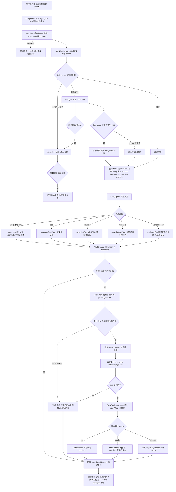
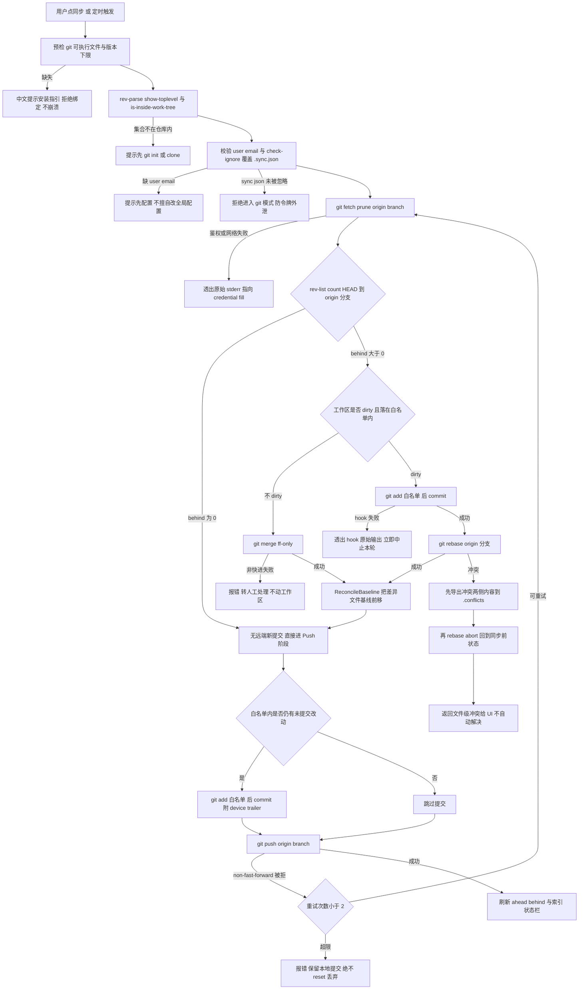
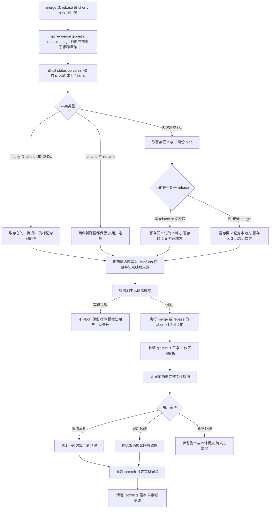
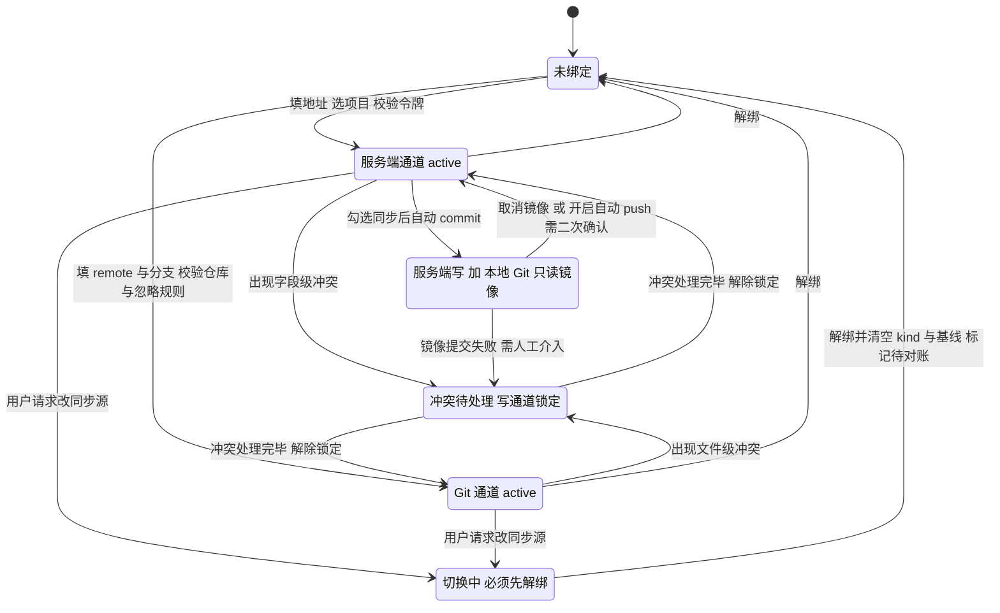

# 《多同步源支持可行性与设计方案》评审

> 评审对象：`doc/多同步源支持可行性与设计方案.md`（558 行，自称"全部来自当前仓库代码实读"）
> 评审基线：`api-doc-go-client` @ 当前工作区（engine.go 1355 行 / client.go 273 行 / collection.go 2052 行 / app_sync.go 462 行 / SyncDialog.vue 462 行），`go build ./internal/...` 通过（go1.27.2）
> 评审方式：逐条复核附录 A 行号索引 + 对关键语义做**可执行实证**（临时探针测试、临时 git 仓库）
> 评审性质：只分析与评审，未修改原文档、未改动产品代码（探针测试已删除，`git status` 干净）

---

## 0. 结论摘要

### 总体结论：**有条件可行**

方案方向是对的，且是本轮几个候选方案里最优的一个：把 Git 当成「同一抽象位的另一种取值」（`BindInfo.Kind` 单值、二选一绑定），而不是试图把 Git 塞进现有 `syncengine` 协议语义里，这个判断我完全同意，并且被代码证据支持（`client.go:28-50` 的 `BindInfo` 是纯服务端形状，`engine.go:182-204` 的 `RunOne` 把 negotiate→pull→push 写死成服务端协议，两者确实不可参数化到 Git 上）。

但文档**不能按现状直接进入开发排期**，有三个层面的问题：

| 层面 | 判断 | 说明 |
|---|---|---|
| 架构判断 | ✅ 成立 | 分层图（§8.1）、单写通道、不做 YAML 语义合并，三条硬约束都正确且必要 |
| 方案选型 | ✅ 成立 | 调系统 git CLI（方案 A）优于 go-git；§7 的七方案对照结论（A 最优增强、B 为彻底方案）合理 |
| 实现细节正确性 | ❌ 不可用 | 至少 2 处会导致**静默丢数据**或**按文档实现必然报错**的硬错误（§3.3 的 `:2:`/`:3:` 语义与 abort 顺序），已实测复现，见 P0-1 / P0-2 |
| 事实基础 | ❌ 不可信 | 附录 A 抽样 20 处，11 处行号指向**完全无关的函数**；文档的"已修复"标记与其自身附录互相矛盾；把 pull 覆盖前的快照保护说得比实际覆盖更全 |
| 完整性 | ⚠️ 有缺口 | 漏了 4 个会直接让功能不可用的场景：pull 之后索引基线未对齐、仓库子目录、`.gitignore` 未追加导致 PAT 外泄、并发无锁 |

### 修复进度（2026-10-19 更新）

本轮先修了两条**与服务端/Git 都无关的现有代码缺陷**（不修的话 Git 模式一落地就踩同样的坑）：

| 条目 | 状态 | 改动 | 证据 |
|---|---|---|---|
| P0-4 | ✅ 已修复 | `pushDirty` 去掉「dirty+墓碑为空就早退」，改为由 `len(b.ops)==0` 兜底；doc/example/variable 的 hash 基线检测因此每轮都会执行 | `engine_test`：`TestPushDirtyOnlyDocChanges` + `push_dirty_regression_test.go`（7 例：改正文/示例/环境、零改动不推送、混合、幂等、删文档） |
| P0-5 | ✅ 已修复 | `Open` 改用 `ensureGitignore`：不存在则整份写入；已存在则**原地追加**缺失条目（保留用户内容、CRLF 风格、文件 mode 与软链语义），幂等 | `gitignore_test.go`（含 mode/软链两例）+ `gitignore_regression_test.go`（7 例，全部走真实 `Open` 并做字节比对） |
| P1-10 | ✅ 已修复 | `pendingDeletes` 带类型（`{uid,type}`，兼容旧 `["uid"]` 格式并按 `DocHashes` 兜底纠正旧数据）；`collectTombstoneOps` 按类型出网；`collectDocOps` 跳过本轮已发墓碑的 uid；`.sync-deletes.json` 补进 `.gitignore` | `pending_delete_test.go`（3）、`push_delete_type_test.go`（5，含迁移兜底与外部删除） |
| P2-A（P1-10 遗留①） | ✅ 已修复 | 墓碑改为**按回执逐条清除**：`succeededTombstones` 取 `status=ok` 的墓碑调 `RemovePendingDeletes`，被拒的那条留在列表继续重试，但不再拖累同批已成功的删除；`dirtyMeta` 记墓碑文件里的**原始类型**（`pendingTypes`），避免旧格式 doc 墓碑按发送类型删不掉；类型纠正后按 `(uid,纠正后type)` 去重 | `push_delete_partial_clear_test.go`、`pending_delete_remove_test.go` + QA 独立验证（混排/conflict/迁移纠偏/异常双类型） |
| P1-7 | ✅ 已修复 | `variable_env` 改名覆盖前留快照：`applyVarEnvWithSnapshot` 先读旧字节→应用→**成功后才落副本**（失败/空名不留、不计数，避免假冲突）；只快照主文件，**不复制 `.secrets.yml`**（`RenameEnv` 会把两个文件一起搬，密钥不丢但不必再抄一份） | `env_rename_snapshot_test.go`（6）+ QA 独立验证（计数=1、secrets 全目录扫描无明文、两环境同轮各 1 份） |
| P1-5 | ✅ 已修复 | 按集合的 `syncMus` 互斥：`runSyncFor(c, token, wait)` 进函数取锁、整轮在锁内；手动同步 `TryLock` 抢不到返回「该集合正在同步中，请稍后再试」，定时同步静默跳过；`SetSyncBindFor`/`UnbindSyncFor` 也纳入同一把锁（否则同步末尾的整份 Bind 回写会盖掉新绑定/令牌）；`setSyncRunning(false)` 改 defer | `app_sync_mutex_test.go`（6）+ QA 真并发验证（阻塞式假服务端：第二路 <1ms busy、`/api/meta` 只命中 1 次）、`-race` 干净 |
| P0-1 / P0-2 / P0-3 / P0-6 | ⬜ 待处理 | 见各自条目 | 需在 Git 方案动工前修（P0-1/P0-2 属实现细节，P0-3 属文档修订，P0-6 属 Git 模式新增步骤） |

> 复核方式：两处修复都做了**反证**——把改动还原后新用例必失败（P0-4：「只改文档也必须调用 Push，实际一次请求都没发」；P0-5：「Open 后 .sync.json 必须被忽略」/「权限应保持 0600，got 0644」），恢复后全绿。

最重要的一条：**文档漏掉了 Git 模式自身的一个必做步骤，缺了它 Git 模式一上线就是"每轮全库 dirty"**。详见 P0-6。这一条比文档里讨论的所有冲突细节都更致命，因为它不报错、不冲突，只是"同步看起来正常、脏计数永远不清零、切回服务端模式就全量回推"。

### 关于文档"事实性论断"的总体判定

文档开篇写「结论依据：全部来自当前仓库代码实读（含行号索引，见附录 A），不含推测性描述」。这句话**在撰写时刻可能是真的，但在当前仓库上不成立**：

- 附录 A 里 `engine.go` 从 `807` 开始的所有行号整体偏移约 **+136**，正好等于 `engine.go` 从 1219 行增长到 1355 行的差值 —— 说明附录写完后，`snapshotOnce`/`snapshotDocIfDirty`/`snapshotExampleIfDirty`/`snapshotVarIfDirty`（`engine.go:563-680`，约 117 行）等 P0 修复代码被插到了这些函数**之前**，附录没有同步。
- 同一份文档里，§5.1 表格第 4 条划掉了「仅 api 落副本」并标注「已于 2026-10-19 修复」，而附录 A 仍写着「pull 覆盖前存冲突副本（**仅 api**）」——文档内部自相矛盾。
- 文件规模数据全部过期（§1.1 表）。这不是"小误差"：它证明文档没有在 P0 修复后重读一遍代码，而 §6 估时、§5 缺陷论证都建立在"我读过代码"的前提上。

结论：**架构评审通过，实施评审不通过**。建议按 §6 的下一步重做一次"行号与语义对齐"，再进入 P2 排期。不需要重写整篇文档，只需修正 §1.2/§1.3/§2.3/§3.3/§5.1/§8.2 与重跑附录 A。

---

## 1. 事实核对结果

### 1.1 附录 A 行号抽样核对（20 处，全部实测）

判定标准：`✅` 指向正确；`≈` 起止差 1-4 行但语义对得上；`❌` 指向无关内容或范围错。

| # | 文档声称 | 位置 | 实际内容（文件:行 + 内容摘要） | 判定 |
|---|---|---|---|---|
| 1 | 一轮同步编排 `engine.go:179` | 179 | 179 是 `Report` 结构体的 `Gap bool` 字段；`RunOne` 在 **182** `func (e *Engine) RunOne() (*Report, error) {` | ❌ 差 3 行 |
| 2 | 增量拉取与页数上限 `engine.go:221-259` | 221-259 | `pullIncremental` 在 **224**，体到 259；`maxPullPages` 在 262 | ≈ |
| 3 | 能力协商 `engine.go:262-279` | 262-279 | 262 `const maxPullPages = 200`；265 `requiredFeatures`；`negotiate` 268-281 | ≈ |
| 4 | 应用顺序 `engine.go:329-346` | 329-346 | `applyItems` 尾 + `typeRank`（**332**-349） | ≈ |
| 5 | pull 覆盖前存冲突副本（仅 api）`engine.go:368-418` | 368-418 | 361-372 是 `applyUpsert` 的 example/variable_env/variable 分支；`saveLocalIfDirty` 的定义在 **411-428**、调用点在 **375-376**。且"仅 api"已被 P0 修复推翻 | ❌ |
| 6 | 推送脏集 + 墓碑 `engine.go:807-858` | 807-858 | 807 `func (e *Engine) removeVarByUID`、819 `envByUIDVar`、835 `removeEnvByUID`。`pushDirty` 实际在 **943-994** | ❌ 指向完全无关函数 |
| 7 | 文档推送（DocHashes）`engine.go:912-942` | 912-942 | 916 `func (e *Engine) folderUIDByDir`。`collectDocOps` 实际在 **1048-1079** | ❌ |
| 8 | 环境/变量推送（secret 加密）`engine.go:1018-1107` | 1018-1107 | 1014 `addFolderOp`、1022 `addRequestOp`、1038 `collectTombstoneOps`、1048 `collectDocOps`、1091 `collectExampleOps`。`collectVarOps` 实际在 **1154-1245** | ❌ |
| 9 | 回执处理 `engine.go:984-1012` | 984-1012 | 属 `pushDirty` 体内（`allOk := e.applyPushResults`）。`applyPushResults` 实际在 **1120-1152** | ❌ |
| 10 | 冲突副本写入 `engine.go:1177-1190` | 1177-1190 | 属 `collectVarOps` 体内。`writeConflictCopy` 实际在 **1313-1325** | ❌ |
| 11 | 绑定读写 `engine.go:1198-1219` | 1198-1219 | 属 `collectVarOps` 体内。`LoadBind` **1335**、`SaveBind` **1346**、`IsLinked` **1352** | ❌ |
| 12 | 墓碑 `LoadPendingDeletes`/`ClearPendingDeletes`（`engine.go:812,851`）§1.4#4 | 812,851 | 实际 **948** `pendingDel := e.Coll.LoadPendingDeletes()`、**988** `e.Coll.ClearPendingDeletes()` | ❌ |
| 13 | secret「未设口令则跳过」`engine.go:1074-1085` §2.3#5 | 1074-1085 | 实际 **1203-1207**：`if !ciph.Enabled() { continue // 未设口令：secret 不出本机 }` | ❌ |
| 14 | 200 页上限 `engine.go:259` §5.1#8 | 259 | 259 是 `pullIncremental` 的 `return false, nil`；`maxPullPages` 在 **262** | ❌ 差 3 行 |
| 15 | 游标不前进就停 `engine.go:238-254` §1.2 | 238-254 | 240-256：`if next.Cursor <= e.Bind.Cursor { ... "服务端游标未推进，已停止增量拉取" }` | ≈ |
| 16 | `BindInfo` `client.go:28-49` | 28-49 | 28 `type BindInfo struct {`，闭合在 50 | ✅ |
| 17 | PAT 明文字段 `client.go:35-37` | 35-37 | 35-37 为 Token 的注释 + `Token string \`json:"token,omitempty"\``（36 行） | ✅ |
| 18 | URL 校验 `client.go:83-105` / 端点 142-249 | 83-105,142-249 | `ValidateServerURL` 83-106；`do` 142、`Meta` 187、`Projects` **225**、`State` 234、`Changes` 241 | ✅ |
| 19 | `.gitignore` 内容 `collection.go:68-69` + 写入 `116-120` | 68-69,116-120 | 68 `const gitignoreContent = ...`，69 为续行串；117 `gi := filepath.Join(abs, ".gitignore")`，118-119 条件写入 | ✅ |
| 20 | 改名不改文件名 `1596-1611` / 移动只改路径 `1613-1649` | | `RenameRequest` **1597**-1611「改请求显示名（文件名与 uid 保持不变）」；`MoveRequest` **1614**-1649「os.Rename + r.Path = newRel」 | ✅ |
| 21 | 索引结构 `index.go:17-29` / 索引路径 `collection.go:224-239` | | `index.Node` 17-29 含 `SyncedHash`/`BaseRev` ✅；`indexPath` 226-239「放在用户配置目录（不污染集合、不进 git）」✅ | ✅ |
| 22 | 脏集 `collection.go:357-405` | | `DirtyNodes` 358、`DirtyNodesFast` 372（注释明确"不做全量重建"）、`MarkSynced` 381、`FileHashOf` 400 | ✅ |
| 23 | 冲突副本 `export.go:45-108,190-238` | | `SaveConflictCopy` 45-78、`ConflictItem` 80-90、`FieldDiff`/`ConflictDetail` 92-108；`ConflictDetail` 组装 185-217、`ResolveConflict` **226-250** | ≈ |
| 24 | `watchLoop` `app.go:445-483` / `watch.go:66-70,128` | | 445 `func (a *App) watchLoop(...)`；watch.go 66-68 skip 表含 `".git": true`，121-135 `addRecursive` 跳过所有点目录 | ✅ |
| 25 | 附件镜像 `app_doc.go:146-170` | | 147-164 `syncDocAssets`「把集合内文档引用的同源图片镜像到 assets/」 | ✅ |
| 26 | `StartAutoSync:302-335` | | 实际 **346-380**；`302` 是 `syncDiskSnapshot` | ❌ 差 44 行 |

**统计**：抽 26 处，`✅`/`≈` 共 15 处，**`❌` 11 处**。`❌` 集中在两段：`engine.go:807` 之后（整体 +136 偏移）与 `app_sync.go`（整体 +44 偏移）。

### 1.2 文件规模（§1.1 表 / §1.2 相关数字）

| 文档 | 实际 | 判定 |
|---|---|---|
| `app_sync.go` 418 行 | **462** | ❌ |
| `engine.go` 1219 行 | **1355** | ❌ |
| `client.go` 256 行 | **273** | ❌ |
| `collection` ~11800 行（含测试） | **11742** | ✅ |
| `watch.go` 257 行 | 257 | ✅ |
| `SyncDialog.vue` 412 行 | **462** | ❌ |
| `SyncDialog.vue:218-224` projectId 手填 / `n-input-number` | **252-256 已是 `n-select` 下拉**，`255` 只是"未拉到项目列表时"的兜底 `n-input-number` | ❌（该论断已被 P0 修复推翻，文档正文未同步） |
| `SyncDialog.vue:84-85` PAT 回显 | 82-95 是 `loadProjects()`；PAT 输入在 **267** | ❌ |

### 1.3 §5.1 / §8.2「P0 已于 2026-10-19 修复」的落地核实

| P0 项 | 核实结论 | 证据 |
|---|---|---|
| `collection/conflict_snapshot.go` 是否存在 | ✅ 存在（196 行，`ConflictKindDoc/Example/Env`） | `conflict_snapshot.go:22-26`、`SaveConflictSnapshot` 64-100 |
| `syncengine` 是否在 pull 覆盖前调用 | ✅ 调用，但**只覆盖三类、漏了 `variable_env`** | `engine.go:361-362` example、`375-376` api、`387-390` doc、`369-370` variable。`variable_env` 分支（`engine.go:365-366`）**没有任何 snapshot 调用**，直接 `applyVarEnv`，而 `applyVarEnv` 会 `RenameEnv` 改文件名（`engine.go:711`） |
| doc / example / env 是否都覆盖 | ⚠️ doc ✅、example ✅、env 部分 ✅（靠 `variable` 类型触发，粒度是"环境文件整份"，见 `snapshotVarIfDirty` 651-680）；env **本身**（`variable_env`，含改名）❌ | 同上 |
| `client.go` 是否新增 `Projects` | ✅ | `client.go:225 func (c *Client) Projects() ([]Project, error)`，另有 `client_project_test.go` |
| `app_sync.go` 是否有 `ListServerProjects` | ✅ | `app_sync.go:109 func (a *App) ListServerProjects(serverURL, token string) ([]ServerProject, error)` |
| `SyncDialog.vue` 是否换成项目下拉 | ✅ 部分 | `SyncDialog.vue:252` `n-select v-if="projects.length"` + `256` `n-button @click="loadProjects"`；`ipc.ts:364-365` 已接 |

**判定**：P0 的两项**实质落地了**，文档的 ✅ 标记在这两点上成立。但有两处"已完成"的表述失准：

1. §5.1 说"doc/example/**env** 统一整文件快照"、§8.2 说"doc/example/**variable** 也要留副本"——两处口径不同，而实际落地是 `doc / example / variable` 三类 + `variable_env` 漏掉。**建议改成**："doc / example / variable 在覆盖前整文件快照；`variable_env`（环境级 upsert，含 `RenameEnv` 改名）尚未覆盖。"
2. §5.1 表格第 1 条和第 4 条都已划掉，但**附录 A 与 §1.4、§2.2、§4.1 里仍然保留修复前的描述**（"仅 api"、"projectId 需手填"）。读者按目录跳读会得到相反结论。

### 1.4 核心论断「现有文件命名策略让 Git 的路径身份够用」

**结论：论断方向正确，但强度需要下调，且论据只验证了一半。**

**已验证为真的部分**（这是文档最扎实的一段）：

- `RenameRequest`（`collection.go:1597-1611`）：`r.Name = name; return c.SaveRequest(r)`，**完全不碰 `Path`、不做 `os.Rename`**，注释原文「改请求显示名（文件名与 uid 保持不变）」。→ 改名 = 文件内容一处变化。
- `MoveRequest`（`collection.go:1614-1649`）：`os.Rename(oldFull, newFull)` 后 `r.Path = newRel; return c.SaveRequest(r)`。
- **关键点（文档没验证，我来验证了）**：`toFile()`（`collection.go:697-745`）只写 `Info.Name/Info.Seq`、`Meta.UID`、`Meta.BaseRev`、`http`/`grpc`/`docs`/`settings` 与 extra 段，**不存在任何 `info.path` 之类字段**。所以"移动只改路径、文件内容字节不变"成立（`baseRev` 未变时），Git 视角确实是纯 rename。
- 文档表格只抽查了 request，我补验了 doc：`RenameDoc`（`doc.go:178-188`）同样只改 frontmatter 的 name，`MoveDoc`（`doc.go:190-`）才 `os.Rename`。→ 文档类也符合该策略。

**需要下调强度的四点**：

1. **`meta.baseRev` 是服务端状态，却被写进受版本控制的 YAML。** `collection.go:700` `f.Meta.UID, f.Meta.BaseRev = r.UID, r.BaseRev` 把它写盘，`collection.go:764` 再读回；`export.go:266/302` 在冲突取舍时把它设成 `item.ServerRev`。→ 同一个文件在两台设备上会带不同的服务端版本号，冲突解决一次就在共享文件里留一个服务端专有数字。Git 视角这是"内容变化"，会进 commit、会参与三方合并。详见 P1-3。
2. **Git 的 rename 不是存储事实，是 diff 期相似度推断。** 文档说"移动 = rename（git 相似度识别），历史可跟随"——`git log -- <path>` **默认不跟随改名**，需要 `--follow`；`git revert <commit> -- <oldpath>` 也不认改名。所以"路径身份够用"对**合并**成立，对**历史追溯与按路径回滚**不成立。建议改口径为："移动在合并期可被 rename 检测吸收，故路径身份对合并够用；但历史追溯需 `--follow`，按旧路径回滚会失败。"
3. **文档只说"改名 + 同时移动才会退化成 delete+add"，但没说这在哪种路径上真实发生**：`applyAPI`（`engine.go:462-513`）在一次 pull 里会**先 `RenameRequest` 再 `MoveRequest`**（`engine.go:486-505`），即从服务端拉到"改名且换分组"的变更时，本地就是"路径 + 内容同时变"。Git 的相似度检测仍能配对（R 分数下降），所以结论不变，但文档把它描述成"用户手工操作的边缘情况"，实际是**服务端同步的常规路径**。
4. **`uid` 在 Git 模式下不是"退化为本地键"，而是仍留在文件里并参与合并。** `meta.uid`（`f.Meta.UID`）是文件内容的一部分；两台设备从不同服务端项目各自建了同名接口 → uid 不同 → 合并后两个文件并存（路径冲突才合并），而不是去重。文档 §2.2 说"uid 退化为给 UI/索引用的本地键"，漏了它同时是**合并输入**。

### 1.5 §1.3「三种本地状态」的描述准确性

| 文档说法 | 实际 | 判定 |
|---|---|---|
| `.sync.json` 0600，含 linked/serverUrl/projectId/mode/cursor/token + 四类 Hashes，已 gitignore | `client.go:28-50` 字段完全一致；`collection.go:68-69` ignore 列表含 `.sync.json` | ✅ |
| SQLite 索引在配置目录，不进 git，含 hash/syncedHash/baseRev | `collection.go:226-239`、`index.go:17-29` | ✅ |
| `.conflicts/` 两种格式：api 的 `*.conflict-<ts>.yml`（去 uid + `conflict_of/server_rev/server_payload`）、doc/example/env 的 `<kind>-<name>-<ts>.yml` | `export.go:45-78` 与 `conflict_snapshot.go:64-100` 完全对应 | ✅ |
| （未提及）`baseRev` **同时存在于请求 YAML 的 `meta.baseRev`** | `collection.go:700`/`764` | ❌ 遗漏 |
| （未提及）`.conflicts/` 与 `.trash/` 被 gitignore ⇒ Git 模式下冲突副本**不会进仓、不跨设备** | `collection.go:68-69` | ⚠️ 影响 §3.3 冲突设计的语义（两台设备各自处理同一冲突） |
| （未提及）`.gitignore` **仅在集合没有 `.gitignore` 时才写入** | `collection.go:118` `if _, err := os.Stat(gi); os.IsNotExist(err) {` | ❌ 安全前提不成立，见 P0-5 |

### 1.6 §3.3 Git 编排的正确性

**判定：不成立，有两处硬错误，均已实测复现。**

**P0-1：rebase 期间 `:2:` / `:3:` 语义与 merge 相反，文档按 merge 语义写的。**

实测（临时仓库，local 分支把 `f.yml` 改成 `LOCAL`，main 改成 `REMOTE`，`git rebase main`）：

```
$ git show :2:f.yml   →  REMOTE
$ git show :3:f.yml   →  LOCAL
```

即 rebase 冲突时 **stage 2 (ours) = 远端分支内容，stage 3 (theirs) = 本地提交内容**，与 `git merge` 正好相反（git 文档明确：rebase 是把本地提交逐个重放到 upstream 上，所以"ours"是已被重放的新基线）。

文档 §3.3 原文：「用 `git show :2:<path>`（ours）与 `:3:<path>`（theirs）导出两份到 `.conflicts/`」，并把 ours 映射到"本地"。**按这行字实现，UI 上的"本地版本"会显示远端内容**，用户点"采用本地"会得到远端内容 → 静默覆盖掉自己的改动。这是数据丢失级错误，且不会报错。

**P0-2：abort 与导出顺序颠倒，按文档顺序实现必然报错。**

文档 §3.3「冲突」段落先写「统一 `abort` 到同步前状态」，再写「用 `git show :2:` 导出」。实测：

```
$ git rebase --abort
$ git show :2:f.yml
致命错误：路径 'f.yml' 在索引中，但不在暂存区 2 中
```

abort 之后 index 的 stage 1/2/3 条目全部消失，`:2:`/`:3:` 取不到任何东西。**必须先导出、后 abort**。§3.3 的伪代码块（"rebase 冲突 → git rebase --abort → 冲突副本 → 报错给 UI"）也是这个错误顺序。

**其余相关细节（文档未覆盖，都有实测依据）**：

- `git status --porcelain=v2 -z` 的 **rename 条目占两条 NUL 记录**。实测 3 个逻辑条目输出 **4 个 NUL 记录**：
  ```
  ... 2 R. N... 100644 ... R100 接口 二.yml\0接口 一.yml\0? newfile.yml\0
  ```
  第二条是裸的旧路径、没有类型前缀。按"一记录一条目"解析会在 rename 之后**整体错位**，把后续所有条目误读。
- 不加 `-z` 时中文/空格路径会被引号+八进制转义、rename 的新旧路径用 TAB 分隔（实测：`"\\346\\216\\245\\345\\217\\243 \\344\\272\\214.yml"\t"..."`）。文档选 `-z` 是对的，但必须同时说明"记录 ≠ 条目"。
- unmerged 条目是第四种记录类型 `u`（实测 `u UU N... 100644 ... <stage2-oid> <stage3-oid> <path>`），字段数与 `1`/`2` 都不同，也是冲突检测最直接的入口。
- `git add -- <白名单>` 与 `.gitignore` 的交互：**显式命名的 ignored 路径 `git add` 会直接失败**（"The following paths are ignored..."），而不是静默跳过；只有 `git add -A -- <dir>` 形式才静默跳过。文档 §3.5#2 只提"`git add -A` 会带进临时文件"，没提这个反向坑。
- 白名单的路径基准问题：`git status --porcelain` 报的是**相对仓库根**的路径，但集合可能是仓库的**子目录**（monorepo 常见，且文档 §3.3 只写"客户端只检测 `.git` 是否存在"，没规定 `.git` 必须在集合根）。此时集合内相对路径与 git 路径不一致，`git add -- <集合相对路径>` 会 "pathspec did not match"。
- 文档缺 `GIT_TERMINAL_PROMPT=0` / `GIT_ASKPASS` / `GIT_EDITOR` / `--no-optional-locks` 的显式要求。GUI 进程没有 TTY，`git push` 遇到凭证提示会**无限期挂住**，§6.3 风险表只写了"超时"，不够。

### 1.7 单写通道（`BindInfo.Kind`）与现有结构的兼容性

**判定：能加字段，但"只需加字段"过于乐观，有三处必须动。**

- `BindInfo`（`client.go:28-50`）是纯 `json` tag 结构体，新增 `Kind string \`json:"kind,omitempty"\`` 对**旧数据反序列化完全向后兼容**：老 `.sync.json` 没有 `kind` → 零值 `""`。所以兼容性的关键不在结构体，而在**判零策略**：文档没写。必须明确 `kind == "" → 视为 "server"`（因为老绑定的语义就是服务端），且这个默认要写在**唯一一处**（`LoadBind` 或 `Kind()` 方法），不能散落在 `runSyncFor`、`GetSyncStatus`、`SyncDialog` 三处各判一遍。
- `SyncStatus`（`app_sync.go:245-257`）是**直接返回给前端的契约**，且 `DiskCount/Cursor/Linked/Mode` 已经在 `syncDiskSnapshot` 里按 2s TTL 缓存（`app_sync.go:301-326`）。加 `kind/ahead/behind` 意味着 `syncDiskSnapshot` 要多读一次 git 状态（每个根每 2s 一次 `git status` = 大仓库直接卡）→ 必须给 Git 侧单独的更长 TTL 或复用 `DirtyNodesFast` 的懒加载思路，文档没提。
- `SetSyncBindFor`（`app_sync.go:60-`）的签名是 `serverURL/projectID/mode/token`，Git 需要 `remote/branch`。这是 **ipc.ts + wailsjs 绑定 + SyncDialog 三处联动的破坏性签名变更**（`ipc.ts:360-361` 有 `setSyncBind(serverUrl, projectId, mode, token)` 的 4 参数形态），而 `SyncBindReq`（`app_sync.go:48-54`）是结构体，改起来还行，但 §6.1 把这块估成 "S，1–2 人日"偏乐观。
- 另一个文档没考虑的：`autoSyncOnce`（`app_sync.go:394-417`）只跑 `mode == ModeAuto`，而 `Mode` 的取值是 `auto/manual/mirror`（`client.go:21-26`），语义是"双向/自动推手动拉/只拉"。Git 模式的 `mirror` 应该映射成"只 fetch 不写"、"manual" 映射成"只 commit 不 push"——**这套映射没说，而它是唯一能同时满足 §8.1 硬约束 1（单写通道）与 P3（服务端 + Git 镜像）的机制**。

---

## 2. 正确性问题清单

按「文档说法 → 实际/风险 → 建议修法」组织。P0 = 会导致丢数据、功能不可用、或按文档实现必然失败。

### P0（6 条，其中 P0-4 / P0-5 已于 2026-10-19 修复）

**P0-1　rebase 冲突时 ours/theirs 语义反转**

- 文档说法：§3.3「用 `git show :2:<path>`（ours）与 `:3:<path>`（theirs）」并隐含 ours=本地、theirs=远端。
- 实际/风险：rebase 时 stage2 = 远端、stage3 = 本地（已实测）。按字面实现，UI 的"本地/远端"标签互换，用户"采用本地"会拿到远端内容，**静默丢失本地改动**，且 `.conflicts/` 里留的副本也是错的，连事后恢复都不可能。
- 建议修法：① 冲突导出统一走 `git ls-files -u -z`（能直接拿到 stage 编号与 oid），或解析 `status --porcelain=v2` 的 `u` 记录；② 在 `gitsync` 内定义一个与 git 无关的中性结构 `ConflictSide{Local, Remote []byte}`，在 **merge 路径**取 `:2:=Local, :3:=Remote`，在 **rebase 路径**取 `:3:=Local, :2:=Remote`，并把"当前处于 rebase"作为显式入参（`git rev-parse --git-path rebase-merge` 存在即 rebase）传入；③ 写一个"本地内容里含有编译器不会骗你的标记"的回归测试（例如本地内容写 `LOCAL`、远端写 `REMOTE`，断言 `Local` 字段含 `LOCAL`），merge 与 rebase 两个用例都跑。

**P0-2　abort 与导出顺序颠倒**

- 文档说法：§3.3「统一 `abort` 到同步前状态……用 `git show :2:` 导出两份」；伪代码「rebase 冲突 → `git rebase --abort` → 冲突副本 → 报错给 UI」。
- 实际/风险：abort 后 index 无 stage2/3，导出必然失败（已实测 `致命错误：路径 'f.yml' 在索引中，但不在暂存区 2 中`）。按文档顺序实现，冲突路径 100% 报错，函数返回错误，`.conflicts/` 里什么都没有 → 用户既没有副本也不能继续。
- 建议修法：固定顺序 **①检出冲突条目 → ②读 stage blob 到内存 → ③落 `.conflicts/` → ④`git <merge|rebase|cherry-pick> --abort` → ⑤校验 `git status` 干净 → ⑥返回结构化冲突给 UI**。第 ⑥ 步之后才允许报错。这条应写进 §8.4 验收标准（现在第 3 条只说"冲突后 `.conflicts/` 出现 ours/theirs 两份"，没规定顺序，无法验出这个 bug）。

**P0-3　附录 A 行号与"代码实读"声明失信**

- 文档说法：开篇「全部来自当前仓库代码实读（含行号索引，见附录 A）」；§1.4、§5.1 大量依赖附录行号。
- 实际/风险：抽样 26 处，11 处指向无关函数（见 §1.1）。`engine.go` 从 807 起整体 +136 偏移，`app_sync.go` 整体 +44。任何一个照着附录去读代码的实现者都会浪费大量时间，也会让评审者无法判断 §5.1 的缺陷论证是否还成立。
- 建议修法：① 附录 A 改为「符号名 + 检索命令」而非纯行号（例如 `engine.go · pushDirty · grep -n "func (e \*Engine) pushDirty"`），行号只作为"参考位置"并注明基线 commit；② 若保留行号，用脚本生成（`go doc`/`gopls symbols`/简单 `grep -n '^func'`）而不是手抄；③ 在文档头写明基线 commit sha，否则行号必然再次失效。

**P0-4　文档把 `pushDirty` 描述得比实际覆盖更多，且漏掉一个真缺陷：只改文档/示例/环境变量时本轮永不推送**

- 文档说法：§1.2「`pushDirty()` POST /api/sync/push 精确 dirty + tombstone；回执 ok → MarkSynced……」，§3.4 复用表把"推送"整体视作可用能力。
- 实际/风险：`engine.go:948-951`：

  ```go
  pendingDel := e.Coll.LoadPendingDeletes()
  if len(dirty) == 0 && len(pendingDel) == 0 {
      return nil
  }
  ```

  `dirty` 来自 `DirtyNodes()`（索引，只含 folder/request）；doc/example/variable 的脏检测在**这行之后**的 `collectDocOps`/`collectExampleOps`/`collectVarOps`（`engine.go:970-972` 才被调用）——而 `engine.go:973-975` 本来就有 `if len(b.ops) == 0 { return nil }`，所以 948-951 的早退是冗余的。所以**"只改了文档正文 / 只改了响应示例 / 只改了环境变量"且没有 request/folder 脏、没有墓碑时，`pushDirty` 提前返回，这些改动本轮完全不推送**。

  我已用临时探针测试复现（构造一个只有 doc 改动、索引无 dirty、无墓碑的集合，`pushDirty` 直接返回 nil，完全没有触达 CLI 层）。现有测试不会发现它：`doc_sync_test.go` 只直接测 `collectDocOps`，从没走过 `pushDirty` 的入口。
- 影响：这是**"用户以为同步了，其实没同步"** 的静默失败，比 Git 冲突严重得多。也直接削弱了文档最重要的一个论证支点——§5.1 用"服务端模式有损/有缺陷"论证 Git 的价值，却漏了这条；同时它证明 §5.1#4 的 P0 修复是"补了副本、没补推送"的半程修复。
- 建议修法：把早退条件改成"索引 dirty + 墓碑 + 三类 Hash 差异"的综合判定（或把四个 `collect*` 提到早退之前，用 `len(b.ops) == 0` 判空——`engine.go:973-975` 本来就有这个判空，948-951 的早退是冗余的）。补两个回归测试：doc-only 与 env-only 各一个。**无论是否做 Git，这条都该先修**。

  **✅ 已修复（2026-10-19）**：删掉 `pushDirty` 里的早退（`engine.go:949-951`），doc/example/variable 三个 `collect*` 现在每轮都执行，空的推送批次仍由 `len(b.ops) == 0` 兜底 —— 这条判空原本就在（`engine.go:975` 附近），早退纯属冗余。回归用例覆盖：只改文档正文 / 只加示例 / 只改变量值 / 三类混合（拓扑序与 op 去重）/ 连续多轮零改动**不得发起任何 Push** / 删文档必须出 `doc` 删除 op。
  **注意**：修完之后「确实没有任何改动」的轮次也会走三次全盘扫描（`ListDocs`/`ListAllResponseExamples`/`ListEnvs`），RunOne 的频率下可接受；若将来同步频率提高，可用索引或 hash 快照先短路。

**P0-5　`.sync.json`（明文 PAT）的 gitignore 保护只在"集合没有 `.gitignore` 时"生效**

- 文档说法：§1.3「`.sync.json`（0600）……已加入 `.gitignore`（`collection.go:68-69`）」；§5.1#2 已知"PAT 以明文存"。§2.2 把"secret 文件被 gitignore 排除"当作 Git 模式的安全优势。
- 实际/风险：`collection.go:116-119`：

  ```go
  gi := filepath.Join(abs, ".gitignore")
  if _, err := os.Stat(gi); os.IsNotExist(err) {
      _ = writeFileAtomic(gi, []byte(gitignoreContent), 0o644)
  }
  ```

  **只在文件不存在时写**。现实中两种常见情况都会中招：(a) 集合目录已有用户自己的 `.gitignore`（`git init` 后先手写一个，或从别的项目拷来）；(b) 集合是已有仓库里的子目录。此时 `.sync.json` 不在 ignore 列表里，而 Git 模式的 `git add` 白名单若以"集合内所有文件"为范围，**明文 PAT 会被 commit 并 push 到远端**。文档把它写成既成事实的安全属性，是错误前提。
- 建议修法：① 启动/绑定时校验 `git check-ignore .sync.json`，未命中则**拒绝进入 `kind=git`** 或自动追加 ignore 规则（追加到集合根的 `.gitignore`，且只追加缺失行，幂等）；② `git add` 白名单**必须显式排除** `.sync.json`/`.conflicts/`/`.trash/`/`*.secrets.yml`/`*.local.yml`，不能只依赖 ignore；③ §8.4 验收标准加一条"已有 `.gitignore` 的仓库绑定后，`git status` 不出现 `.sync.json`"。

  **✅ 已修复（2026-10-19，仅 ① 的「自动追加」部分）**：`Open` 改用 `ensureGitignore(dir)` —— 文件不存在时写入全文（旧行为不变）；已存在时**只追加缺失条目**（整行 trim 比对、保留用户每一行、跟随原文件 CRLF、缺 banner 才补 banner、幂等），且用 `O_APPEND` 原地追加而不是整份重写，因此**原有 mode（如 0600）与软链语义都保持不变**（这一点是回归时发现的：第一版用原子写把 0600 放宽成 0644、还把软链换成了普通文件）。
  **仍未做（保留为建议）**：② 的 `git add` 显式硬排除集、① 的 `git check-ignore` 绑定期拒绝——它们属于 Git 模式自身的实现（P1-8），本次没有 Git 代码可挂，故未提前实现。

**P0-6　Git pull 之后没有任何"索引基线对齐"步骤 → 每轮 pull 后全库 dirty**

- 文档说法：§3.4 复用表——「文件监听 → 索引重建 → 前端刷新 ✅ `watchLoop`（`app.go:445-483`），已忽略 `.git` → **直接复用**，git pull 落地即自动刷新」；§3.3 一轮同步的伪代码里 Pull 之后直接进 Push。
- 实际/风险：`index.Dirty()`（`index.go:188-198`）的判定是 `hash != synced_hash`。`synced_hash` 只在 `MarkSynced` 里前移，而**只有服务端模式的 `applyUpsert` 会调它**（`engine.go:398-405` 用 `FileHashOf` 前移，`engine.go:609-623` 的 `rememberDocHash` 前移 `DocHashes`，`engine.go:760-763` 由 `applyVariable` 前移 `VarHashes`）。Git 模式的 pull 是 `git merge --ff-only` 直接改工作区文件，**没有任何等价步骤**。于是：

  1. pull 落地 N 个文件 → `watchLoop` → `RebuildIndex` → 这 N 个节点 `hash` 变、`synced_hash` 还是旧值 → **全部变成 dirty**；
  2. 状态栏"待推送 N 处"永远不清零（正是文档 §5.2#8 担心的"dirty 永不清零"，但真因不是 autocrlf，是缺基线对齐）；
  3. 下一轮 Push 阶段会把刚拉下来的远端内容**当成自己的改动再提交一次**（commit 空转，历史里出现"同步却没有任何 diff 的提交"）；
  4. 用户若切回 `kind=server`，会把这 N 个节点的 `hash != synced_hash` 解释为本地改动 → **全量回推到服务端**，把远端刚合并进来的内容再推一遍。

  服务端模式之所以没这个问题，是因为 `runSyncFor` 结尾还有 `c.RebuildIndex()`（`app_sync.go:232`）配合 `applyUpsert` 里逐条 `MarkSynced`。**Git 模式必须自建对等物**。文档 §3.4 的"直接复用"结论是错的。
- 建议修法：在 `Pull` 成功后增加显式 `ReconcileBaseline()`：对本轮被 git 改动的路径集合（`git diff --name-only <oldHead>..<newHead>` 或 `git status` 的 changed 集）逐个把 `synced_hash` 前移到当前 `hash`，并同步前移 `DocHashes`/`ExampleHashes`/`EnvHashes`/`VarHashes`。等价地：**定义"基线 = HEAD 的 blob oid"而不是"上次同步时的 sha256"**，这才是 Git 模式该有的模型（文档 §3.4 只把 cursor 换成 `lastCommit`"仅用于显示"，其实是把它当基线用）。同时补验收标准："git pull 落地 3 个文件后，状态栏待推送数为 0"。

### P1（9 条）

**P1-1　集合是仓库子目录的场景完全未覆盖**

- 文档说法：§3.3「客户端只检测 `.git` 是否存在」。§3.5 六个工程细节里没有这一条。
- 实际/风险：`.git` 可以位于任意祖先目录（monorepo、`~/work/apis` 一个仓库装多个集合）。此时 (a) `git status` 报的是仓库根相对路径，集合内相对路径全部不匹配 → `git add -- <集合路径>` 报 "pathspec did not match"；(b) `git status` 会把**整个仓库**的改动算进 dirty 计数与白名单，可能提交集合之外的代码；(c) `git merge --ff-only` 会改写集合之外的文件，触发集合外的 watch？不会（watch 只盯集合），但用户的代码会被无预警切换。必须规定：`repoRoot := git rev-parse --show-toplevel`，所有路径 = `repoRoot → collectionDir` 前缀 + 集合相对路径；且**集合外有改动时拒绝自动 commit**（否则会把用户的代码一起提交）。
- 建议修法：不检测 `.git` 存在，而检测 `rev-parse --show-toplevel` 后断言 `collectionDir` 是其子目录（含相等），并把 `pathspec = rel(repoRoot, collectionDir)` 持久化进 `.sync.json`；首版可以**只允许 `.git` 与集合根重合**（等于 `collectionDir == repoRoot`），把子目录场景明确列为"不支持，给出提示"——这比半支持安全。

**P1-2　`--porcelain=v2 -z` 解析边界未定义**

- 文档说法：§3.1「解析 `--porcelain=v2 -z`」；§3.2 `status.go  git status --porcelain=v2 -z → 变更集`。
- 实际/风险：实测 3 个条目产生 4 条 NUL 记录——rename/copy 条目（`2 R.`/`2 C.`）后面**紧跟一条裸的旧路径记录**。按行/按 NUL 一对一的解析器在第一个 rename 之后整体错位；集合里只要用户拖过一次文件就中招。此外 `u`（unmerged）字段数不同，`?`/`!` 是独立类型，`#` 开头是 `--branch` 时的头信息。
- 建议修法：`status.go` 必须写成**带状态的流式解析器**（读完 `2`/`u` 记录后按类型吃第二或第三条记录），并对未知类型前缀**返回错误而不是跳过**（跳过会静默丢改动）。单测必须含：中文名、空格名、rename（staged 与 unstaged 各一）、rename+modify（`R100` 变成 `R0xx`）、unmerged、untracked。

**P1-3　`baseRev` 泄漏进受版本控制的 YAML**

- 文档说法：§1.3「本地 SQLite 索引……`baseRev`」；§3.4「游标 `BindInfo.Cursor` → 换成 `lastCommit`」。全文未提 `meta.baseRev` 会写进请求文件。
- 实际/风险：`collection.go:700`（`toFile`）写 `f.Meta.BaseRev = r.BaseRev`，`764`（`fromFile`）读回，`export.go:266/302` 在冲突取舍时设成 `item.ServerRev`。后果：(a) Git 模式下每次解决冲突都在共享文件里写入一个**只对某台设备某个服务端项目有意义**的版本号 → 另一台设备看到的就是内容差异；(b) P3「服务端同步后自动 commit」会因为这个字段的变化产生"无实际内容的提交"，历史变噪声；(c) 切回 server 模式时，文件里的过期 `baseRev` 会被 `RebuildIndex` 写回索引（`index.go:126-131`：`rev := n.BaseRev; if rev == 0 { rev = prevRev[uid] }` —— **文件里的非零值优先于索引**），覆盖掉 `MarkSynced` 刚写的正确基线，影响下一次 push 的 `base_rev` 判定。
- 建议修法：把 `meta.baseRev` 从"服务端模式专用"降级为**只读兼容字段**：Git 模式下写盘时统一置 0（或干脆不写，加 `omitempty`），并规定 `RebuildIndex` 不把文件里的 `baseRev` 当作基线来源（基线只信索引）。文档 §1.3 的状态表要加一行"`meta.baseRev`：服务端版本号，写在请求 YAML 内，Git 模式下必须清零/不写"。

**P1-4　冲突 UI 已有"整文件"模式，文档提议新增 `mode=file` 属重复设计**

- 文档说法：§3.3「UI 复用现有冲突面板，`mode` 从 `fields` 改成 `file`（整份 YAML 对照）」；§3.4「冲突 UI `ConflictResolver.vue` 字段级 → 新增文件级模式（或并列组件）」；§6.1 为此估 2–3 人日。
- 实际：P0 修复时已经做了 `ConflictModeSnapshot = "snapshot"`（`export.go:96-99`）、`ConflictItem.Kind`（request/doc/example/env，`export.go:81-90`）、`ConflictDetail.Preview/RemotePreview`（`export.go:104-108`）、`snapshotDetail`（`conflict_snapshot.go:140-154`），前端 `ConflictResolver.vue:31` 已有 `const isSnapshot = computed(() => props.detail.mode === 'snapshot')` 并渲染本地预览与远端摘要。
- 风险：文档把一个"已存在且名字不同"的机制当成新功能报工时，会让实现者新建一套平行结构，前端出现 `fields|snapshot|file` 三分支。而且该模式目前只渲染 `previewText(local, 400)`（400 字截断），**不足以做"整份 YAML 对照"**——真正缺的是完整文件 diff 视图，不是 mode 值。
- 建议修法：改口径为"复用 `mode=snapshot`；Git 侧只需把 ours/theirs **两份完整内容**塞进 `Preview`/`RemotePreview` 的完整版（或新增 `LocalFull/RemoteFull`），前端把 400 字预览换成可折叠全文/逐行 diff"。估时从 2-3 人日降到 0.5-1 人日。

**P1-5　并发与锁完全缺失**

- 文档说法：§6.3 风险表六条，没有一条是并发；§3.5 六个工程细节也没有。
- 实际/风险：现有代码**没有同步互斥**——`RunSync`（`app_sync.go:175-183`）直接调 `runSyncFor`，`setSyncRunning`（`app_sync.go:337-339`）只是把 `st.Running` 写进状态，不阻塞任何人；`autoSyncOnce`（`app_sync.go:394-`）读了 `st.Running` 也只是"软"保护（读与设置不在同一临界区）。所以现状就允许"手动同步 + 定时器触发"并发跑两轮。Git 模式下这会更糟：两个 `git` 进程并发 → `index.lock` 冲突（`fatal: Unable to create '.git/index.lock'`），且可能是"一个在 rebase、一个在 commit"这种会把仓库留在中间状态的最坏情况。
- 建议修法：在 `App` 层按集合加 `syncMu map[string]*sync.Mutex`（或复用 `a.mu` + 每根的 running 标志做真互斥），`RunSync*`/`autoSyncOnce`/Git 的 `Pull/Push` 全部串行化；Git 侧额外用文件锁（`<repo>/.git/client-sync.lock`）防跨进程/跨窗口。写进 §6.3 风险表。

  **✅ 已修复（2026-10-19，客户端侧；Git 文件锁待 Git 方案落地时再加）**：
  - `App.syncMus map[string]*sync.Mutex`（key = 根标识，`a.mu` 保护、懒建）；
  - `runSyncFor(c, token, wait bool)` 进函数即取锁、`defer Unlock`，**整轮**（LoadBind → 令牌 → RunOne → SaveBind → RebuildIndex → 事件）都在锁内；`setSyncRunning` 保留给状态栏；
  - 语义：手动（活动根 / 按根刷新）`TryLock` 抢不到 → `errSyncBusy`（"该集合正在同步中，请稍后再试"，前端直接 toast）；定时 `autoSyncOnce` 抢不到 → 静默跳过（不写 LastError）。**选择拒绝而不是排队**：连点两次的用户要等两整轮，而第二轮通常是多余的；
  - 同一把锁还覆盖 `SetSyncBindFor` / `UnbindSyncFor`：`runSyncFor` 结尾是**整份 Bind 回写**，同步中改绑定/令牌会被覆盖回去；解绑同理会"复活"。全仓 `.sync.json` 的写入点就这三处；
  - `setSyncRunning(false)` 改 `defer`（引擎 panic 时也不会把状态栏永久挂在"同步中"）。
  - 验证：QA 起了一个「第一次 `/api/meta` 阻塞」的假服务端制造长事务——第二路 <1ms 拿到 busy、服务端只命中 1 次、期间 `Running=true`；定时在占锁时零 HTTP 且不写 LastError（并有对照用例证明断言有牙）；三种早退（未绑定/明文 http 非回环/缺 PAT）后锁都释放；两根并发互不阻塞；`-race` 干净；读代码确认无 `a.mu → syncMu` 的反向嵌套（无 ABBA）。
  - 仍未做：`CloseCollection` 不清理 `syncMus`（每个打开过的根留一个 mutex，常量级、无害）。

**P1-6　push 非快进、（hook 失败、fetch 半途失败）没有重试与恢复定义**

- 文档说法：§3.3 Push 段只有 `add → commit → push` 三步，无失败分支。
- 实际/风险：`fetch` 与 `push` 之间远端可能前进（另一台设备、Web 端、CI），`git push` 报 `non-fast-forward` / `[rejected]`。文档流程没有回到 Pull 阶段重试的路径 → 用户看到"同步失败"，且**本地已经 commit 了**，下次同步又会走 commit（空提交）→ rebase → push。另外用户 `pre-commit` hook 失败时，`git commit` 返回非零，文档要求"透出原始 stderr"（§3.5#5）但没说 hook 失败后是否继续 rebase（应该**不继续**，否则会把未提交改动和 rebase 混在一起）。
- 建议修法：Push 失败且原因为 non-fast-forward 时，`Pull` → `Push` 重试**最多 2 次**，之后报错并保留本地 commit（关键：**不要 `reset` 掉本地 commit**，否则丢改动）。hook 失败 → 立即中止本轮，返回原文 stderr，不改动工作区。边界要写进 §8.4。

**P1-7　`variable_env` 在 pull 覆盖前没有快照，P0 修复未覆盖第四类**

- 文档说法：§5.1#4「doc/example/env 统一整文件快照」；§8.2「doc/example/variable 也要留副本」。
- 实际：`engine.go:365-366` 的 `variable_env` 分支直接 `return e.applyVarEnv(it.UID, p)`，**没有 snapshot**；而 `applyVarEnv`（`engine.go:696-722`）在改名时会 `e.Coll.RenameEnv(env.Name, p.Name, "")`（`engine.go:711`，实现见 `collection.go:1344`），即**服务端改环境名会把本地 `environments/<old>.yml` 及其 `.secrets.yml` 搬走**。此时 `e.Bind.EnvHashes[uid] = envHashOf(p.Name)`（`engine.go:718`）直接把基线前移到新名字，本地若有未推送的环境级改动（例如被手工改过文件、或本地把环境改名成了别的名字）会被静默吸收。
- 建议修法：`variable_env` 分支在 `applyVarEnv` 前调用 `snapshot`（kind 用现有 `ConflictKindEnv`，key 用环境文件路径，`snapshotOnce` 的去重逻辑正好复用）；若 `applyVarEnv` 需要改名，改名**前**先快照旧文件。§5.1/§8.2 的口径统一成"doc / example / variable / variable_env（含改名）四类全覆盖"。

  **✅ 已修复（2026-10-19）**：`applyUpsert` 的 `variable_env` 分支改走 `applyVarEnvWithSnapshot`——
  1. 判定是**窄口子**：只有「本地按 uid 找到该环境 且 `env.Name != p.Name`」才需要副本。`applyVarEnv` 同名是 no-op、本地没有是新建，两者都不覆盖任何东西；真正被静默吸收的只是**本地命名意图**（文件内容由 `RenameEnv` 平移，不丢）。
  2. 时序是**两段式**：先读旧主文件字节 → `applyVarEnv` → 返回 nil 才 `snapshotOnce` 落副本。第一版写成"先落副本再应用"，实测踩了两个假冲突：`p.Name == ""`（apply 是 no-op）与目标名被本地占用（`RenameEnv` 报错、本地没被覆盖）都会留下副本并计一次 `Conflicts`。
  3. **不复制 `.secrets.yml`**：副本会被界面/导出/贴工单打开且长期驻留，明文密钥扩散面太大；而 `RenameEnv` 本来就把 secrets 一起搬到新名字，内容不会丢。
  4. 口径更新：四类实体（doc / example / variable / **variable_env 改名**）现在都有覆盖前留底。

**P1-8　`git add` 白名单的定义缺失（只有"要有白名单"这个结论）**

- 文档说法：§3.5#2「add 白名单：`git add -A` 会把用户自己放进目录的临时文件、`.tmp`、编辑器备份一起提交」。§3.3 伪代码写「过滤白名单路径 → `git add -- <白名单>`」。
- 实际/风险：白名单到底"是什么"没定义，而三种定义方式的行为完全不同：(a) "集合内所有被追踪的文件"→ 新文件永远进不去；(b) "集合内所有文件（walk 目录）"→ 显式 `git add` 被 ignore 的路径会**报错**（不是跳过），且会把 `.sync.json` 拖进来（见 P0-5）；(c) "`git status` 报告的、且在集合路径前缀内的条目"→ 最合理，但引用了 P1-2 的解析正确性，且**无法表达"集合内新增文件"与"集合外改动"的区分**（P1-1）。
- 建议修法：明确白名单 = `git status --porcelain=v2 -z` 结果 ∩ `pathspec 前缀` − `硬排除集（.sync.json/.conflicts/.trash/*.secrets.yml/*.local.yml）`，并把这条规则连同排除集写进 §8.4 验收标准。

**P1-9　模式切换未定义既有同步状态的清理语义**

- 文档说法：§8.4#7「同一集合切换到 `kind=git` 后，原 `.sync.json` 的服务端字段保留但不生效（可切回）」。
- 实际/风险："保留但不生效"在数据结构上做不到干净：`index.Node.SyncedHash`/`BaseRev`（`index.go:17-29`）与 `BindInfo` 的四类 Hash 都是**服务端模式的基线**，切到 Git 后它们既不对齐 Git 的 HEAD，也不被更新；切回服务端时，`Cursor` 已前进（`engine.go:990-992`），但文件被 Git 改过（P0-6），于是"本地 dirty"集恰好等于"Git 期间改动的全部内容" → 切回瞬间全量回推。
- 建议修法：切换时执行**基线重置**：`kind` 变更 → 清空四类 Hash 与索引 `synced_hash`（置为当前 `hash`，即"视为已同步"）、`baseRev` 清零、`Cursor` 保留但标记 `cursorStale`，切回 server 时先做一轮 `snapshot`（cursor=0 全量对比）而不是增量。把"切换 = 需要一次全量对账"写进文档与 UI 提示。

**P1-10　删除文档会产生两条删除 op（既有缺陷，QA 回归时发现，非本次引入）**

- 实际：删掉一篇文档后，`pendingDeletes` 里记的是 `uid`、不带类型，`collectTombstoneOps`（`engine.go:1000` 附近）一律按 `Type:"api"` 出网；而 `collectDocOps` 的墓碑分支（`internal/syncengine/engine.go` 末尾循环 `Bind.DocHashes`）又会按 `Type:"doc"` 出一条（`internal/collection/doc.go:173` 把文档 uid 也写进了 `pendingDeletes`）。
- 影响：同一次删除发出 `delete/api/<文档uid>` 与 `delete/doc/<文档uid>` 两条 op。若服务端对未知 uid 的 `api` 删除返回 `rejected`，`allOk` 变 false → `pendingDeletes` **永远不清空** → 每轮重复推送并报错。
- 建议修法：`pendingDeletes` 带类型（`{uid, type}`），或 `collectTombstoneOps` 按 uid 是否属于 doc 集合过滤。**建议在 Git 方案动工前先修**——它和 P0-4 一样属于"不报错但同步不干净"的那类。

  **✅ 已修复（2026-10-19）**：按"带类型"实现，没有采用"按 uid 归属过滤"——后者对**从未同步过就被删除**的文档仍然无能为力（uid 不在 `DocHashes` 里，只能按 api 发出，照样被服务端拒绝）。
  - `collection.PendingDelete{UID, Type}`：`.sync-deletes.json` 从 `["uid"]` 变为 `[{uid,type}]`，`UnmarshalJSON` 兼容旧字符串数组（按 api 解释）；
  - `collectTombstoneOps` 按条目类型出网；对"旧格式且无类型"的条目，用 `Bind.DocHashes` 兜底纠正为 `doc`（升级前刚好删了文档的用户不会卡死）；
  - `pushBatch.pendingDel` 登记本轮已发的删除 uid，`collectDocOps` 的墓碑分支跳过它们（保留其基于 `DocHashes` 的差异检测——那是"用户在文件管理器里直接删文件"的唯一发现路径）；
  - 顺手把 `.sync-deletes.json` 加进 `.gitignore`（纯本地待推送状态，之前会被提交进仓库）。
  - 验证：删除文档/请求各恰好 1 条对应类型 op；同一轮混合删除共 2 条且不串；连推多轮不重复；旧格式（请求 uid / 文档 uid）都能正确推送并清空；外部删除仍能发现；真实 git 仓库 `git check-ignore .sync-deletes.json` 命中。

  **遗留 P2（QA 回归时发现，未修）**：
  1. ~~`ClearPendingDeletes` 是整文件删除（all-or-nothing）~~ **已于 2026-10-19 修复**（见 P2-A）——同批里只要有一条墓碑被服务端永久拒绝，列表就永远清空不了，且 `op_id` 每轮重新生成，服务端按 op_id 的幂等去重失效 → 同批已成功的删除被无限重推。建议按回执**逐条移除**成功墓碑，或对 `rejected/not-found` 直接丢弃该条。
  2. 迁移兜底依赖 `Bind.DocHashes`：绑定被清/索引缺失时，旧格式的 doc 墓碑只能按 api 出网——服务端若 ok 则静默漏删、若 rejected 则永久卡住。属已知边界，至少应在 rejected 时给出明确日志。

### P2（7 条）

| # | 问题 | 文档说法 | 实际/建议 |
|---|---|---|---|
| P2-1 | 文件规模数据过期 | §1.1 表（418/1219/256/412 行） | 实际 462/1355/273/462。估时基于旧规模会偏乐观，至少要把 §6.1 的"基于现有代码结构估算"重新对齐 |
| P2-2 | "历史可跟随"表述过强 | §2.3(1)「移动 = rename，历史可跟随」 | `git log -- <path>` 默认不跟随，需 `--follow`；按旧路径 `revert`/`checkout <commit> -- path` 会失败。建议补一句限定 |
| P2-3 | 空仓库/无 upstream 未覆盖 | §3.3「`behind = rev-list --count HEAD..origin/<branch>`」 | 新 `git init` 无 commit 时 `HEAD` 不存在 → `rev-list` 报 `unknown revision`；游离 HEAD、未设 upstream 同理。建议先 `rev-parse --verify HEAD` 判空、用 `@{upstream}` 并处理其缺失 |
| P2-4 | 非交互环境变量缺失 | §3.5#6 只提"依赖 credential helper" | 必须显式设 `GIT_TERMINAL_PROMPT=0`、`GIT_ASKPASS`/空、`GIT_EDITOR=true`、`GIT_SEQUENCE_EDITOR=true`、`git --no-optional-locks`，否则 GUI 无 TTY 会挂死在凭证提示上 |
| P2-5 | CRLF 的深层后果没说 | §3.5#4 只说"dirty 计数永远不清零" | 更深一层：checkout 时 LF→CRLF 改变了**文件字节**，而客户端用 sha256 字节哈希（`collection.go:352-355`）→ 索引 `hash` 与 `synced_hash` 会永久不一致。建议在集合 `.gitignore` 之外再落地 `.gitattributes`（`* text=auto eol=lf`），并把 `core.autocrlf`/`core.eol` 纳入启动预检 |
| P2-6 | 前端行号错位且论断已被推翻 | §2.2「projectId 需手填（`SyncDialog.vue:218-224`）」、§2.3(5)「UI 回显（`SyncDialog.vue:84-85`）」 | 实际 252-256 已是下拉；84-95 是 `loadProjects()`，PAT 输入在 267。这两处会误导"服务端首次体验差"的对比结论（§4.1 仍以"手填"作为 Git 的优势论据） |
| P2-7 | §2.3 "只有改名+移动才退化成 delete+add"的因果 | | 该场景不是边缘情况：`applyAPI`（`engine.go:486-512`）一次 pull 内就"先 RenameRequest 再 MoveRequest"。结论仍成立（rename 检测能配对），但要改叙述 |

**P2-A　墓碑清空是 all-or-nothing（P1-10 遗留①）——✅ 已修复（2026-10-19）**

- 原实现：`pushDirty` 用 `allOk && ClearPendingDeletes()` 一把清。同批只要有一条墓碑被永久拒绝，整个列表就永远清不掉；下一轮会把同批**已成功**的删除也再发一遍，且用的是新的 `op_id`——服务端按 `op_id` 的幂等去重完全失效。
- 修法：`RemovePendingDeletes(done)` 按 `(uid,type)` 逐条摘除成功墓碑；`succeededTombstones(resp, meta)` 从回执里挑 `status=ok` 的删除条目；被拒的留在列表重试（服务端拒绝需人工介入，但不该拖累别人）。`ClearPendingDeletes` 保留但推送链路不再使用。
- 两个容易写错的点（都有反证用例）：① 清墓碑必须按**墓碑文件里的原始类型**，不能按"纠正后的发送类型"——旧格式 doc 墓碑会被 `DocHashes` 纠正成 `doc` 发出，而文件里存的仍是 `api`；② 去重键必须是 `(uid, 纠正后type)` 而非裸 uid——同 uid 的 `api`/`doc` 是两条**合法**的独立删除，按裸 uid 合并会少删一条却把墓碑清掉。
- 仍未做：`applyPushResults` 的返回值已无人使用、`ClearPendingDeletes` 仅测试在用（P3，不影响正确性）。

---

## 3. 文档遗漏但必须回答的问题

按"不回答就会在实现期返工"排序。前四条我在上面已给出具体修法，这里给出**必须在文档里补写**的结论性内容。

### 3.1 Git 模式下索引 `baseRev` / `syncedHash` 如何维护

**必须在文档里定死三件事**：(1) **基线是什么**——服务端模式基线 = 上次同步时的 sha256（`index.synced_hash`）+ 服务端条目版本（`base_rev`）；Git 模式的自然基线是 **HEAD 的 blob oid**，两者不等价。若沿用 sha256 基线，就必须在每次 `pull` 后做对账（P0-6）；若改用 blob oid，则 `synced_hash` 列要存 oid 而不是 sha256，`Dirty()` 的 `hash != synced_hash` 判定同时失效（`index.go:186-195`）→ 需要新增判定分支。(2) **谁清 `baseRev`**——`meta.baseRev` 在文件里（P1-3），Git 模式写盘必须清零。(3) **切回 server 时怎么办**——见 P1-9，必须"一次全量对账"。

建议文档给出一张"状态字段 × 模式"矩阵（字段 / server 语义 / git 语义 / 切换时动作），这张表比 §1.3 现在那张更能防错。

### 3.2 `.gitignore` 与 `git add` 白名单的交互

必须回答：谁拥有 `.gitignore`？客户端写入是"只在不存在时"还是"缺失行追加"（现状是前者，`collection.go:118`）？已有 `.gitignore` 的仓库如何保证 `.sync.json` 不泄漏（`git check-ignore` 校验+拒绝绑定）？显式 `git add` 一个 ignored 路径会**报错**而非跳过，白名单如何避免踩到？`.gitignore` / `.gitattributes` 本身要不要纳管（建议纳管，否则每台设备行为不同）？`.conflicts/` 与 `.trash/` 被 ignore ⇒ 冲突副本不跨设备，两台设备会各自处理同一冲突，这是可接受的产品决策吗？

### 3.3 并发与锁

必须回答：单进程内 `RunSync`/`autoSyncOnce`/`RunSyncForRoot` 是否互斥（现状**不互斥**，`app_sync.go:337` 只是状态标志）？多窗口/多进程（同一个集合被两个客户端打开）怎么办？`git` 的 `index.lock` 冲突如何呈现给用户？`watchLoop`（`app.go:445`）在 `git checkout` 大批量落盘时会不会与 `RebuildIndex` 打架（现有 300ms 防抖 + `ignoreWrite` 机制是给"自己写盘"用的，git 是第三方进程无法 `IgnoreWrite`）？同步进行中用户点保存（`SaveRequest` 的 `ExpectHash` 冲突检测，`collection.go:1899-1904`）会不会误报？

### 3.4 大仓库性能

必须回答：`DirtyNodes()` 每次同步都 `RebuildIndex()`（`collection.go:358-366`，"先刷新 hash"= walk 整个集合并逐个读 yml）；`GetSyncStatus` 走 `DirtyNodesFast` 才避开它。Git 模式下 `git status` 本身在大仓库是 O(N)（要 stat 整个工作树），如果每 2s 一次（`syncDiskTTL`，`app_sync.go:299`）会明显卡。需要给出：集合规模上限假设（多少条目/多少文件）、`git status` 的调用时机（只在用户点同步 + 状态栏长 TTL≥30s）、`fetch` 是否需要 `--depth`（文档已明确不做 shallow，那么"仓库随历史线性膨胀"这条风险（§2.2 表末）需要在验收标准里给出量化上限）。`watch.addRecursive`（`watch.go:121-135`）对点目录整体 `SkipDir`、无深度上限，大集合要实测。

### 3.5 Windows 换行与 sha256 稳定性

见 P2-5。必须回答：`core.autocrlf=true` 的仓库上，客户端算出的文件 hash 是否随 checkout 变动？若变动，(a) 服务端模式的 `synced_hash` 是否也会永久 dirty（这是现存的跨平台隐患，不只影响 Git 模式）；(b) 需要 `.gitattributes` 的 `eol=lf` 强制；(c) 需要在绑定时检测 `core.autocrlf` 并给出中文指引（文档已提，但只提"提示"，没提"不满足就拒绝"）。

### 3.6 回滚后索引重建

**这是文档完全没提、但一定会发生且后果严重的场景**。用户执行 `git revert` / `git checkout <old-commit> -- path` / `git reset --hard <old>` 之后：文件内容回到旧版 → `watchLoop` → `RebuildIndex` → 这些节点 `hash` 变、`synced_hash` 是"回滚前"的值 → **全部显示为 dirty** → 下一轮同步把"回滚"当作"本地新改动"提交/推送 → **回滚被立刻撤销**，且用户看到的历史是"回滚 + 再改回去"两个提交，等于回滚无效。

必须回答：Git 模式下"外部（git 命令）改动了工作区"与"用户在客户端内改动了文件"如何区分？服务端模式靠 `.sync.json` 的 Hash + `ExpectHash` 能区分"自己写盘/外部改盘"（`ignoreWriteContent`），Git 模式需要新增一条规则：**本轮 `Pull` 的 `oldHead..newHead` 差异文件集合内的节点，一律视为"已同步"，不产生 dirty**（这正是 P0-6 的 `ReconcileBaseline`）。并且要明确"用户在终端里 `git checkout` 之后点同步"的期望行为（建议：当作 pull，不算本地改动）。

### 3.7 与 MCP / 文档条目顺带能力的关系

文档通篇未提 MCP，但仓库里有完整的 MCP 写入通道（`internal/mcp/`、`mcpaudit/`、`mcpauth/`）。必须回答：AI 通过 MCP 改接口时，Git 模式下 `git commit` 由谁触发、commit message 里是否要有 MCP 来源标记（对齐现有 `mcpaudit` 的审计口径）？MCP 写盘后 `watchLoop` 会不会与同步的 commit 抢时序？`device`/`actor` 溯源（服务端模式有 `change_log.device`，`engine.go:125-135` 的 `DeviceID`）在 Git 模式下退化为 commit author，是否需要把 `deviceID` 写进 commit trailer 以保留可解释性？还有文档条目：`RenameDoc`/`MoveDoc`（`doc.go:178-`、`190-`）与请求同构，但 Git 模式对 `docs/*.md` 的 frontmatter 合并（uid 在 frontmatter 里）是否与服务端模式一致，值得单列一行验证。

### 3.8 其余需要补的小项

`git` 版本下限（`--porcelain=v2` 需 ≥2.11，`status --porcelain=v2 -z` 的 rename 双记录行为需实测各平台）；`GIT_DIR`/`GIT_WORK_TREE` 环境变量污染（用户从 GUI 启动时可能带着别处的 `GIT_DIR`）；`safe.directory`（Windows 上仓库属主变化会 `detected dubious ownership`）；git 子模块（文档明确不做，但要检测并拒绝而不是静默错误）。

---

## 4. 方案与估时校核

### 4.1 §6.1 逐项校核

| 模块 | 文档估时 | 我的校核 | 理由 |
|---|---|---|---|
| Provider 抽象 + App 分派 | 1–2 | **2–3** | `SetSyncBindFor`/`SyncBindReq` 签名要扩（remote/branch），牵动 `ipc.ts:360-361` 与 wailsjs 绑定、`SyncDialog` 表单、`syncDiskSnapshot` 缓存策略；`Kind` 默认值的单一判定点；`SyncStatus` 前端契约 |
| git 执行与解析 | 3–5 | **4–6** | `--porcelain=v2 -z` 的 rename 双记录 + unmerged + untracked 需要流式解析器（P1-2）；非交互环境变量（P2-4）；子目录 pathspec（P1-1）；stderr 中文映射 |
| 同步编排 | 3–5 | **5–7** | 缺 push 非快进重试（P1-6）、无 commit 仓库/游离 HEAD（P2-3）、hook 失败中止、并发锁（P1-5）、`ReconcileBaseline`（P0-6） |
| 冲突映射 | 3–5 | **4–6** | ours/theirs 反转 + abort 顺序（两条实测过的坑）+ modify/delete + rename/rename；但 mode=snapshot 可复用（P1-4）抵消一部分 |
| 绑定与状态 UI | 2–3 | **2–3** | 合理（前端改动集中在 SyncDialog + 状态栏） |
| 冲突 UI | 2–3 | **0.5–1** | `mode=snapshot` + `ConflictResolver.isSnapshot` 已存在，只需把 ours/theirs 全文塞进去 + 可折叠/逐行 |
| 测试 | 4–6 | **6–9** | 冲突矩阵（merge/rebase × content/modify-delete/rename-rename）、CRLF、中文/空格/rename 解析、子目录仓库、凭证失败、非快进重试，每项都要真 git 临时仓库；且现有测试对 `pushDirty` 入口零覆盖（P0-4），Git 侧必须自己补入口级测试 |
| 环境与发布 | 1–2 | 1–2 | 合理 |
| **合计** | **19–31** | **≈ 24–37（中位 30）** | 整体偏低约 20–25%，方向正确 |

### 4.2 §6.2 范围对比

- "最小可用（单向 pull ff-only + 状态 + abort 提示）6–9 人日"——**仍偏乐观**：ff-only pull 之后必须做 `ReconcileBaseline`（P0-6），否则"单向 pull"这个最小可用版本自己就是坏的（拉完就全库 dirty）。加上这一项，8–11 人日更真实。
- "双向 19–31" → 见上表 24–37。
- "双源并存 +4–6"——**低估**：真正的成本在 §1.7 与 P1-9（状态矩阵与切换对账），不是加一个 provider。
- "含 LFS/子模块 +5–8、风险高"——**合理**，且文档已明确"不做"，同意。

### 4.3 §8.2 分期校核

**P0（前置修复）**：两项实质落地（见 §1.3），但本次评审又发现三个应并入 P0 的：
1. `pushDirty` 早退导致 doc/example/env 改动不推送（P0-4，已实证）——比原 P0 更严重；
2. `variable_env` 缺快照（P1-7）；
3. `.gitignore` 不追加（P0-5，不修则 Git 模式有 PAT 外泄风险）。

**P1（只读优先）——值得做，但收益被高估，要改设计**：
- 值得：能低成本验证"用户是否真的需要 Git"，且可以把 P1-2 的解析器（`status.go`）在无写风险的前提下打透，这是最高复用的部分。
- 收益被高估：**真正的风险全在写路径**（冲突语义、abort 顺序、基线对齐、非快进重试），只读阶段一个都验证不到。而"只读"的定义必须精确为"**只 `fetch`，不 `merge`，不写工作区**"——否则 ff-only merge 也是写操作，会踩 P0-6，就丧失"最小成本验证"的定位。
- 建议把 P1 扩成"只 fetch + 展示 ahead/behind + 展示 `git status` 口径试算（dry-run 对比索引 dirty）"，这样能提前暴露 P0-6/P1-2/P2-5 三个大坑，成本仅 +1–2 人日，性价比远高于原设计的"纯展示"。

**P2/P3**：顺序合理。P3（服务端 + Git 本地 commit 镜像）我赞同文档 §7 的"性价比最高（A 方案 ⭐⭐⭐⭐⭐）"判断，但要补一条硬约束：**P3 若允许自动 push，必须先解决 P1-3（baseRev 泄漏）与 P0-6（基线对齐）**，否则镜像会产生大量"无内容变化的提交"，把 Git 的历史价值直接毁掉。

### 4.4 §6.3 风险清单校核

现有六条里，"YAML 冲突标记导致条目消失（高/高）"和"双源同时写（中/高）"判断准确、缓解措施正确。缺失的高风险项：
- **"按文档实现冲突导出，本地改动被静默覆盖"**（概率高、影响高）→ 缓解：P0-1/P0-2 的修法 + 带 `LOCAL`/`REMOTE` 标记的回归测试；
- **"pull 后基线未对齐 → 全库 dirty / 切回服务端全量回推"**（概率必然发生、影响高）→ P0-6；
- **"`.sync.json` 明文 PAT 被提交"**（概率中、影响高，安全类）→ P0-5；
- **"并发 git 进程 → index.lock / 半 rebase 状态"**（概率中、影响高）→ P1-5。

---

## 5. 流程图

以下四条流程图回答文档正文没有讲清、或讲错的四个过程。语法为标准 `flowchart` / `stateDiagram-v2`，可在 GitHub 直接渲染。

### 5.1 现状：服务端同步一轮

**图注：回答「现有服务端同步到底按什么顺序做、失败与上限在哪里截断」，并标出文档 §1.2 遗漏的两个真实分叉——`pushDirty` 的空集早退（P0-4）与 `mirror` 模式跳推。**



### 5.2 Git 模式：一轮同步

**图注：回答「Git 模式一轮里 fetch、behind 判定、ff-only 与 commit+rebase 的分叉、以及 push 非快进如何回到 Pull 重试」，其中 `导出先于 abort` 与 `pull 后基线对齐` 是文档缺失/写错的两处。**



### 5.3 冲突处理分支

**图注：回答「merge 与 rebase 两种情形下 ours/theirs 的映射为什么相反、以及 abort 与导出的正确顺序」，这是文档 §3.3 写错的两点。**



### 5.4 绑定与单写通道状态机

**图注：回答「同一集合在同一时刻只能有一个写通道」这个硬约束在状态层面如何表达，以及切换时必须先解绑（并触发一次全量对账）。**



---

## 6. 建议的下一步

按"能立刻降低风险"排序，与是否做 Git 无关：

1. **先修 P0-4（`pushDirty` 早退）**。这是现存产品缺陷、与 Git 无关、已实证，修它只需把早退条件并进 `len(b.ops) == 0`（`engine.go:1066-1068` 已有该判空），并补 doc-only / env-only 两个入口级回归测试。**这是整份评审里投入产出比最高的一条。**
2. **修 P0-5（`.gitignore` 追加）**。改为"缺失行追加 + 绑定时 `git check-ignore .sync.json` 校验"。在 Git 功能上线前做，避免把明文 PAT 写进远端历史。
3. **文档对齐一轮**（不重写）：① 附录 A 改为符号名 + 检索命令，注明基线 commit；② 同步 §1.1/§1.2/§2.2/§4.1 里被 P0 修复推翻的论断；③ 统一 §5.1/§8.2 关于快照覆盖范围的措辞（含 `variable_env` 缺口）；④ 把 P0-1/P0-2/P0-6 的结论写进 §3.3 与 §8.4 验收标准。
4. **把 §8.4 验收标准补成可验证项**：现在 7 条里没有一条能验出本次发现的最严重三个问题。至少补：
   - rebase 场景下 `.conflicts` 里的"本地"内容确实来自本地提交（用 `LOCAL`/`REMOTE` 标记断言）；
   - 冲突后 `git status` 干净、`.conflicts` 有两份、顺序为"先导出后 abort"；
   - `git pull` 落地 3 个文件后状态栏待推送数为 0；
   - 已有 `.gitignore` 的仓库绑定后 `git status` 不含 `.sync.json`；
   - 集合为仓库子目录时给出明确拒绝提示（或正确工作）。
5. **估时按 24–37 人日（中位 30）重排**，并把 §6.3 风险表补上 4 条（P0-1、P0-6、P0-5、P1-5）。
6. **P1 只读阶段扩成"只 fetch + dry-run 对账"**，成本 +1–2 人日，可提前暴露 P0-6/P1-2/P2-5 三个坑，值得。
7. **§9 未决问题补 3 条**：Git 模式是否要求"集合根 = 仓库根"（建议首版要求）；`.sync.json` 未命中 ignore 时是拒绝绑定还是自动追加（建议静默追加 + 提示）；Git 模式与 MCP 写入通道的关系（谁触发 commit、要不要写 device trailer）。

### 与产品判断有关的一条附注

文档 §7 的排序结论（"没有比 Git 作为可选同步源 + 服务端保留更合适的替代方案"）我认可，但建议把 A 方案（服务端 + Git 本地镜像）的优先级**提前到与 P2 并行评估**：它几乎不动同步引擎（只需在 `runSyncFor` 成功后加一步 commit），却能拿到文档 §5.2 里 Git 最硬的三个收益（历史/回滚/CI），且**完全绕开**本次评审发现的全部 P0（冲突语义、abort 顺序、基线对齐都不涉及，因为 Git 侧只写本地、不 merge、不 push）。如果用户的真实诉求是"想要历史和回滚"而不是"想用 Git 做团队协作"，A 方案是 3–5 人日就能验证的路径，比 19–37 人日的 P2 划算得多。这一条建议不影响本文对 §3 方案的"有条件可行"判定。
