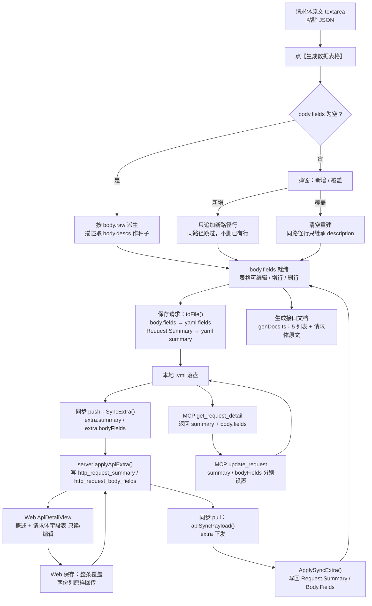
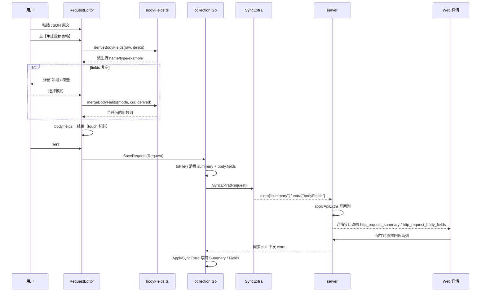
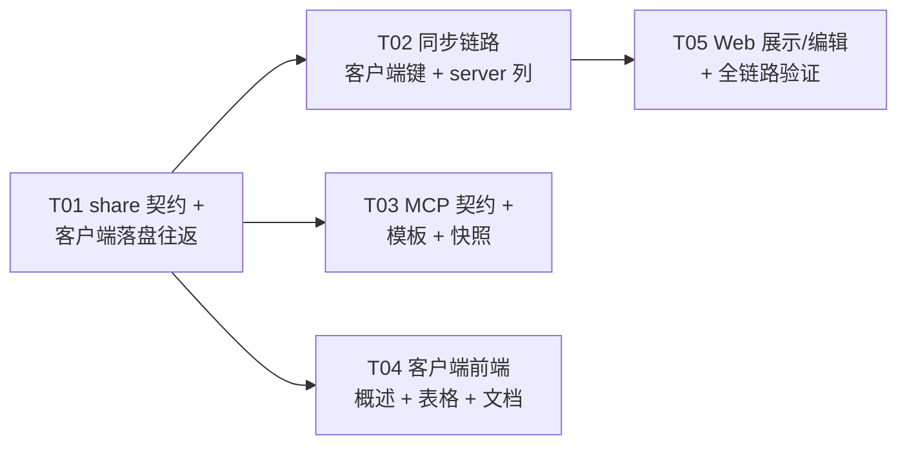

# 请求体字段表格与 API 概述 —— 设计

> 状态：设计定稿（待实现）　作者：架构师　范围：`api-doc-go-share` / `api-doc-go-client` / `api-doc-go/server` / `api-doc-go/web` / MCP
> 本文只做设计与任务分解，不含实现代码改动。

---

## 1. 目标与非目标

### 1.1 目标

| # | 目标 | 判定 |
|---|---|---|
| G1 | 请求体（JSON）可**手工生成**一张字段表格：字段名 / 类型 / 必填 / 示例值 / 描述，可编辑、可增行、可删行 | 客户端「表格」子页签 |
| G2 | 表格成为请求体字段说明的**唯一真源**，随文件落盘、随同步往返 server 与 Web | `body.fields` |
| G3 | 再点「生成」时按「新增 / 覆盖」二选一合并，覆盖时同名字段继承原描述 | 弹窗 + 合并算法 |
| G4 | 「生成接口文档」时输出「请求体示例 + 5 列表格」；表格为空时**只出请求体原文** | `genDocs.ts` / `doctpl.go` |
| G5 | API 新增纯文本「概述」字段，客户端放 URL 上方，Web 展示与编辑，MCP 可读写 | `summary` / `http_request_summary` |
| G6 | MCP `create_request` / `update_request` 里「请求体」与「表格」「概述」**可分别设置**，传一个不清另一个 | 三态语义 |
| G7 | 老数据（无 summary / 无 fields）不报错、不丢内容；`body.descs` 继续 round-trip 作为描述种子 | 兼容用例 |

### 1.2 非目标（明确排除）

- ❌ 不再从 JSON 自动派生表格（原「打开即派生」行为取消；派生只发生在点击「生成数据表格」时）。
- ❌ 表格 → JSON 的反向写回（单向：编辑表格不改 `body.raw`；body 改动后表格不自动刷新，本次不做「已过期」提示）。
- ❌ `body.descs` 批量迁移成 `body.fields`（只做「首次生成时作描述种子」+ round-trip 保真）。
- ❌ B14 的 Markdown/HTML 集合导出**不加**请求体字段表（保持现状）。
- ❌ Git 同步方案不在本次范围。
- ❌ 表格行拖拽排序、字段嵌套树形编辑（沿用派生路径 `a.b` / `a[].c` 的平铺表达）。

---

## 2. 数据契约

### 2.1 `api-doc-go-share/collection/types.go`（新增类型 + Body 扩字段）

```go
// BodyField 请求体字段表格的一行（表格的唯一真源：随文件落盘、随同步往返 server / Web）。
// 命名与 ResponseParam（客户端 collection/types.go:100）对齐：name/type/required/example/description，
// 仅把 fieldName 收短为 name —— 表格就是「字段名」本身，不含路径前缀语义。
type BodyField struct {
	Name        string `yaml:"name" json:"name"`
	Type        string `yaml:"type" json:"type"`
	Required    bool   `yaml:"required" json:"required"`                  // 与 KV.Enabled 同口径：不 omitempty，落盘显式给出
	Example     string `yaml:"example,omitempty" json:"example,omitempty"`
	Description string `yaml:"description,omitempty" json:"description,omitempty"`
}

// Body 请求体：none / json / text / form（urlencoded）/ multipart。
// Descs 为 JSON 体「字段路径 → 备注」（旧数据种子，保留 round-trip）；Fields 为字段表格（唯一真源）。
type Body struct {
	Type   string            `yaml:"type" json:"type"`
	Data   string            `yaml:"data,omitempty" json:"data,omitempty"`
	Raw    string            `yaml:"raw,omitempty" json:"raw"`
	Form   []KV              `yaml:"form,omitempty" json:"form"`
	Descs  map[string]string `yaml:"descs,omitempty" json:"descs,omitempty"`
	Fields []BodyField       `yaml:"fields,omitempty" json:"fields,omitempty"`
}
```

> ⚠️ **必改**：`HTTPBlock.IsZero()`（`collection/request.go:37-41`）必须把 `len(h.Body.Fields) == 0` 纳入判空。
> 现有注释已记录同款坑：只填了 `body.descs` 的请求块若被误判为空，会被 `http,omitempty` 整段丢掉、用户备注凭空消失。
> 「只填了表格、没有原文」的请求同样会踩坑。

### 2.2 `api-doc-go-share/collection/request.go`（RequestFile 增顶层 summary）

```go
// RequestFile 一条接口在磁盘上的形态。
type RequestFile struct {
	Info     FileInfo         `yaml:"info"`
	Meta     FileMeta         `yaml:"meta"`
	// Summary API 概述：一句话说明用途（纯文本）；Docs 保持原样作为详细说明。
	Summary  string           `yaml:"summary,omitempty" json:"summary,omitempty"`
	HTTP     HTTPBlock        `yaml:"http,omitempty"`
	GRPC     *GRPCBlock       `yaml:"grpc,omitempty" json:"grpc,omitempty"`
	Settings *RequestSettings `yaml:"settings,omitempty"`
	Docs     string           `yaml:"docs"`
	Extra    map[string]any   `yaml:"-"`
}

// knownTopLevel 必须加 "summary"，否则 summary 会被 unknownTopLevel 当成未知字段收进 Extra，
// MarshalYAML 时又与结构体输出重复（或被 marshalWithExtra 的 known 过滤掉→静默丢失）。
var knownTopLevel = map[string]bool{
	"info": true, "meta": true, "summary": true, "http": true,
	"grpc": true, "docs": true, "settings": true,
}
```

### 2.3 YAML 落盘样例

```yaml
info:
  name: 创建订单
  type: http
  seq: 3
meta:
  uid: 6f1c2a9e
  base_rev: 0
summary: 下单接口，创建一笔待支付订单
http:
  method: POST
  url: "{{host}}/api/v1/orders"
  params: []
  headers:
    - name: Content-Type
      value: application/json
      enabled: true
  body:
    type: json
    raw: |-
      {
        "uid": "u-42",
        "items": [{ "sku": "A-1", "qty": 2 }]
      }
    descs:
      items[].sku: 商品编码
    fields:
      - name: uid
        type: string
        required: true
        example: u-42
        description: 用户ID
      - name: items[].sku
        type: string
        required: false
        example: A-1
        description: 商品编码
      - name: items[].qty
        type: number
        required: false
        example: "2"
docs: |
  ## 简要描述
  ...
```

要点：
- `fields` 为空切片时因 `omitempty` 不落盘（老文件零改动）。
- `required: false` 显式写出（便于人工阅读与 diff），`example`/`description` 空则省略。
- `summary` 在 `meta` 之后、`http` 之前（结构体字段顺序决定），老文件无该键。

### 2.4 extra 键 ↔ DB 列 ↔ Web 字段 对照表（键名即契约，逐字一致）

| 语义 | 客户端 extra 键 | 客户端来源 | server 列 | server model 字段 | Web 字段 | extra 值形态 |
|---|---|---|---|---|---|---|
| API 概述 | `summary` | `Request.Summary`（string） | `api.http_request_summary text NOT NULL DEFAULT ''` | `HttpRequestSummary` | `http_request_summary` | 字符串；空串 = 清空 |
| 请求体字段表格 | `bodyFields` | `Request.Body.Fields` | `api.http_request_body_fields text NOT NULL DEFAULT ''` | `HttpRequestBodyFields` | `http_request_body_fields` | `[]BodyField` 的 JSON 数组**字符串**；空串 = 清空该列 |

沿用既有 extra 三态：**键存在且为字符串才覆盖，空串清空，缺键不动**。

### 2.5 Go 内存模型（客户端）与前端 TS 契约

```go
// api-doc-go-client/internal/collection/types.go:51
type Request struct {
	// ...
	Summary string `json:"summary"` // API 概述（纯文本），落盘走 RequestFile.summary
	// ...
}
// Body 为 share.Body 的别名 → Body.Fields 自动获得；无需重复声明
```

```ts
// api-doc-go-client/frontend/src/types.ts
export interface BodyField {
  name: string
  type: string
  required: boolean
  example: string
  description: string
}
export interface ReqBody {
  type: BodyType
  raw: string
  data?: string
  form: KV[]
  descs?: Record<string, string>   // 旧数据种子，保留
  /** 字段表格（唯一真源）；老数据缺省 → 归一化为 [] */
  fields?: BodyField[]
}
export interface RequestDoc { /* ... */ summary: string }
```

```ts
// api-doc-go/web/src/types/entities.ts（Api 实体）
http_request_summary?: string
http_request_body_fields?: string  // BodyField[] 的 JSON 串
```

MCP JSON 契约（`jsonschema` 由结构体反射生成）：

```jsonc
// create_request 新增
"summary":    "string",
"bodyFields": [{ "name": "string", "type": "string", "required": true,
                 "description": "string", "example": "string" }]
// update_request 新增（指针语义：不传=不动，传空数组=清空）
"summary":    "string | null",
"bodyFields": "[BodyField] | null"
```

---

## 3. 端到端数据流



关键时序（生成 → 保存 → 同步 → Web）：



---

## 4. 生成 / 合并算法

### 4.1 派生（仅在点击「生成」时执行）

```
deriveBodyFields(raw, descs) -> BodyField[]:
    fields = extractFields(raw)          # 复用 lib/responseFields.ts，MAX_FIELDS=200, MAX_DEPTH=4
    if fields 为空:                       # JSON 非法 / 含 {{变量}} / 空串
        throw 提示「请求体不是合法 JSON，无法生成表格」
    return fields.map(f => {
        name:        f.path              # 路径即字段名：a.b / a[].c
        type:        f.type              # extractFields 的 JSON 类型名
        required:    false               # 默认非必填，用户自行勾选
        example:     f.value             # 叶子原始值文本；容器为空串
        description: descs[f.path] ?? '' # 旧 descs 作首次描述种子
    })
```

### 4.2 匹配键

**字段名（路径）trim 后逐字完全相等**。由于路径由同一套派生规则生成，路径相等即「结构 + 字段名一致」（`a.b` 与 `a[].c` 天然区分层级与数组），无需额外比对结构。

### 4.3 新增（append）

```
mergeAppend(cur, derived) -> BodyField[]:
    byName = index(cur by name.trim())
    next   = copy(cur)                       # 保留原顺序
    for d in derived:
        if byName has d.name: continue       # 跳过：已有行一律不动（描述、必填都不改）
        next.push(d)
    return next                              # 不删除任何已有行
```

### 4.4 覆盖（overwrite）

```
mergeOverwrite(cur, derived) -> BodyField[]:
    byName = index(cur by name.trim())
    return derived.map(d => ({
        name:        d.name,
        type:        d.type,                   # 取自本次派生
        required:    false,                    # 不继承
        example:     d.example,                # 取自本次派生
        description: byName[d.name]?.description ?? d.description   # 只继承描述
    }))
    # 行数/顺序 = derived；cur 中不存在于 derived 的行全部丢弃
```

### 4.5 空表格直接生成（无弹窗）

当 `body.fields.length === 0` 时按 4.1 结果直接赋值，不弹窗（等价「新增」到空表 = 覆盖到空表）。

### 4.6 文档生成口径（`genDocs.ts`）

```
if body.type != 'none' and (bodyRaw or bodyForm.length or fields.length):
    输出 "## 请求体" + "- {type}"
    if body.type == 'json' and fields.length:
        5 列：参数名 | 必选 | 类型 | 示例值 | 说明
        必选 = field.required ? L.requiredYes : L.requiredNo
        类型空则 DEFAULT_TYPE
    if bodyRaw: 代码块（json 时带语言标记）
    if bodyForm.length: 原有 3 列表（名称|值|说明）不变
    body.descs 不再参与文档生成
```

---

## 5. 各端改动清单（逐文件）

### 5.1 `api-doc-go-share`（契约源头，先改）

| 文件 | 改动点 |
|---|---|
| `collection/types.go` | 新增 `BodyField` 结构体；`Body` 增 `Fields []BodyField`（yaml/json `fields,omitempty`） |
| `collection/request.go` | `RequestFile` 增 `Summary string`（yaml/json `summary,omitempty`）；`knownTopLevel` 加 `"summary"`；`HTTPBlock.IsZero()` 加 `len(h.Body.Fields) == 0` |
| `collection/collection_test.go` | 增用例：fields/summary round-trip；只有 fields 的 http 块不被 omitempty 丢弃；未知顶层字段行为不变 |
| `collection/extra_test.go` | 增用例：`summary` 不被当作未知字段进 Extra |

### 5.2 `api-doc-go/server`

| 文件 | 改动点 |
|---|---|
| `migrations/postgres/0022_api_summary_body_fields.up.sql` | `ALTER TABLE "api" ADD COLUMN "http_request_summary" text NOT NULL DEFAULT '';` + `"http_request_body_fields" text NOT NULL DEFAULT '';` |
| `migrations/postgres/0022_api_summary_body_fields.down.sql` | 两条 `DROP COLUMN IF EXISTS` |
| `migrations/sqlite/0022_api_summary_body_fields.up.sql` / `.down.sql` | 同上，反引号写法（对齐 0013 sqlite 版） |
| `internal/model/api.go`（约 :46 之后） | 增 `HttpRequestSummary string` / `HttpRequestBodyFields string` 两个 gorm 字段（`type:text`） |
| `internal/dto/dto.go`（`ApiCreateReq`，约 :155） | 增 `HttpRequestSummary string json:"http_request_summary"` / `HttpRequestBodyFields string json:"http_request_body_fields"` |
| `internal/service/content.go`（`apiFromCreate`，约 :516） | 两个新列原样透传 |
| `internal/service/sync_payload.go`（`applyApiExtra` :184 附近、`apiSyncPayload` :237 附近） | `setStr("summary", &e.HttpRequestSummary)`、`setStr("bodyFields", &e.HttpRequestBodyFields)`；extra map 加 `"summary"` / `"bodyFields"` 两键 |

> 迁移文件按文件名自动发现（`internal/database/migrate.go:375` 的 `fs.ReadDir`），只需落文件；GORM AutoMigrate 亦会补列。

### 5.3 `api-doc-go-client`（Go 侧）

| 文件 | 改动点 |
|---|---|
| `internal/collection/types.go`（:51） | `Request` 增 `Summary string json:"summary"` |
| `internal/collection/collection.go`（`toFile` :797、`fromFile` :860） | `f.Summary = r.Summary` / `r.Summary = f.Summary` |
| `internal/collection/collection.go`（`CreateRequestFromDraft` :1563 起） | `r` 初始化补 `Summary: src.Summary`（MCP 新建走草稿落盘，漏了会导致 create 的 summary 丢失） |
| `internal/collection/sync_extra_fields.go` | 键常量增 `extraKeySummary = "summary"`、`extraKeyBodyFields = "bodyFields"`；`applyExtendedFields` 增两分支（`parseRows[BodyField]` / 直赋字符串）；新增 `marshalBodyFields` |
| `internal/collection/syncrows.go` | `SyncExtra` 增 `extra[extraKeySummary]`、`extra[extraKeyBodyFields]`；**必须在 `if r.IsGRPC()` 早退之前赋值 summary**（见风险 R5） |
| `internal/collection/sync_extra_fields_test.go` | `extendedKeys` 加两键；补 round-trip / 空串清空 / 缺键不动 三组用例 |
| `internal/mcp/service.go`（`RequestDetail` :543） | 增 `Summary string json:"summary,omitempty"`；`GetRequestDetail` 赋值 `Summary: r.Summary`（`Body` 已是 `collection.Body`，`fields` 自动带出） |
| `internal/mcp/service.go`（`CreateRequestInput` :659） | 增 `Summary string json:"summary,omitempty"`、`BodyFields []collection.BodyField json:"bodyFields,omitempty"` |
| `internal/mcp/service.go`（`UpdateRequestInput` :812） | 增 `Summary *string`、`BodyFields *[]collection.BodyField` |
| `internal/mcp/service.go`（`applyCreateFields` :731） | 在 `in.Body` 覆盖**之后**：`if in.BodyFields != nil { draft.Body.Fields = *in.BodyFields }`；`if in.Summary != "" { draft.Summary = in.Summary }` |
| `internal/mcp/service.go`（`applyUpdateFields` :869） | `in.Body != nil` 时**先快照再恢复** `Fields`（nil 则保留）与 `Descs`（nil 则保留），随后 `in.BodyFields != nil` 才覆盖 `Fields`；`in.Summary != nil` 才覆盖 `Summary` |
| `internal/mcp/meta.go`（`create_request` / `update_request` / `get_request_detail` 三条 Description） | 文案补 summary / bodyFields 语义（尤其「body 整份覆盖不会清掉表格与概述，除非显式传 bodyFields/body.fields」） |
| `internal/mcp/doctpl.go`（:27-66） | 请求体字段表改 5 列（参数名\|必选\|类型\|示例值\|说明）；「书写规则」改为「表格来自 body.fields，手工生成，可为空；为空时只输出请求体原文」 |
| `internal/mcp/testdata/schema/create_request.json` / `update_request.json` / `get_request_detail.json` | 用 `go test ./internal/mcp/ -run TestToolSchemaContract -update` 重新生成 |

### 5.4 `api-doc-go-client`（前端）

| 文件 | 改动点 |
|---|---|
| `frontend/src/types.ts`（:15 `ReqBody`、:153 `RequestDoc`） | `ReqBody.fields?: BodyField[]`；新增 `BodyField` 接口；`RequestDoc.summary: string` |
| `frontend/src/lib/ipc.ts`（`normalizeRequest` :153-175） | `body` 重建里补 `fields: r.body?.fields ?? []`；顶层补 `summary: r.summary ?? ''` |
| `frontend/src/lib/ipc.ts`（`normalizeExample` :198-215） | 同样补 `fields`（历史快照请求体也会被重建，漏了会丢表格） |
| `frontend/src/lib/bodyFields.ts` | 重写：`BodyFieldRow` 改为 5 字段（name/type/required/example/description）；导出 `deriveBodyFields` / `mergeAppend` / `mergeOverwrite` / `mergeBodyFields(mode, cur, derived)` / `emptyFieldRow()` |
| `frontend/src/components/BodyFieldsTable.vue` | 重写为 5 列可编辑表格（`n-input` ×3 + `n-select` 类型 + `n-checkbox` 必填 + 删除按钮），底部「新增行」；`data-testid`：`body.fieldsRow` / `body.fieldName` / `body.fieldType` / `body.fieldRequired` / `body.fieldExample` / `body.fieldDesc` / `body.fieldRemove` / `body.fieldAdd` |
| `frontend/src/components/RequestEditor.vue`（:349 `bodyRows`） | 改为 `const fieldRows = computed(() => props.tab.request.body.fields ?? [])`；删除 `onBodyDesc`；新增 `onGenerateFields()`、`onFieldUpdate(i, patch)`、`onFieldAdd()`、`onFieldRemove(i)`，均调 `touch()` |
| `frontend/src/components/RequestEditor.vue`（:606 子页签区） | 子页签右侧加「生成数据表格」按钮（`data-testid="body.generate"`，json 体常显）；表格视图渲染新 `BodyFieldsTable`；新增 `NModal` 做「新增 / 覆盖 / 取消」二选一弹窗（`data-testid="body.genDialog"` + `body.genAppend` / `body.genOverwrite`） |
| `frontend/src/components/RequestBar.vue`（:518 附近的地址栏） | 在 `.req-url` 行**之上**插一行概述输入：`v-model:value="tab.request.summary"`，`placeholder` 走 i18n，`@input="touch"`；HTTP / gRPC 两种分支共用一个容器 |
| `frontend/src/lib/genDocs.ts`（:117-142） | 请求体表改取 `body.fields`，5 列（`colName|colRequired|colType|colExample|colDesc`）；`fields` 为空不输出表；移除 `toBodyRows` 依赖；出现条件加 `fields.length` |
| `frontend/src/i18n/locales/zh-CN.ts` / `en-US.ts` | `body.*` 段新增：`colRequired`（必填）、`colExample`（示例值）、`genBtn`、`genAppend`、`genOverwrite`、`genTitle`、`genHint`、`addRow`、`genInvalid`；请求栏 `summary.ph`（概述）|

### 5.5 `api-doc-go/web`

| 文件 | 改动点 |
|---|---|
| `src/types/entities.ts`（:73 附近） | 增 `http_request_summary?: string`、`http_request_body_fields?: string` |
| `src/views/project/ApiDetailView.vue`（`form` reactive :64-68） | 增 `http_request_summary: ''`（纯文本列，随 `...form` 展开自动参与保存） |
| 同上（`ext` reactive :78-82） | 增 `http_request_body_fields: ''`（JSON 串，走「保存原样回传」通道） |
| 同上（`load` 的 Object.assign :403-425） | `form` 补 `http_request_summary: a.http_request_summary ?? ''`；`ext` 补 `http_request_body_fields: a.http_request_body_fields ?? ''` |
| 同上（模板 :868 `.req-url` 之前） | 查看态展示概述（`md-preview` 或纯文本 `<p>`），编辑态 `n-input` 绑定 `form.http_request_summary`；空则不占位 |
| 同上（`body` 段 :948 起） | 新增请求体字段表：查看态 5 列只读（参数名/必选/类型/示例值/说明）；编辑态可改行、加行、删行，落 `extEdit.bodyFields`，`serializeExtEdit` 写回 `ext.http_request_body_fields`（空则空串） |
| 同上（`parseExtEdit` :283 / `serializeExtEdit` :311） | 增加 bodyFields 的解析 / 序列化（未知键保留策略同 bodyDescs） |
| `src/i18n/...`（web 侧文案） | 「概述」「请求体字段」两组文案 |

**公开分享页 `ShareView.vue` 结论**：本次**不展示**请求体字段表，也**不展示概述**。
理由：(1) 分享页当前只渲染「请求头 / 请求参数 / 返回参数 / 响应样例 / 文档（description）」五段，从不展示任何 `http_*` 客户端富字段（body 原文、form、descs 均不展示），单独为 fields 破例会让分享页与既有取舍不一致；(2) 概述的用途是编辑器内的快速定位，详细说明已在「文档」段（`description`）呈现，公开页再加一行简介收益低。若后续确有需求，另开需求统一补「公开页是否展示请求体」的完整决策。

### 5.6 文档

| 文件 | 改动点 |
|---|---|
| `api-doc-go-client/doc/请求体字段表格与概述-设计.md` | 本文 |
| `api-doc-go-client/AGENTS.md`（如有相关契约段） | 视实现结果补一句「body.fields 为请求体字段唯一真源、body.descs 仅旧数据种子」 |

---

## 6. 任务列表（5 个任务，按实现顺序）

### T01 · share 契约 + 客户端落盘往返　【P0，无依赖】

- **源文件**：`api-doc-go-share/collection/types.go`、`api-doc-go-share/collection/request.go`、`api-doc-go-share/collection/collection_test.go`、`api-doc-go-share/collection/extra_test.go`、`api-doc-go-client/internal/collection/types.go`、`api-doc-go-client/internal/collection/collection.go`
- **验收标准**
  1. `cd api-doc-go-share && go build ./... && go test ./collection/` 全绿；
  2. `cd api-doc-go-client && go build ./...` 通过；
  3. 单测：含 `summary` + `body.fields` 的 `Request` 经 `toFile → Encode → DecodeRequest → fromFile` 后逐字段相等（含 `Required=false`、`Example`/`Description` 空值）；
  4. 单测：`body` 只有 `fields`（无 type/raw/form/descs）时，编码结果仍含 `http:` 段（`IsZero` 未误判）；
  5. 单测：老文件（无 summary/fields）解码后 `Summary == ""`、`len(Fields) == 0`，且 `Extra` 里不含 `summary`；
  6. `CreateRequestFromDraft` 保留 `Summary`。

### T02 · 同步链路：客户端 extra 键 + server 迁移/列/映射　【P0，依赖 T01】

- **源文件**：`api-doc-go-client/internal/collection/sync_extra_fields.go`、`api-doc-go-client/internal/collection/syncrows.go`、`api-doc-go-client/internal/collection/sync_extra_fields_test.go`、`api-doc-go/server/migrations/{postgres,sqlite}/0022_api_summary_body_fields.{up,down}.sql`、`api-doc-go/server/internal/model/api.go`、`api-doc-go/server/internal/dto/dto.go`、`api-doc-go/server/internal/service/content.go`、`api-doc-go/server/internal/service/sync_payload.go`
- **验收标准**
  1. `cd api-doc-go-client && go test ./internal/collection/` 全绿；`cd api-doc-go/server && go build ./... && go test ./internal/...` 全绿；
  2. 客户端 `extendedKeys` 含 `summary`、`bodyFields`；三组兼容用例（round-trip / 空串清空 / 缺键不动）通过；
  3. **gRPC 请求**的 `summary` 也能 push 与 pull（`SyncExtra`/`ApplySyncExtra` 的 gRPC 早退分支之外）；
  4. server 迁移 0022 正反向均可执行（`migrate` 单测或手工 `up → down → up`）；
  5. `applyApiExtra` 与 `apiSyncPayload` 的键集严格对齐（同文件相邻书写，人工 review 逐字比对）；
  6. 端到端手测：客户端保存带概述/表格 → 同步 push → Web 详情能看到；Web 保存 → 同步 pull → 客户端重载仍在。

### T03 · MCP 契约（create/update/detail + 模板 + 快照）　【P0，依赖 T01】

- **源文件**：`api-doc-go-client/internal/mcp/service.go`、`api-doc-go-client/internal/mcp/meta.go`、`api-doc-go-client/internal/mcp/doctpl.go`、`api-doc-go-client/internal/mcp/testdata/schema/{create_request,update_request,get_request_detail}.json`
- **验收标准**
  1. `cd api-doc-go-client && go test ./internal/mcp/` 全绿（含 `TestToolSchemaContract`，快照已用 `-update` 重新生成并 review diff）；
  2. 工具数量仍为 **24**（没有新增工具）；
  3. `create_request` 传 `summary` + `bodyFields` 后 `get_request_detail` 能读回；
  4. **关键用例**：先 `update_request` 设好 `bodyFields` 与 `summary`，再 `update_request` 只传 `body`（`fields` 为 nil、无 `bodyFields`）→ 表格与概述**都还在**；
  5. `update_request` 传 `bodyFields: []` → 表格被清空；不传 → 不动；
  6. `get_doc_template` 文案为 5 列且注明「表格来自 body.fields，可为空」。

### T04 · 客户端前端（概述输入 + 5 列表格 + 生成/合并 + 文档生成）　【P0，依赖 T01】

- **源文件**：`frontend/src/types.ts`、`frontend/src/lib/ipc.ts`、`frontend/src/lib/bodyFields.ts`、`frontend/src/components/BodyFieldsTable.vue`、`frontend/src/components/RequestEditor.vue`、`frontend/src/components/RequestBar.vue`、`frontend/src/lib/genDocs.ts`、`frontend/src/i18n/locales/{zh-CN,en-US}.ts`
- **验收标准**
  1. `npm run type-check` 通过；`npm run i18n:check` 通过；
  2. 空表格点「生成数据表格」→ 直接生成，描述列取到 `body.descs` 旧值；
  3. 非空表格点生成 → 弹窗；「新增」只追加新路径且不删已有行；「覆盖」行数与顺序等于派生结果、同路径描述保留、`required` 回到 false；
  4. 表格可改 5 列、可增行、可删行，任何改动都标脏并可保存；
  5. 概述输入框位于 URL 行上方，改动标脏并保存；
  6. 「生成接口文档」：表格有数据出 5 列表 + 请求体原文；表格为空只出原文代码块；`body.descs` 不再影响文档；
  7. `normalizeRequest` / `normalizeExample` 均保留 `fields`，重载后表格不丢（历史坑回归）；
  8. `npm run test:e2e` 相关用例（`response-fields-manual.spec.ts`、`regression-response.spec.ts`）通过或按新契约更新。

### T05 · Web 端展示/编辑 + 全链路验证　【P0，依赖 T02】

- **源文件**：`api-doc-go/web/src/types/entities.ts`、`api-doc-go/web/src/views/project/ApiDetailView.vue`、`api-doc-go/web/src/i18n/*`（文案）
- **验收标准**
  1. `cd api-doc-go/web && npm run build` 通过（含 vue-tsc 类型检查）；
  2. 查看态：概述显示在 URL 上方（空则不占位）；请求体区显示 5 列只读字段表；
  3. 编辑态：概述可改；字段表可改行 / 加行 / 删行，保存后 `http_request_summary` / `http_request_body_fields` 两列落库正确；
  4. **整条覆盖不丢列**：只改 `api_name` 保存后，概述与字段表仍在（`...form` + `...ext` 回传验证）；
  5. 客户端 push 后 Web 刷新可见，Web 保存后客户端 pull 可见（双向）；
  6. `ShareView.vue` 未受影响（保持现有效果）。

**依赖图**



---

## 7. 测试计划

### 7.1 Go 单测

| 包 | 用例 |
|---|---|
| `api-doc-go-share/collection` | fields/summary round-trip；IsZero 覆盖 fields；summary 不进 Extra；老文件兼容 |
| `api-doc-go-client/internal/collection` | `SyncExtra`/`ApplySyncExtra` 两新键三态；gRPC summary push/pull；`toFile`/`fromFile`；`CreateRequestFromDraft` 保 Summary；syncrows 既有用例回归 |
| `api-doc-go-client/internal/mcp` | `TestToolSchemaContract`（快照更新并 review）；`applyUpdateFields` 的「body 覆盖不清 fields/descs」；`create_request` 双写 |
| `api-doc-go/server` | `applyApiExtra` 两新键写列；`apiSyncPayload` 两新键下发；0022 迁移 up/down |

### 7.2 前端

- `npm run type-check`（vue-tsc）：types.ts / ipc.ts / bodyFields.ts / genDocs.ts 契约一致性。
- `npm run i18n:check`：新增 key 在中英双语齐备。
- `npm run test:e2e:headless`：重点 `response-fields-manual.spec.ts`（响应字段表交互，与请求体表共用样式与 testid 命名）、`regression-response.spec.ts`、`regression-collection.spec.ts`；新增建议用例 `body-fields-table.spec.ts`（生成 → 新增 → 覆盖 → 删行 → 保存 → 重载仍在）。
- `genDocs` 为纯函数，若后续引入 vitest 可单测（当前项目无 vitest，本次不引入）。

### 7.3 Web

- `cd api-doc-go/web && npm run build`（含 `vue-tsc`）。
- 手工：查看/编辑/保存/回传四态 + 分享页回归。

### 7.4 MCP 契约快照

```bash
export GOROOT=/home/zq-deepin/.vfox/sdks/golang
export GOPATH=/home/zq-deepin/.vfox/sdks/golang/packages
export GOMODCACHE=/home/zq-deepin/.vfox/sdks/golang/packages/pkg/mod
export GOPROXY=https://goproxy.cn,direct
export GOCACHE=/home/zq-deepin/.cache/go-build
export TMPDIR=/home/zq-deepin/.cache/pwtmp
export PATH=$GOROOT/bin:$PATH
cd api-doc-go-client
go test ./internal/mcp/ -run TestToolSchemaContract -update
go test ./internal/mcp/
```

快照 diff 必须只有「新增 summary / bodyFields（及 body.fields）属性」，不得出现其它工具的漂移。

---

## 8. 风险与取舍

| # | 风险 | 影响 | 对策 |
|---|---|---|---|
| R1 | **`update_request` 传 body 整份覆盖会清空表格** | AI 补请求体原文时表格消失，用户看不到字段说明 | `applyUpdateFields` 里对 `Body` 做「快照 → 覆盖 → 恢复 nil 字段」：`in.Body.Fields == nil` 保留原 `Fields`；`in.Body.Descs == nil` 保留原 `Descs`；显式传 `bodyFields` / `body.fields: []` 才清空。测试用例 T03-4 钉死 |
| R2 | **老数据 `body.descs` 与新 `body.fields` 双源** | 两处描述不一致时用户困惑；文档只认 fields 后旧备注「看起来消失了」 | 定位清晰：`fields` 是唯一真源，`descs` 只作「首次生成」的种子 + round-trip 保真（不再参与文档生成）。UI 在表格为空时给出「点生成可从 JSON 派生（含旧备注）」引导。不做批量迁移，避免误伤与不可回滚 |
| R3 | **同步键缺省语义**（空串=清空 vs 缺键=不动） | 旧客户端推旧键集不能清空新列；新客户端推空串必须能传播删除 | 严格沿用既有 extra 三态；`marshalBodyFields` 空切片返回 `""`（=清空），`parseRows` 空串返回 nil（=清空）、解析失败保留旧值。`summary` 直传字符串，空串即清空 |
| R4 | **`HTTPBlock.IsZero` 漏判 Fields** | 只有表格没有原文/descs 的请求，`http:` 段被 omitempty 整段丢弃 → 表格与 summary 一起「凭空消失」（descs 踩过同款坑） | T01-4 单测钉死；`IsZero` 与 `Body` 字段增删强绑定，新增字段必须同步 |
| R5 | **gRPC 请求的 summary 不同步** | `SyncExtra` / `ApplySyncExtra` 在 gRPC 分支提前 return，只在 base 键里带 `desc`；照原样加键会导致 gRPC 请求的概述本地有、Web 无 | 把 `summary` 的赋值/应用放在 gRPC 早退**之前**（与 `desc` 同位置）；`bodyFields` 仍只在 HTTP 分支（gRPC 无请求体表格） |
| R6 | **Web 编辑与客户端并发** | Web 整条覆盖保存 + 客户端同步 push 同时发生 → 后写者赢，可能互相清掉对方刚写的值 | 已由现状承担（Web 有 `expected_update_time` 乐观锁，仅防 Web↔Web）；客户端同步 push 无版本号。本次不引入新机制，但要求「Web 保存必须原样回传两列」（T05-4），把「静默清空」的概率降到只剩「同时编辑同一字段」。后续若要根治需给 sync 加 revision，另开需求 |
| R7 | **`required` 列不继承** | 用户勾过的必填，覆盖生成后回到 false，需要重新勾 | 这是需求明确口径（覆盖只继承描述）。用 `required: false` 而非 `omitempty` 落盘，至少让 diff 可见；文档「必选」列在 false 时写「否」，不会静默变成「是」 |
| R8 | **测试快照/文案漂移** | `tools_schema_test`、i18n check、e2e testid 变更会红 | 快照用 `-update` 显式再生并 review；i18n 双语同步加键；`BodyFieldsTable.vue` 的 testid 保留 `body.fieldsRow` 语义（新增列各自独立 testid），e2e 按需更新 |

---

## 9. 与已定口径的差异 / 待确认

### 9.1 采纳原口径，另加 4 处必要补充（不推翻设计，但漏了会出 bug）

1. **`HTTPBlock.IsZero` 必须加 `len(h.Body.Fields) == 0`**（R4）—— 原口径未提，必补。
2. **`SyncExtra` / `ApplySyncExtra` 的 summary 必须在 gRPC 早退之前**（R5）—— 否则 gRPC 请求的概述不同步。
3. **`update_request` 的 `Body` 覆盖除保 `Fields` 外，建议同时保 `Descs`**：需求只写了 Fields，但 §8「round-trip 不丢」要求 descs 也不能被无关的 body 覆盖清掉。用「nil=不动 / 显式 `{}`=清空」三态即可两全（JSON 解码能区分 nil 与空对象）。**若团队坚持「只保 Fields」**，则 descs 会被默认清空，需要在文档里降级说明「descs 仅为旧数据种子，可丢」。
4. **`CreateRequestFromDraft` 必须搬 `Summary`**（`collection.go:1563`）—— 原口径未提；MCP `create_request` 走这条路径，漏了等于 create 的 summary 无效。

### 9.2 落地口径微调（实现层，不影响语义）

5. **Web 的概述放 `form` 而非 `ext`**：`form` 是纯文本列通道（`api_name`/`url`/`description`），保存时 `...form` 自动带出；`ext` 专收「JSON 串富字段」并需 `parseExtEdit`/`serializeExtEdit` 处理。概述是纯文本，放 `form` 更省事且不易漏回传。
6. **`CreateRequestInput.BodyFields` 用切片而非指针**：JSON 里「缺键 → nil」与「`[]` → 非 nil 空切片」在 Go 解码后本就可区分，切片即可表达三态；`UpdateRequestInput` 按原口径用指针，两者行为一致。
7. **文档生成里请求体节的「出现条件」放宽**：由 `bodyRaw || bodyForm.length` 扩为 `bodyRaw || bodyForm.length || fields.length`，否则「手工加了行但原文为空」时表格不输出。

### 9.3 仍不明确、需产品确认（不阻塞实现，按默认走）

- 表格行是否需要「上移/下移」排序？**默认不做**（顺序 = 生成顺序 / 用户追加顺序）。
- 「生成接口文档」是否要顺带把 `summary` 写进「简要描述」小节的第一行？**默认不做**（保持 `r.name` 为标题，避免与概述重复）。
